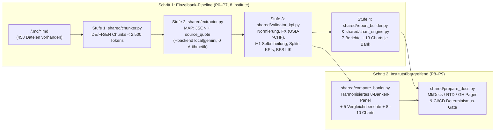

# Master-Umsetzungsplan für Gemini Hydrogen: Ausweitung der BEKB-Analysen auf alle 8 Schweizer Banken & Institutsübergreifende Auswertung

> **Referenz-Implementierung:** [`chatelao/bekb-geschaeftsbereichte-analysen`](https://github.com/chatelao/bekb-geschaeftsbereichte-analysen)
> **Ziel-Repository:** `chatelao/xkb-geschaeftsbereichte-analysen`
> **Ausführungsmodell:** Optimiert für die schrittweise, deterministisch verifizierbare Umsetzung durch **Gemini Hydrogen** (`gemini-2.5-flash-lite` bzw. Hydrogen-Agent-Tier).
> **Aktueller Stand (Voraussetzung erfüllt):** Alle Rohdaten (**458 PDFs** und **458 Markdown-Dateien** ohne Bild-Bloat) liegen bereits vollständig in den 8 Instituts-Unterverzeichnissen vor.

---

## 1. Gesamtkonzept in zwei Hauptschritten

Das Projekt gliedert sich in **zwei klar getrennte Ausbaustufen**:

1. **Schritt 1 — Instituts-Ausweitung (Phasen P0 bis P7):**
   - Die bewährte 4-stufige **«Hydrogen-First» Map-Validate-Reduce-Pipeline** der BEKB (`chunk_reports.py` → `extract_with_hydrogen.py` → `build_dataset_and_reports.py` → `generate_charts.py`) wird **einmalig** in eine generische, unit-getestete Kernbibliothek [`shared/`](./shared/) extrahiert und über deklarative `<bank>/bank_config.yaml`-Dateien parametrisiert.
   - **BEKB (`bekb/`)** dient in Phase 0 als **Goldstandard-Regressionstest** (100 % Nachbildung der bisherigen BEKB-Kennzahlen und 7 Berichte / 13 Grafiken aus den kopierten Rohdaten).
   - Anschliessend wird die Pipeline in **7 vertikalen Instituts-Scheiben** (aufsteigend nach struktureller Komplexität: `vskb` → `zkb` → `bcv` → `gekb` → `raiffeisen` → `postfinance` → `ubs`) ausgerollt.
2. **Schritt 2 — Institutsübergreifende Auswertung & Gesamtportal (Phasen P8 bis P9):**
   - Alle 8 validierten Einzelbank-Panels werden über einen **Harmonisierungs- und Vergleichbarkeits-Layer** (`shared/compare_banks.py`) in ein einheitliches Cross-Bank-Datenmodell (`comparison/data/`) zusammengeführt (inkl. Währungsumrechnung `USD → CHF` für UBS, BFS-LIK-Inflationsbereinigung auf `real 2025 CHF` sowie expliziten Vergleichbarkeits-Flags für Konzern vs. Stammhaus, ARB vs. IFRS, FINMA-Kategorie 1/2/3, Staatsgarantie und Kreditverbot).
   - Darauf aufbauend entstehen **5 institutsübergreifende Vergleichsberichte**, **8–10 Benchmark-Grafiken** sowie ein gemeinsames **MkDocs-/Read-the-Docs- & GitHub-Pages-Portal** mit automatisiertem Determinismus-CI/CD.

---

## 2. Bestandsaufnahme der 8 Institute (Rohdaten bereit)

| Phase | Ordner | Institut | Rechtsform / Ticker | Staatsgarantie | FINMA-Kat. | Scope / Standard / Währung | Sprache | Rohdaten im Repo (PDF / MD) |
| :---: | :--- | :--- | :--- | :---: | :---: | :--- | :---: | :---: |
| **P0 (Baseline)** | [`bekb/`](./bekb/) | **Berner Kantonalbank (BEKB)** | AG (SIX: `BEKN`) | Keine | Kat. 3 | Einzelabschluss / ARB / CHF | DE | **57 / 57** (`2003–2026`) |
| **P1 (Pilot)** | [`vskb/`](./vskb/ANALYSE_STRATEGIE.md) | **Walliser Kantonalbank (WKB / BCVs)** | AG (SIX: `WKB`) | Voll | Kat. 3 | Einzelabschluss / ARB / CHF | DE / FR | **40 / 40** (`2007–2026`) |
| **P2** | [`zkb/`](./zkb/ANALYSE_STRATEGIE.md) | **Zürcher Kantonalbank (ZKB)** | Anstalt (100 % Kt. ZH) | Voll | **Kat. 2 (D-SIB)** | Konzern / ARB / CHF | DE | **74 / 74** (`2013–2026`) |
| **P3** | [`bcv/`](./bcv/ANALYSE_STRATEGIE.md) | **Banque Cantonale Vaudoise (BCV)** | AG (SIX: `BCVN`) | Keine | Kat. 3 | Konzern / ARB / CHF | FR / EN | **73 / 73** (`2007–2026`) |
| **P4** | [`gekb/`](./gekb/ANALYSE_STRATEGIE.md) | **Banque Cantonale de Genève (BCGE)** | AG (SIX: `BCGE`) | Keine | Kat. 3 | Konzern / ARB / CHF | FR | **65 / 65** (`2003–2026`) |
| **P5** | [`raiffeisen/`](./raiffeisen/ANALYSE_STRATEGIE.md) | **Raiffeisen Gruppe Schweiz** | Genossenschaftsverbund | Keine | **Kat. 2 (D-SIB)** | Konzern / ARB / CHF | DE | **75 / 75** (`2011–2026`) |
| **P6** | [`postfinance/`](./postfinance/ANALYSE_STRATEGIE.md) | **PostFinance AG** | AG (100 % Post) | Keine | **Kat. 2 (D-SIB)** | Einzelabschluss / ARB / CHF | DE | **60 / 60** (`2013–2026`) |
| **P7** | [`ubs/`](./ubs/ANALYSE_STRATEGIE.md) | **UBS Group AG** | AG (SIX: `UBSG`, NYSE: `UBS`) | Keine | **Kat. 1 (G-SIB)** | Konzern / **IFRS / USD** | EN | **14 / 14** (`2020–2025`) |
| **Total** | **8 Institute** | **5 KB + Raiffeisen + PostFinance + UBS** | | | | | DE/FR/EN | **458 PDFs / 458 MDs** |

> **Wichtig für Gemini Hydrogen:** Phase 0 (PDF-Download & `pymupdf4llm`-Konvertierung) ist für alle 8 Institute bereits abgeschlossen. Beginne direkt mit dem Aufbau der generischen Pipeline unter `shared/` und verwende die vorhandenen `<bank>/.md/*.md`-Dateien als unveränderliche Primärquelle.

---

## 3. Ziel-Architektur & Repository-Struktur



```text
xkb-geschaeftsbereichte-analysen/
├── PLAN.md                             # Dieses Runbook für Gemini Hydrogen
├── README.md                           # Zentrale Portalseite mit 8-Banken-Scorecard
├── mkdocs.yml                          # Gemeinsame Material-for-MkDocs-Navigation
├── .readthedocs.yaml                   # Read the Docs Build-Konfiguration (Python 3.12)
├── docs/requirements.txt               # mkdocs, mkdocs-material, pymdown-extensions
├── docs_assets/                        # mathjax.js, extra.css (analog BEKB)
├── .github/workflows/docs-cicd.yml     # pytest + Determinismus-Check + mkdocs --strict + Pages
├── shared/                             # Gemeinsame, unit-getestete Kernbibliothek
│   ├── __init__.py
│   ├── config.py                       # Typsicherer Loader für <bank>/bank_config.yaml
│   ├── cpi_bfs.py                      # BFS LIK (Dez. 1982 = 100, 2003–2025) -> real 2025 CHF
│   ├── fx_rates.py                     # SNB-Referenzkurse USD/CHF (Stichtag 31.12. & Jahresdurchschnitt)
│   ├── download_utils.py               # (bereits vorhanden) PDF-Downloader + Manifest
│   ├── pdf_to_md.py                    # (bereits vorhanden) pymupdf4llm-Konverter
│   ├── chunker.py                      # Mehrsprachiger (DE/FR/EN) Chunker mit Scope-Filter
│   ├── extractor.py                    # Stufe 2 Map-Phase (--backend local|gemini|auto)
│   ├── validator_kpi.py                # Stufe 3 Normierung, FX, t+1 Selbstheilung, Splits, KPIs
│   ├── report_builder.py               # Stufe 4 Reduce-Phase (7 Berichte pro Institut)
│   ├── chart_engine.py                 # 13 standardisierte 300-DPI-Grafiken pro Institut
│   ├── compare_banks.py                # Schritt 2: Cross-Bank-Panel, 5 Berichte & 8–10 Charts
│   └── prepare_docs.py                 # Erzeugt .rtd_docs/ für alle 8 Institute + comparison/
├── tests/                              # Unit- & Regressionstests (pytest)
│   ├── test_number_parser.py           # DE/FR/EN Zahlen, Klammern, Fussnoten
│   ├── test_unit_fx_and_split.py       # TCHF/Mio./Mrd., USD->CHF, Aktiensplits
│   ├── test_self_healing.py            # t->t+1 Kreuzvalidierung & Abweichungs-Audit
│   ├── test_kpi_and_cpi.py             # CIR, ROE, RWA-Dichte, BFS LIK Real-Bereinigung
│   ├── test_bekb_regression.py         # Abgleich shared/ gegen BEKB-Referenzwerte
│   └── test_comparison_layer.py        # Cross-Bank-Harmonisierung, Peer-Gruppen, Schema
├── bekb/                               # Referenz-Baseline (57 PDFs/MDs vorhanden)
├── vskb/                               # Pilotbank (40 PDFs/MDs vorhanden)
├── zkb/                                # D-SIB Kantonalbank (74 PDFs/MDs vorhanden)
├── bcv/                                # FR/EN Konzern, IRB, 1:10-Split (73 PDFs/MDs vorhanden)
├── gekb/                               # FR Konzern, öff. Mehrebenen-Aktionariat (65 PDFs/MDs vorhanden)
├── raiffeisen/                         # Genossenschaftsverbund D-SIB (75 PDFs/MDs vorhanden)
├── postfinance/                        # Post-Tochter D-SIB, Kreditverbot (60 PDFs/MDs vorhanden)
├── ubs/                                # G-SIB, IFRS in USD, CS-Integration (14 PDFs/MDs vorhanden)
└── comparison/                         # Schritt 2: Institutsübergreifende Auswertung (Phase 8)
    ├── data/
    │   ├── xkb_comparison_annual.csv
    │   ├── xkb_comparison_semester.csv
    │   ├── xkb_comparison_offenlegung.csv
    │   ├── xkb_comparison_verguetung_real.csv
    │   └── xkb_comparison_all.json
    └── reports/
        ├── README.md
        ├── 01_groesse_wachstum_und_geschaeftsmodell.md
        ├── 02_profitabilitaet_effizienz_und_produktivitaet.md
        ├── 03_kapitalisierung_regulierung_und_staatsgarantie.md
        ├── 04_ausschuettung_eigentuemer_und_verguetung_real.md
        ├── 05_zinswenden_saisonalitaet_und_resilienz.md
        └── charts/                     # 8–10 Cross-Bank-Grafiken (300 DPI)
```

---

## 4. Verbindliche «Hydrogen-First» Leitplanken

1. **Einmal bauen, achtmal konfigurieren (`shared/` + `bank_config.yaml`):** Keine kopierten Bank-Skripte. Alle Instituts-Unterschiede (Sprache, Scope, Rechnungslegung, Währung, Anker-Regex, Aktiensplits, FINMA-Zielgrössen, `report_05_mode`, Farbpalette, Epochen, Strukturbrüche) werden ausschliesslich deklarativ in `<bank>/bank_config.yaml` (und dokumentierte Sonderfälle in `<bank>/overrides.json`) gepflegt.
2. **Kein Rechnen im LLM:** In Stufe 2 extrahiert Gemini Hydrogen ausschliesslich `value_current`, `value_prior_year`, `unit`, `currency` und `source_quote`. Einheiten-Normierung (`TCHF`/`Mio.`/`Mrd.`), Währungsumrechnung (`USD → CHF`), Aktiensplits, Differenzen, CAGRs, Quoten und Inflationsbereinigung laufen **ausschliesslich deterministisch in Python**.
3. **Konzern vs. Einzelabschluss strikt trennen:** `reporting_scope` (`consolidated` vs. `standalone`) wird im Chunker hart erzwungen, damit niemals Misch-Zeitreihen aus Konzern- und Stammhauszahlen entstehen.
4. **Dual-Backend (`--backend local` & `--backend gemini`):** Sowohl `shared/extractor.py` als auch `shared/report_builder.py` und `shared/compare_banks.py` müssen mit `--backend local` **vollständig offline und bit-deterministisch** laufen (CI-Gate: `git diff --exit-code`), während `--backend gemini` die Hydrogen-API (`gemini-2.5-flash-lite` via `GEMINI_API_KEY`) ansteuert.
5. **Vertikale Scheiben & harte Verifikations-Gates:** Keine neue Phase starten, bevor die Verifikationskommandos der laufenden Phase mit Exit-Code `0` bestehen.

---

## 5. Kanonisches Datenmodell & `bank_config.yaml`-Schema

### 5.1 Kanonisches Kennzahlen-Schema (identisch über alle 8 Institute)

Alle Werte werden intern in **Originalwährung** (`value_orig`, `currency_orig`) **und** harmonisiert in **CHF** (`TCHF` bzw. `Mio. CHF`) gespeichert, damit Einzelbank-Berichte (z. B. UBS in USD *und* CHF-Vergleichswert) und Cross-Bank-Analysen (durchgehend in CHF / `real 2025 CHF`) konsistent bleiben.

| Dimension | Kanonische `metric_id`s | Einheit (harmonisiert) |
| :--- | :--- | :---: |
| **A. Erfolgsrechnung** | `net_interest_income`, `commission_income`, `trading_income`, `other_ordinary_income`, `total_operating_income`, `personnel_expenses`, `general_expenses`, `total_operating_expenses`, `operating_profit`, `reserves_change`, `taxes`, `net_profit` | `TCHF` |
| **B. Bilanz & Volumen** | `total_assets`, `mortgage_loans`, `customer_loans_other`, `financial_investments`, `customer_deposits`, `kassenobligationen`, `pfandbriefe_bonds`, `reserves_banking_risks`, `shareholders_equity`, `assets_under_management` (`Mio. CHF`), `net_new_money` (`Mio. CHF`) | `TCHF` / `Mio. CHF` |
| **C. Offenlegung (Basel III)** | `rwa_total`, `cet1_capital`, `tier1_capital`, `total_capital`, `cet1_ratio_pct`, `tier1_ratio_pct`, `total_capital_ratio_pct`, `tlac_ratio_pct` *(D-SIB/G-SIB)*, `leverage_ratio_pct`, `lcr_pct`, `nsfr_pct` | `TCHF` / `%` |
| **D. Eigentümer, Aktie & Operatives** | `share_price_eoy`, `dividend_per_share`, `payout_total_mio`, `public_share_pct`, `contribution_public_mio`, `state_guarantee_fee_mio`, `fte_count`, `branch_count`, `coop_members_count` *(Raiffeisen)* | `CHF` / `Mio. CHF` / `%` / `FTE` |
| **E. Vergütung (real 2025 CHF)** | `vr_total_comp_tchf`, `gl_total_comp_tchf`, `ceo_total_comp_tchf`, `avg_personnel_cost_per_fte_tchf` | `TCHF` (nom. & real 2025) |

> **Hinweis zu `financial_investments`:** Besonders wichtig für **PostFinance** (gesetzliches Kreditverbot → Bilanz dominiert von Finanzanlagen statt Hypotheken) und für den Geschäftsmodell-Vergleich in Schritt 2.

### 5.2 Deklaratives `bank_config.yaml`-Schema (pro Institut)

```yaml
bank_id: "ubs"                           # bekb | vskb | zkb | bcv | gekb | raiffeisen | postfinance | ubs
short_name: "UBS"
full_name: "UBS Group AG"
peer_group: "g_sib"                      # cantonal_bank | domestic_dsib | g_sib
canton_or_hq: "Zürich"
legal_form: "listed_ag"                  # listed_ag | cantonal_institution | cooperative_group | post_subsidiary
listed: true
ticker: "UBSG"                           # null bei ZKB, Raiffeisen, PostFinance
state_guarantee: false
has_credit_ban: false                    # true nur bei PostFinance
finma_category: 1                        # 1 (G-SIB) | 2 (D-SIB) | 3
reporting_scope: "consolidated"          # standalone | consolidated
accounting_standard: "IFRS"              # ARB_RVB | IFRS
reporting_currency: "USD"                # CHF | USD (steuert shared/fx_rates.py)
primary_languages: ["en"]                # ["de"], ["fr", "en"], ["de", "fr"], ["en"]
file_prefix: "ubs"

capital_targets_pct:                     # Für Bericht 03 & Chart 03 (Soll-Ist)
  cet1_target: 14.0                      # Bankindividuell aus aktuellem KM1/Pillar 3!
  total_capital_target: 18.0
  tlac_target: 28.6                      # Optional für Kat. 1 & 2 (Gone Concern / TLAC)
  leverage_min: 5.0                      # TBTF Going-Concern vs. 3.0 % für Kat. 3
  lcr_min: 100.0
  nsfr_min: 100.0

share_splits: []                         # z.B. BCV: [{date: "2020-05-28", ratio: 10}]

report_05_mode: "listed_share"           # listed_share | cantonal_endowment | cooperative_payout | post_dividend
report_05_slug: "05_aktie_dividenden_und_wertschoepfung"

palette:                                 # Eindeutige Markenfarben für Einzel- & Vergleichscharts
  primary: "#E60000"
  secondary: "#1E293B"
  accent: "#0F766E"
  muted: "#64748B"

plausibility_bounds_chf_mio:             # Verhindert 1'000x-Einheitenfehler deterministisch
  total_assets_min: 800000
  total_assets_max: 2200000

epochs:
  - {label: "Epoche 1", start: 2020, end: 2022, title: "Vor-CS-Normalisierung & Zinswende"}
  - {label: "Epoche 2", start: 2023, end: 2025, title: "Credit-Suisse-Übernahme & Integration"}

structural_breaks:
  - {year: 2023, label: "Akquisition Credit Suisse (Negative Goodwill USD 27.7 Mrd.)"}
  - {year: 2025, label: "Basel III final (ab 01.01.2025)"}
```

### 5.3 Die 4 Modi für Bericht 05 & Chart 05 (Eigentümer-Wertschöpfung)

Da nicht alle 8 Institute börsenkotierte Aktiengesellschaften sind, unterstützt `report_builder.py` und `chart_engine.py` vier konfigurierbare Modi für **Bericht 05**:

| `report_05_mode` | Institute | Fokus von Bericht 05 & Chart 05 |
| :--- | :--- | :--- |
| `listed_share` | **BEKB, VSKB, BCV, GEKB, UBS** | Split-bereinigter Aktienkurs, Dividende je Aktie, Ausschüttungsquote, Total Return & Rückfluss an öffentliche Hand (falls KB) bzw. Aktionäre (inkl. Aktienrückkäufe bei UBS). |
| `cantonal_endowment` | **ZKB** | Dotationskapital, ordentliche Gewinnausschüttung an Kanton & Gemeinden, Staatsgarantie-Abgeltung & OECD-Mindeststeuer (ab 2024). |
| `cooperative_payout` | **Raiffeisen** | Genossenschaftsanteilscheine, Verzinsung der Anteilscheine, Mitgliederzahl (`coop_members_count`), Thesaurierungsquote & lokale Wertschöpfung der Raiffeisenbanken. |
| `post_dividend` | **PostFinance** | Dividendenablieferung an die Schweizerische Post AG (indirekt Bund), Eigenkapital-Steuerung unter TBTF-Anforderungen & Einfluss der Zinswende auf die Ausschüttungsfähigkeit. |

---

## 6. Schritt 1: Detaillierter Umsetzungsplan für die Einzelbank-Ausweitung (Phasen P0–P7)

> **Ausführungsanweisung für Gemini Hydrogen:** Arbeite die Phasen strikt in der Reihenfolge `P0 → P1 → P2 → P3 → P4 → P5 → P6 → P7` ab. Führe am Ende jeder Phase das jeweilige Verifikations-Gate aus und committe erst bei Exit-Code `0`.

### Phase 0: Kernbibliothek `shared/` & BEKB-Goldstandard-Regression

**Ziel:** Überführung der 5 BEKB-Referenzskripte in die generische, parametrisierbare `shared/`-Bibliothek und Nachweis, dass `bekb/` damit vollständig und deterministisch reproduziert wird.

#### Atomare Aufgaben
1. **Basis- & Doku-Konfiguration im Root anlegen:**
   - `docs/requirements.txt`, `.readthedocs.yaml`, `docs_assets/javascripts/mathjax.js`, `docs_assets/stylesheets/extra.css` (analog `bekb-geschaeftsbereichte-analysen`).
2. **Referenzdaten-Module in `shared/` anlegen:**
   - `shared/cpi_bfs.py`: BFS LIK Jahresdurchschnitt (Basis Dez. 1982 = 100, `2003–2025`: identisch zu BEKB) + `deflate_to_real_2025(value, year)`.
   - `shared/fx_rates.py`: Offizielle SNB-Referenzkurse `USD/CHF` (`2019–2026`, Jahresendkurs für Bilanz/RWA, Jahresdurchschnittskurs für Erfolgsrechnung/Vergütung) + Hilfsfunktion `convert_to_chf(value, currency, year, rate_type)`.
   - `shared/config.py`: Lädt und validiert `<bank>/bank_config.yaml` (inkl. Plausibilitätsgrenzen & `report_05_mode`).
3. **4-Stufen-Pipeline in `shared/` generalisieren:**
   - `shared/chunker.py`: Mehrsprachige (DE/FR/EN) Sektions-Anker (Erfolgsrechnung, Bilanz, Kapital/KM1/Offenlegung, Aktie/Dividende/Eigentümer, Vergütung/Governance, Semester), TOC-Filter, strikter `reporting_scope`-Filter (`Konzern`/`Consolidé`/`Consolidated` vs. `Stammhaus`/`Einzelabschluss`), Chunks `< 9'500` Zeichen.
   - `shared/extractor.py`: DE/FR/EN-Zahlenparser (`1'234,5`, `1 234.5`, `(12,345)`, `–12 345`), Einheiten- & Währungserkennung (`TCHF`, `Mio. CHF`, `Mrd. CHF`, `USD million`, `USD billion`, `en milliers/millions de CHF`), Dual-Backend `--backend local|gemini|auto`, strikter JSON-Output mit `source_quote`.
   - `shared/validator_kpi.py`: Einheiten- & FX-Normierung, `t → t+1` Vorjahres-Selbstheilung mit Abweichungs-Audit (`> 0.5 %`), deterministische Aktiensplit-Bereinigung, Plausibilitäts-Korridor-Check, Berechnung aller KPIs (`cir_pct`, `roe_pct`, `roa_pct`, `interest_share_pct`, `commission_share_pct`, `loan_to_deposit_pct`, `mortgage_share_assets_pct`, `rwa_density_pct`, `income_per_fte_tchf`, `assets_per_fte_mio`, Kapital-Puffer über FINMA-Zielgrösse), Export nach `<bank>/data/<bank>_panel_*.csv`, `<bank>_verguetung_real_*.csv`, `<bank>_panel_all.json` und `validation_report.md`.
   - `shared/report_builder.py`: Generiert die **7 Standard-Berichte** (`01_*.md` bis `07_*.md` + `reports/README.md`) mit Unterstützung aller vier `report_05_mode`-Varianten und `--backend local|gemini`.
   - `shared/chart_engine.py`: Generiert die **13 Standard-Grafiken** (`300 DPI`) vollständig datengetrieben aus `<bank>/data/` (identische Nummernlogik `01` bis `07` wie BEKB, Bank-Farbpalette aus `bank_config.yaml`, dynamische Achsen- und Währungsbeschriftung).
4. **BEKB-Regression (`bekb/`) einrichten:**
   - `bekb/bank_config.yaml` (und ggf. `bekb/overrides.json` für historische Vergütungstabellen) anlegen.
   - Pipeline `chunker → extractor --backend local → validator_kpi → report_builder --backend local → chart_engine` auf `bekb/.md/` ausführen.
   - `tests/test_bekb_regression.py` prüft Schlüsselwerte 2003–2025/H1-2026 gegen die bekannten BEKB-Eckwerte (Abweichung `= 0.0 %`).
5. **Unit-Test-Suite (`tests/`) schreiben:** Mindestens 25 Tests für Zahlenparser, Einheiten/FX/Splits, Selbstheilung, KPIs/CPI und BEKB-Regression.

#### Verifikations-Gate Phase 0
```bash
uv run --with pytest --with pyyaml --with matplotlib pytest -q tests/
python3 -m shared.validator_kpi --bank bekb --strict-audit
python3 -m shared.report_builder --bank bekb --backend local
uv run --with matplotlib --with pyyaml python3 -m shared.chart_engine --bank bekb
ls bekb/reports/0*.md | wc -l         # Erwartet: 7
ls bekb/reports/charts/*.png | wc -l  # Erwartet: 13
```

---

### Phasen P1 bis P7: Vertikaler Rollout über die 7 weiteren Institute

Für **jedes** Institut (`<bank>`) folgt Gemini Hydrogen demselben reproduzierbaren 5-Schritte-Muster:
1. `<bank>/bank_config.yaml` gemäss `<bank>/ANALYSE_STRATEGIE.md` anlegen.
2. `python3 -m shared.chunker --bank <bank>` und `python3 -m shared.extractor --bank <bank> --backend local` *(optional Abgleich mit `--backend gemini`)* ausführen.
3. `python3 -m shared.validator_kpi --bank <bank>` ausführen und `<bank>/data/validation_report.md` auditieren → Parser-Anker in `bank_config.yaml` verfeinern bzw. dokumentierte Einzelfälle in `<bank>/overrides.json` hinterlegen, bis `--strict-audit` besteht.
4. `python3 -m shared.report_builder --bank <bank> --backend local` und `chart_engine --bank <bank>` ausführen (`7 Berichte` + `13 Grafiken`).
5. `<bank>/README.md` aktualisieren (Executive-Scorecard + Links auf alle 7 Berichte & Grafiken).

| Phase | Institut | Spezifische Schwerpunkte & Sonderprüfungen (Audit-Checkliste) |
| :---: | :--- | :--- |
| **P1 (Pilot)** | **`vskb/`** (WKB) | Einzelabschluss, DE/FR, Kat. 3, volle Staatsgarantie, SIX `WKB`. Prüfen: bruchfreie Übernahme der 40 Berichte (`2007–2026`), Lücken `2008` & `2011–2013` über `t+1`-Selbstheilung schliessen/dokumentieren. |
| **P2** | **`zkb/`** (ZKB) | Konzern, DE, Kat. 2 D-SIB, `report_05_mode: cantonal_endowment`. Prüfen: 2025-Split-PDFs korrekt als ein Geschäftsjahr `2025` zusammenführen; Swisscanto (2015), Custody-Umklassierung AuM 2024 (-55 Mrd. CHF), TLAC/Gone-Concern und OECD-Mindeststeuer (ab 2024) sauber ausweisen. |
| **P3** | **`bcv/`** (BCV) | Konzern, FR/EN, Kat. 3, keine Staatsgarantie, SIX `BCVN`. Prüfen: FR/EN-Parser, deterministischer **1:10-Aktiensplit (Mai 2020)** auf Kurs & Dividende, Kapitalrückzahlungen aus Reserven, IRB-Ansatz vs. Basel III final Output Floor (`2025/06-2026`). |
| **P4** | **`gekb/`** (BCGE) | Konzern, FR, Kat. 3, keine Staatsgarantie, SIX `BCGE`. Prüfen: Mehrebenen-Aktionariat (Kanton + Stadt + Gemeinden ≈ 72,6 %), Global Commodity Finance / Risikovorsorge, etwaiger Aktiensplit 2025/2026, historische Abwicklung *Fondation de valorisation* (bis 2008). |
| **P5** | **`raiffeisen/`** | Konzern Genossenschaftsverbund, DE, Kat. 2 D-SIB, `report_05_mode: cooperative_payout`. Prüfen: Genossenschaftsanteilscheine & Mitgliederzahl, D-SIB TLAC/Bail-in-Bonds, interne Governance-Wende nach 2018 in Bericht 07, hohe Hypothekenkonzentration (~80 % Bilanzsumme). |
| **P6** | **`postfinance/`** | Einzelabschluss, DE, Kat. 2 D-SIB, `has_credit_ban: true`, `report_05_mode: post_dividend`. Prüfen: **Bilanz-Architektur ohne Hypotheken/Kredite** (Finanzanlagen & SNB-Guthaben dominieren → Chart 02 & Bericht 02 explizit anpassen), extreme Zinswende-Sensitivität (`Negativzinsen 2015–2022` vs. `2023–2025`), D-SIB-Kapitalanforderungen & Dividende an Post AG. |
| **P7** | **`ubs/`** (UBS) | Konzern, EN, **IFRS in USD**, Kat. 1 G-SIB, SIX `UBSG`. Prüfen: **USD→CHF-Umrechnung** via `shared/fx_rates.py` (Original-USD in Einzelbank-Tabellen, CHF-Äquivalent für Cross-Bank), **Credit-Suisse-Übernahme 2023** (Negative Goodwill von ~USD 27,7 Mrd. als Einmaleffekt in Bericht 01/04/07 explizit von operativer Profitabilität trennen!), G-SIB Going-/Gone-Concern- & TLAC-Puffer, Aktienrückkäufe. |

#### Einheitliches Verifikations-Gate für jede Phase P1–P7
```bash
BANK="<bank>"   # vskb | zkb | bcv | gekb | raiffeisen | postfinance | ubs
python3 -m shared.validator_kpi --bank "$BANK" --strict-audit
python3 -m shared.report_builder --bank "$BANK" --backend local
uv run --with matplotlib --with pyyaml python3 -m shared.chart_engine --bank "$BANK"
ls "$BANK"/reports/0*.md | wc -l         # Erwartet: 7
ls "$BANK"/reports/charts/*.png | wc -l  # Erwartet: 13
```

---

## 7. Schritt 2: Institutsübergreifende Auswertung & Gesamtportal (Phasen P8–P9)

Sobald alle 8 Einzelbank-Panels (`bekb`, `vskb`, `zkb`, `bcv`, `gekb`, `raiffeisen`, `postfinance`, `ubs`) ihre Verifikations-Gates bestanden haben, startet **Schritt 2**.

### Phase 8: Harmonisierungs-Layer & Cross-Bank-Benchmarking (`comparison/`)

**Ziel:** Methodisch saubere, transparente und vollständig reproduzierbare institutsübergreifende Vergleiche über alle **8 Schweizer Banken** (sowie konfigurierbare Peer-Gruppen).

#### 8.1 Methodische Harmonisierungsregeln (`shared/compare_banks.py`)
Um «Äpfel-mit-Birnen»-Vergleiche auszuschliessen, erzwingt `shared/compare_banks.py` folgende Regeln:
1. **Einheitliche Währung & Preisbasis:**
   - Alle Geldgrössen in `comparison/data/` werden in **CHF (`Mio. CHF` / `TCHF`)** und zusätzlich inflationsbereinigt in **`real 2025 CHF`** (über `shared/cpi_bfs.py`) ausgewiesen.
   - UBS-Zahlen (`USD`) werden deterministisch über `shared/fx_rates.py` umgerechnet: **Jahresendkurs** für Bestandsgrössen (Bilanz, AuM, RWA, Kapital), **Jahresdurchschnittskurs** für Stromgrössen (Erfolgsrechnung, Vergütung).
2. **Explizite Vergleichbarkeits-Metadaten (Pflichtspalten in jedem Vergleichs-CSV):**
   - `peer_group`: `cantonal_bank` (BEKB, VSKB, ZKB, BCV, GEKB), `domestic_dsib` (ZKB, Raiffeisen, PostFinance), `g_sib` (UBS).
   - `reporting_scope`: `consolidated` vs. `standalone`.
   - `accounting_standard`: `ARB_RVB` vs. `IFRS` (mit automatischem Hinweis in Berichten bei Kennzahlen, die zwischen ARB und IFRS abweichen, z. B. Reserven für allgemeine Bankrisiken).
   - `state_guarantee`: `true` (ZKB, VSKB) vs. `false` (übrige 6).
   - `has_credit_ban`: `true` (PostFinance) vs. `false`.
   - `extraordinary_flag`: Markiert Struktureffekte (z. B. UBS 2023 CS-Negative-Goodwill), sodass Durchschnittswerte sowohl **inkl.** als auch **exkl.** Einmaleffekt berechnet werden.
3. **Gemeinsame Vergleichsfenster (Time Windows):**
   - **Volles 8-Banken-Fenster (`2020–2025` / `H1-2026`):** Alle 8 Institute inkl. UBS lückenlos vergleichbar.
   - **7-Banken-Inland-Fenster (`2014–2025` / `H1-2026`):** Alle 7 Inlandbanken (5 KB + Raiffeisen + PostFinance).
   - **Langfrist-KB-Fenster (`2003–2025`):** BEKB, GEKB (sowie BCV/VSKB ab 2007).
4. **Skalen- & Grössennormalisierung:**
   - Da UBS (~1'500 Mrd. CHF Bilanzsumme) und ZKB/Raiffeisen (~200–310 Mrd. CHF) die kleineren Kantonalbanken (~20–65 Mrd. CHF) in absoluten Balken erdrücken, nutzt die Chart-Engine systematisch **indizierte Reihen (`2020 = 100`)**, **relative Quoten (`%`, `bps`, `pro FTE`)**, **logarithmische Skalen** oder **Small-Multiples nach Peer-Gruppe**.

#### 8.2 Artefakte unter `comparison/`
- **Harmonisierte Datensätze (`comparison/data/`):**
  - `xkb_comparison_annual.csv` (Langformat: `bank_id, year, peer_group, ...` alle 8 Banken)
  - `xkb_comparison_semester.csv` (Halbjahres-Panel inkl. `H1-2026`)
  - `xkb_comparison_offenlegung.csv` (Basel-III-/TBTF-Panel inkl. `Basel III final`)
  - `xkb_comparison_verguetung_real.csv` (VR/CEO/GL-Vergütung & Lohnkosten pro FTE in `real 2025 CHF`)
  - `xkb_comparison_all.json` (Gesamt-JSON mit Metadaten, Peer-Aggregaten & Rankings)
- **5 Institutsübergreifende Vergleichsberichte (`comparison/reports/`):**
  1. `01_groesse_wachstum_und_geschaeftsmodell.md` — Bilanzsumme, CAGR (`2014–2025` & `2020–2025`), Ertrags-Mix (Zins vs. Kommission vs. Handel), Hypotheken- vs. Finanzanlagen-Fokus (PostFinance-Kontrast), AuM & NNM.
  2. `02_profitabilitaet_effizienz_und_produktivitaet.md` — CIR vs. ROE-Positionierung, ROA, Ertrag & Gewinn pro FTE, reale Personal-/Sachkostenentwicklung (`real 2025 CHF`), Skaleneffekte nach Institutsgrösse.
  3. `03_kapitalisierung_regulierung_und_staatsgarantie.md` — CET1, Gesamtkapital, Leverage Ratio, LCR/NSFR, FINMA-Kategorie 1 vs. 2 vs. 3 (TBTF/TLAC), Staatsgarantie-Effekt (ZKB/VSKB vs. BCV/GEKB/BEKB), Übergang zu **Basel III final (2025/2026)**.
  4. `04_ausschuettung_eigentuemer_und_verguetung_real.md` — Ausschüttungen an Kantone/Gemeinden, Bund (via Post), Genossenschafter & Aktionäre; Total Return der 5 kotierten Institute; **realer VR/CEO/GL-Vergütungsvergleich (`real 2025 CHF`)** sowie CEO-zu-Mitarbeitenden-Verhältnis.
  5. `05_zinswenden_saisonalitaet_und_resilienz.md` — Vergleich der Zinsmargen-Reaktion in der Negativzinsphase (`2015–2022`) vs. Zinswende (`2022–2025`) vs. Zinssenkungszyklus (`2025–H1-2026`), H1/FY-Saisonalität und Reservenpolitik.
- **8–10 Cross-Bank-Grafiken (`comparison/reports/charts/`, 300 DPI):**
  - `01_bilanzsumme_und_cagr_8_banken.png` (Peer-gruppierter Grössen- & Wachstumsvergleich)
  - `02_ertragsmix_geschaeftsmodelle_2025.png` (100-%-Stacked-Bars: Zins / Kommission / Handel / Übriger)
  - `03_cir_vs_roe_quadrant_2025.png` (Effizienz-Profitabilitäts-Scatter mit Bilanzsumme als Blasengrösse)
  - `04_produktivitaet_ertrag_gewinn_je_fte.png` (Ertrag & Gewinn je FTE über alle 8 Institute)
  - `05_kapitalpuffer_basel_iii_final_2026.png` (CET1 & Leverage Ratio vs. individuelle FINMA-Zielgrösse)
  - `06_staatsgarantie_und_finma_kategorien.png` (RWA-Dichte, Kapitalquote & Refinanzierung nach Kategorie)
  - `07_zinswende_indiziert_2015_2025.png` (Indizierte Netto-Zinserfolgs-Entwicklung `2020 = 100`)
  - `08_verguetung_real_2025_vergleich.png` (Reale CEO-/GL-/VR-Vergütung & Lohnkosten/FTE in `real 2025 CHF`)
  - `09_ausschuettung_und_total_return.png` (Öffentliche Ablieferungen & Total Return der 5 kotierten Banken)

---

### Phase 9: Gemeinsames Dokumentationsportal (`mkdocs.yml`) & CI/CD

1. **`shared/prepare_docs.py`:** Erzeugt `.rtd_docs/` mit konsistenter Link-Umschreibung für Root-`README.md`, `PLAN.md`, `comparison/` und alle **8 Institute** (`bekb`, `vskb`, `zkb`, `bcv`, `gekb`, `raiffeisen`, `postfinance`, `ubs`) inkl. Einzel- und Gesamt-Grafikgalerie.
2. **`mkdocs.yml`:** Material-for-MkDocs Top-Navigation mit Tabs: `Übersicht`, `Bankenvergleich (8 Institute)`, `Kantonalbanken (BEKB, ZKB, BCV, GEKB, VSKB)`, `Systemrelevante & Spezialinstitute (Raiffeisen, PostFinance, UBS)`.
3. **Root-`README.md`:** Executive-Scorecard aller 8 Banken (`2025` / `H1-2026`) + eingebettete Cross-Bank-Hauptgrafik.
4. **`.github/workflows/docs-cicd.yml`:**
   - `pytest tests/` (inkl. `test_bekb_regression.py` und `test_comparison_layer.py`),
   - Determinismus-Prüfung für alle 8 Institute + `comparison/` (`--backend local` → `git diff --exit-code`),
   - `python3 -m shared.prepare_docs` + `mkdocs build --strict`,
   - Automatisches Deployment auf **GitHub Pages** & optionaler **Read-the-Docs**-Webhook.

#### Endabnahme-Gate (Phase 8 & 9)
```bash
uv run --with pytest --with pyyaml --with matplotlib pytest -q tests/
for b in bekb vskb zkb bcv gekb raiffeisen postfinance ubs; do
  python3 -m shared.validator_kpi --bank "$b" --strict-audit
  python3 -m shared.report_builder --bank "$b" --backend local
done
python3 -m shared.compare_banks --backend local
python3 -m shared.prepare_docs
uvx --with mkdocs-material --with pymdown-extensions mkdocs build --strict
```
**Abnahmekriterium:** `0` Testfehler, `mkdocs build --strict` mit `0 Warnings / 0 Errors`; **56 Einzelbank-Berichte + 104 Einzelbank-Grafiken** (8 × 7 Berichte / 13 Grafiken) sowie **5 Cross-Bank-Berichte + 9 Vergleichsgrafiken**.

---

## 8. Risiko- & Fallstrick-Matrix für Gemini Hydrogen

| Risiko / Fallstrick | Betroffene Institute | Deterministische Gegenmassnahme |
| :--- | :--- | :--- |
| **Regression gegenüber bestehender BEKB-Analyse** | BEKB | `tests/test_bekb_regression.py` in Phase 0 blockiert Änderungen, die von den BEKB-Referenzkennzahlen abweichen. |
| **Konzern vs. Einzelabschluss vermischt** | ZKB, BCV, GEKB, Raiffeisen, UBS | `reporting_scope` in `bank_config.yaml` filtert im Chunker hart auf Konzern- bzw. Stammhaus-Tabellen. |
| **USD-Währung & IFRS-Unterschiede** | UBS | `shared/fx_rates.py` (Jahresend- vs. Durchschnittskurs) + explizite `accounting_standard`- und `extraordinary_flag`-Spalten (CS Negative Goodwill 2023 separat ausweisen). |
| **Kredit-/Hypothekenverbot verzerrt Bilanz-KPIs** | PostFinance | `has_credit_ban: true` aktiviert `financial_investments` in Bilanz-Analysen und verhindert Division-durch-Null bei Hypotheken-Quoten. |
| **Fehlende Börsenkotierung / Aktie** | ZKB, Raiffeisen, PostFinance | 4 konfigurierbare `report_05_mode`-Modi (`listed_share`, `cantonal_endowment`, `cooperative_payout`, `post_dividend`). |
| **Aktiensplits verzerren Langfristreihen** | BCV (1:10, 2020), ggf. GEKB/VSKB | Rohwert speichern + deterministische Split-Umrechnung über `share_splits` in `shared/validator_kpi.py`. |
| **ZKB-2025-Teil-PDFs (Lagebericht / Finanzbericht / CG)** | ZKB | Chunker/Validator aggregieren alle Teil-Dateien desselben Geschäftsjahres auf `period = "2025"` mit Quellen-Nachweis pro Kennzahl. |
| **Skalendominanz (UBS vs. Kantonalbanken)** | Cross-Bank (`comparison/`) | Indizierte Reihen (`2020 = 100`), Quoten (`%`, `pro FTE`), Peer-Gruppen und Log-Skalen statt rein absoluter Balken. |
