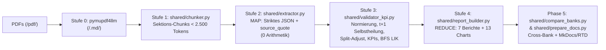

# Master-Umsetzungsplan: XKB Geschäftsberichte Analysen (ZKB, GEKB, VSKB, BCV, Raiffeisen, PostFinance, UBS)

> **Auftraggeber / Referenz:** Analog zu [`chatelao/bekb-geschaeftsbereichte-analysen`](https://github.com/chatelao/bekb-geschaeftsbereichte-analysen)
> **Ausführungsmodell:** Optimiert für die schrittweise, deterministisch verifizierbare Umsetzung durch **Gemini Hydrogen** (z. B. `gemini-2.5-flash-lite` bzw. Hydrogen-Agent-Tier).
> **Ziel-Repository:** `chatelao/xkb-geschaeftsbereichte-analysen`

---

## 1. Zielsetzung & Abdeckung der sieben Banken

Dieses Repository erweitert die bewährte vierstufige **«Hydrogen-First» Map-Validate-Reduce-Pipeline** der BEKB-Analyse auf **sieben Schweizer Banken** (vier Kantonalbanken + Raiffeisen, PostFinance und UBS) – jeweils in einem eigenen Unterverzeichnis, gespeist von einer **gemeinsamen, getesteten Python-Kernbibliothek (`shared/`)** sowie abgerundet durch ein **Cross-Bank-Benchmarking (`comparison/`)** und ein **gemeinsames MkDocs-/Read-the-Docs- & GitHub-Pages-Portal**.

| Ordner | Kürzel | Offizieller Name | Kanton / Sitz | Rechtsform & Börse | Staatsgarantie | FINMA-Kat. | Abschluss-Scope | Berichts-Sprachen |
| :--- | :---: | :--- | :---: | :--- | :---: | :---: | :---: | :--- |
| [`zkb/`](./zkb/ANALYSE_STRATEGIE.md) | **ZKB** | Zürcher Kantonalbank | ZH | Öffentlich-rechtliche Anstalt (100 % Kanton ZH, **nicht kotiert**) | Voll (exkl. nachrangig) | **Kat. 2 (D-SIB / TBTF)** | **Konzern** | DE (EN) |
| [`gekb/`](./gekb/ANALYSE_STRATEGIE.md) | **GEKB / BCGE** | Banque Cantonale de Genève | GE | Öffentlich-rechtliche AG (SIX: `BCGE`; ~72,6 % öff. Hand) | **Keine** (abgeschafft) | Kat. 3 | **Konzern** | **FR** (teils EN/DE) |
| [`vskb/`](./vskb/ANALYSE_STRATEGIE.md) | **VSKB / WKB** | Walliser Kantonalbank (BCVs) | VS | Öffentlich-rechtliche AG (SIX: `WKB`; 70 % Kanton VS) | Voll | Kat. 3 | **Einzelabschluss** | **DE** & FR |
| [`bcv/`](./bcv/ANALYSE_STRATEGIE.md) | **BCV** | Banque Cantonale Vaudoise | VD | Öffentlich-rechtliche AG (SIX: `BCVN`; ~66,95 % Kanton VD) | **Keine** | Kat. 3 | **Konzern** | **FR** & EN |
| [`raiffeisen/`](./raiffeisen/ANALYSE_STRATEGIE.md) | **Raiffeisen** | Raiffeisen Gruppe Schweiz | SG | Genossenschaftsverbund (**nicht kotiert**) | **Keine** | **Kat. 2 (D-SIB / TBTF)** | **Konzern** | **DE** (FR/IT) |
| [`postfinance/`](./postfinance/ANALYSE_STRATEGIE.md) | **PostFinance** | PostFinance AG | BE | AG (100 % Die Schweizerische Post AG, **nicht kotiert**) | **Keine** | **Kat. 2 (D-SIB / TBTF)** | **Einzelabschluss** | **DE** (FR/IT/EN) |
| [`ubs/`](./ubs/ANALYSE_STRATEGIE.md) | **UBS** | UBS Group AG | ZH | Publikums-AG (SIX: `UBSG`, NYSE: `UBS`) | **Keine** | **Kat. 1 (G-SIB / TBTF)** | **Konzern (USD)** | **EN** (teils DE) |

### Ziel-Berichtszeitraum (analog BEKB)
- **Geschäftsberichte (`annual`):** Ideal `2003–2025` (mindestens lückenlos ab ältestem öffentlich über Website, `vskb.ch` oder Wayback Machine verfügbarem Jahrgang; Ziel: ≥ 15–23 Jahre).
- **Semesterberichte (`semester`):** Ideal `H1-2013–H1-2026` (per 30. Juni).
- **Offenlegungsberichte (`offenlegung`):** Ideal `FY2015–FY2025` sowie `H1-2018–H1-2026` (inkl. **Basel III final** ab `2025` / `06-2025`). Bei ZKB (D-SIB) werden Halbjahres- (`06-YYYY`) und Jahresstichtage (`YYYY`) analog extrahiert; Quartalsstichtage Q1/Q3 sind optional.
- **Berichtssprache aller erzeugten Analysen & Grafiken:** Einheitlich **Deutsch** (Schweizer Finanzterminologie, Zahlenformat `1'234,5` bzw. `CHF 10.80`), auch wenn die Primärquellen bei GEKB/BCGE und BCV auf Französisch/Englisch vorliegen.

---

## 2. Ziel-Repository-Struktur

```text
xkb-geschaeftsbereichte-analysen/
├── PLAN.md                             # Dieser Master-Umsetzungsplan (Runbook für Hydrogen)
├── README.md                           # Zentrale Portalseite mit 4-Banken-Scorecard & Links
├── .gitignore                          # Ignoriert .rtd_docs/, site/, __pycache__/, .venv/
├── .readthedocs.yaml                   # Read the Docs Build-Konfiguration (Python 3.12)
├── mkdocs.yml                          # Gemeinsame Material-for-MkDocs-Navigation (Root + 4 Banken + Vergleich)
├── docs/
│   └── requirements.txt                # mkdocs, mkdocs-material, pymdown-extensions
├── docs_assets/
│   ├── javascripts/mathjax.js
│   └── stylesheets/extra.css           # Einheitliches Tabellen- & Karten-Styling
├── .github/
│   └── workflows/docs-cicd.yml         # Determinismus-Check + mkdocs --strict + GH Pages + RTD Webhook
├── shared/                             # Gemeinsame, unit-getestete Pipeline-Kernbibliothek
│   ├── __init__.py
│   ├── config.py                       # Lädt <bank>/bank_config.yaml in typsicheres BankConfig-Objekt
│   ├── cpi_bfs.py                      # BFS LIK (Dez. 1982 = 100, 2003–2025) – Single Source of Truth
│   ├── download_utils.py               # PDF-Downloader mit %PDF/%%EOF-Check, Retry & Wayback-CDX-Helper
│   ├── pdf_to_md.py                    # pymupdf4llm-Konverter (<bank>/pdf/ -> <bank>/.md/)
│   ├── chunker.py                      # Mehrsprachiger (DE/FR/EN) deterministischer Chunker (< 2.500 Tokens)
│   ├── extractor.py                    # Stufe 2 Map-Phase (--backend gemini|local|auto, Swiss/FR/EN Parser)
│   ├── validator_kpi.py                # Stufe 3 Normierung, t->t+1 Selbstheilung, Split-Adjustierung, KPIs
│   ├── report_builder.py               # Stufe 4 Reduce-Phase (7 Berichte pro Bank, --backend local|gemini)
│   ├── chart_engine.py                 # 13 standardisierte 300-DPI-Grafiken pro Bank + Vergleichscharts
│   ├── compare_banks.py                # Cross-Bank-Panel & Benchmarking-Bericht (ZKB/GEKB/VSKB/BCV)
│   └── prepare_docs.py                 # Erzeugt .rtd_docs/ aus Root, comparison/ und zkb|gekb|vskb|bcv
├── tests/                              # Schnelle Unit-Tests für shared/ (pytest)
│   ├── test_number_parser.py           # DE/FR/EN Zahlen, Klammern, Tausendertrennzeichen, Fussnoten
│   ├── test_unit_and_split.py          # TCHF/Mio./Mrd.-Normierung & Aktiensplit-Bereinigung
│   ├── test_self_healing.py            # Vorjahres-Kreuzvalidierung & Abweichungs-Audit
│   └── test_kpi_and_cpi.py             # CIR, ROE, RWA-Dichte, BFS LIK Real-Bereinigung
├── comparison/                         # Bankübergreifendes Benchmarking (Phase 5)
│   ├── data/
│   │   ├── xkb_comparison_annual.csv
│   │   ├── xkb_comparison_offenlegung.csv
│   │   └── xkb_comparison_all.json
│   └── reports/
│       ├── README.md
│       ├── 01_groesse_wachstum_und_geschaeftsmodell.md
│       ├── 02_profitabilitaet_effizienz_und_produktivitaet.md
│       ├── 03_kapitalisierung_staatsgarantie_und_basel_iii.md
│       ├── 04_ausschuettung_aktie_und_verguetung_real.md
│       └── charts/                     # 6–8 Cross-Bank-Vergleichsgrafiken
├── zkb/                                # Zürcher Kantonalbank (analog BEKB-Struktur)
│   ├── ANALYSE_STRATEGIE.md
│   ├── ROADMAP.md
│   ├── README.md
│   ├── bank_config.yaml                # Deklarative Bank-Metadaten, Anchor-Patterns, Epochen, Palette
│   ├── download_reports.py             # Kuratierte Download-URLs (Website + vskb.ch + Wayback)
│   ├── overrides.json                  # Dokumentierte Sonderfälle (z.B. Vergütungs-Tabellen, Einmaleffekte)
│   ├── pdf/                            # Original-PDFs: zkb-{geschaeftsbericht|semesterbericht|offenlegungsbericht}-*.pdf
│   ├── .md/                            # Konvertiertes Markdown + .md/images/
│   ├── data/
│   │   ├── chunks/                     # Stufe 1 JSON-Chunks + manifest.json
│   │   ├── extracted/                  # Stufe 2 Roh-Extraktionen mit source_quote
│   │   ├── zkb_panel_2003_2026.csv
│   │   ├── zkb_panel_annual.csv
│   │   ├── zkb_panel_semester.csv
│   │   ├── zkb_panel_offenlegung.csv
│   │   ├── zkb_verguetung_real_2003_2025.csv
│   │   ├── zkb_panel_all.json
│   │   └── validation_report.md
│   └── reports/
│       ├── README.md
│       ├── 01_zinszyklen_und_ertragsarchitektur.md
│       ├── 02_bilanzwachstum_hypotheken_und_refinanzierung.md
│       ├── 03_aufsichtsrechtliche_resilienz_basel_iii.md
│       ├── 04_operative_effizienz_und_transformation.md
│       ├── 05_dotationskapital_ausschuettung_und_kanton_zuerich.md   # ZKB-spezifisch (nicht kotiert)
│       ├── 06_unterjaehrige_dynamik_semesterberichte.md
│       ├── 07_strategische_epochen_und_governance.md
│       └── charts/                     # 13 Grafiken (identische Nummernlogik 01..07 wie BEKB)
├── gekb/                               # Banque Cantonale de Genève (BCGE) – identischer Aufbau
├── vskb/                               # Walliser Kantonalbank (WKB / BCVs) – identischer Aufbau
└── bcv/                                # Banque Cantonale Vaudoise (BCV) – identischer Aufbau
```

> **Speicher-Regel für PDFs & Markdown:** Alle Original-PDFs werden in `<bank>/pdf/` heruntergeladen, gespeichert und in `<bank>/.md/*.md` konvertiert (analog BEKB).
> 1. Einzelne PDF-Dateien > 95 MB dürfen wegen des GitHub-100-MB-Hard-Limits nicht direkt gepusht werden (falls ein Geschäftsbericht > 95 MB gross ist, per `qpdf`/Ghostscript verlustarm komprimieren oder per Git LFS tracken).
> 2. **Konvertierte `.md/*.md`-Textdateien** werden standardmässig ohne eingebettete Deko-PNGs (`write_images=False`) erzeugt, um das Repository kompakt und schnell klonbar zu halten.

---

## 3. «Hydrogen-First» Architekturprinzipien (Verbindliche Leitplanken)

Da der gesamte Plan durch **Gemini Hydrogen** umgesetzt wird, gelten **sechs unverrückbare Regeln** für jede Phase:



1. **Einmal bauen, viermal konfigurieren (`shared/` + `bank_config.yaml`):** Niemals 1'500 Zeilen Python pro Bank kopieren. Alle Bank-Unterschiede (Sprache, Konzern/Stammhaus, Anker-Regex, Aktiensplits, FINMA-Zielgrössen, Farbpalette, Epochen) werden deklarativ in `<bank>/bank_config.yaml` gepflegt.
2. **Kein Rechnen im LLM:** In Stufe 2 extrahiert Gemini Hydrogen ausschliesslich `value_current`, `value_prior_year`, `unit` und `source_quote`. Einheiten-Normierung (`TCHF`/`Mio. CHF`/`Mrd. CHF`), Aktiensplit-Bereinigung, Differenzen, CAGRs, Quoten und Inflationsbereinigung laufen **ausschliesslich deterministisch in Python**.
3. **Konzern vs. Stammhaus strikt trennen:** Jede Bank legt in `bank_config.yaml` genau einen `reporting_scope` fest (`consolidated` für ZKB, GEKB, BCV; `standalone` für VSKB). Der Chunker muss Konzern-Tabellen (`Konzernbilanz`, `Bilan consolidé`, `Consolidated balance sheet`) explizit priorisieren und Stammhaus-Tabellen ausschliessen, damit keine Misch-Zeitreihen entstehen.
4. **Dual-Backend (`--backend local` & `--backend gemini`):** Sowohl Stufe 2 (`extractor.py`) als auch Stufe 4 (`report_builder.py`) müssen – genau wie bei BEKB – mit `--backend local` vollständig offline und deterministisch laufen (CI-Gate: `git diff --exit-code`!) und mit `--backend gemini` (`gemini-2.5-flash-lite` via `GEMINI_API_KEY`) die Hydrogen-API ansteuern können.
5. **Vertikale Scheiben (Bank für Bank):** Niemals alle 4 Banken gleichzeitig halbfertig beginnen. Erst `shared/` + Unit-Tests (Phase 0), dann **VSKB** als Pilotbank komplett bis zu 7 Berichten + 13 Charts (Phase 1), dann **ZKB** (Phase 2), **BCV** (Phase 3), **GEKB** (Phase 4), abschliessend **Cross-Bank & Portal** (Phase 5).
6. **Jede Phase endet mit einem maschinellen Verifikations-Gate:** Keine nächste Phase starten, bevor alle Akzeptanztests der laufenden Phase mit Exit-Code `0` bestehen.

---

## 4. Kanonisches Datenmodell & `bank_config.yaml`-Schema

### 4.1 Kanonische Kennzahlen (identisch über alle 4 Banken + BEKB)

| Dimension | `metric_id` | Kanonische Einheit | DE / FR / EN Kernbegriffe |
| :--- | :--- | :---: | :--- |
| **A. Erfolgsrechnung** | `net_interest_income` | `TCHF` | Netto-Zinserfolg / Résultat net des opérations d'intérêts / Net interest income |
| | `commission_income` | `TCHF` | Erfolg aus Kommissions- und Dienstleistungsgeschäft / Résultat des opérations de commissions |
| | `trading_income` | `TCHF` | Erfolg aus Handelsgeschäft / Résultat des opérations de négoce |
| | `other_ordinary_income` | `TCHF` | Übriger ordentlicher Erfolg / Autres résultats ordinaires |
| | `total_operating_income` | `TCHF` | Geschäftsertrag / Total des produits d'exploitation / Total income |
| | `personnel_expenses` | `TCHF` | Personalaufwand / Charges de personnel / Personnel costs |
| | `general_expenses` | `TCHF` | Sachaufwand / Autres charges d'exploitation / Other operating expenses |
| | `total_operating_expenses` | `TCHF` | Geschäftsaufwand / Total des charges d'exploitation / Operating expenses |
| | `operating_profit` | `TCHF` | Geschäftserfolg (ab 2015) bzw. Bruttogewinn / Résultat opérationnel / Operating profit |
| | `reserves_change` | `TCHF` | Veränderung Reserven für allg. Bankrisiken / Variation des réserves pour risques bancaires généraux |
| | `taxes` | `TCHF` | Steuern / Impôts / Taxes |
| | `net_profit` | `TCHF` | Konzerngewinn / Jahresgewinn / Bénéfice net / Net profit |
| **B. Bilanz & Volumen** | `total_assets` | `TCHF` | Bilanzsumme / Total de l'actif / Total assets |
| | `mortgage_loans` | `TCHF` | Hypothekarforderungen / Créances hypothécaires / Mortgage loans |
| | `customer_loans_other` | `TCHF` | Forderungen gegenüber Kunden / Créances sur la clientèle / Loans and advances to customers |
| | `customer_deposits` | `TCHF` | Verpflichtungen aus Kundeneinlagen / Engagements résultant des dépôts de la clientèle |
| | `kassenobligationen` | `TCHF` | Kassenobligationen / Obligations de caisse (falls ausgewiesen) |
| | `pfandbriefe_bonds` | `TCHF` | Anleihen und Pfandbriefdarlehen / Emprunts et prêts des centrales d'émission de lettres de gage |
| | `reserves_banking_risks` | `TCHF` | Reserven für allg. Bankrisiken / Réserves pour risques bancaires généraux |
| | `shareholders_equity` | `TCHF` | Eigenkapital / Total des capitaux propres / Shareholders' equity |
| | `assets_under_management` | `Mio. CHF` | Verwaltete Vermögen / Masse sous gestion / Assets under management (AuM) |
| | `net_new_money` | `Mio. CHF` | Netto-Neugeld / Afflux nets de fonds / Net new money (NNM) |
| **C. Offenlegung (Basel III)** | `rwa_total` | `TCHF` | Total RWA / Total des positions pondérées en fonction des risques (KM1 / OV1) |
| | `cet1_capital` | `TCHF` | Hartes Kernkapital (CET1) / Fonds propres de base durs (CET1) |
| | `tier1_capital` | `TCHF` | Kernkapital (T1) / Fonds propres de base (T1) |
| | `total_capital` | `TCHF` | Gesamtkapital / Total des fonds propres (inkl. T2; ZKB zusätzl. `tlac_ratio_pct` / Gone Concern) |
| | `cet1_ratio_pct` | `%` | CET1-Quote / Ratio CET1 |
| | `total_capital_ratio_pct` | `%` | Gesamtkapitalquote / Ratio global de fonds propres |
| | `leverage_ratio_pct` | `%` | Leverage Ratio / Ratio de levier |
| | `lcr_pct` | `%` | Liquidity Coverage Ratio (LCR) |
| | `nsfr_pct` | `%` | Net Stable Funding Ratio (NSFR, ab 2021) |
| **D. Aktie, Kanton & Operatives** | `share_price_eoy` | `CHF` | Aktienkurs 31.12. / Cours de l'action (nur GEKB, VSKB, BCV; `null` bei ZKB) |
| | `dividend_per_share` | `CHF` | Dividende pro Aktie (inkl. Nennwertrückzahlung separat flaggen; `null` bei ZKB) |
| | `canton_share_pct` | `%` | Beteiligungsquote Kanton / öffentliche Hand |
| | `contribution_public_mio` | `Mio. CHF` | Gesamtablieferung an öffentliche Hand (Dividende Kanton/Gem. + Steuern + Staatsgarantie-Abgeltung) |
| | `canton_guarantee_fee_mio` | `Mio. CHF` | Abgeltung Staatsgarantie (ZKB, VSKB; `0`/entfällt bei GEKB, BCV) |
| | `fte_count` | `FTE` | Personalbestand teilzeitbereinigt / Effectif en équivalents plein temps (EPT) |
| | `branch_count` | `Anzahl` | Geschäftsstellen / Filialen / Succursales & agences |

### 4.2 Verpflichtende `bank_config.yaml`-Struktur (pro Bank)

```yaml
bank_id: "vskb"                          # zkb | gekb | vskb | bcv
short_name: "WKB (VSKB)"
full_name: "Walliser Kantonalbank"
canton: "Wallis"
legal_form: "public_ag"                  # public_ag | cantonal_institution
listed: true
ticker: "WKB"                            # null für ZKB
state_guarantee: true
finma_category: 3                        # 2 (D-SIB) für ZKB, 3 für GEKB/VSKB/BCV
reporting_scope: "standalone"            # standalone | consolidated
primary_languages: ["de", "fr"]
file_prefix: "vskb"                      # Einheitliches Präfix für pdf/ und .md/

capital_targets_pct:                     # Für Chart 03 (Soll-Ist-Vergleich)
  cet1_target: 9.2                       # Bankindividuell aus aktuellem KM1/Offenlegung verifizieren!
  total_capital_target: 13.4
  leverage_min: 3.0                      # ZKB (D-SIB): Going-Concern TBTF-Anforderung!
  lcr_min: 100.0
  nsfr_min: 100.0

share_splits: []                         # z.B. BCV: [{date: "2020-05-28", ratio: 10}]

report_05_mode: "listed_share"           # "listed_share" (GEKB/VSKB/BCV) | "cantonal_endowment" (ZKB)
report_05_slug: "05_aktie_dividenden_und_wertschoepfung"

palette:                                 # Bank-Markenfarben für 13 Charts
  primary: "#C8102E"
  secondary: "#0F2942"
  accent: "#0F766E"
  muted: "#64748B"

epochs:                                  # 3–4 strategische Epochen für Bericht 07 & Scorecard
  - {label: "Epoche 1", start: 2003, end: 2014, title: "..."}
  - {label: "Epoche 2", start: 2015, end: 2021, title: "..."}
  - {label: "Epoche 3", start: 2022, end: 2026, title: "..."}

structural_breaks:                       # Automatisch in validation_report.md & Reduce-Prompts zitiert
  - {year: 2015, label: "FINMA-RVB / ARB Umstellung"}
  - {year: 2025, label: "Basel III final (ab 01.01.2025)"}
```

### 4.3 Standard-Katalog: 7 Mehrjahresberichte & 13 Visualisierungen pro Bank

Jede der vier Banken erzeugt exakt **7 Berichte** (Struktur: *1. Management Summary*, *2. Quantitative Entwicklung*, *3. Treiberanalyse & Wendepunkte*, *4. Fazit & Ausblick*) und **13 Grafiken** analog BEKB:

| Nr. | Bericht | Standard-Grafiken (`<bank>/reports/charts/`) | Bank-spezifische Anpassung |
| :---: | :--- | :--- | :--- |
| **01** | Zinszyklen & Ertragsarchitektur | `01_erfolgsrechnung_wasserfall_2025.png`, `01_ertrag_kosten_marge_kombi.png` | ZKB: starkes Handels- & Asset-Management-Geschäft (Swisscanto); GEKB: Trade/Commodity Finance & Private Banking |
| **02** | Bilanzwachstum, Hypotheken & Refinanzierung | `02_bilanz_gestapelte_saeulen_2025.png`, `02_bilanz_treemap_2025.png`, `02_bilanz_sankey_2025.png`, `02_bilanz_langfrist_wachstum.png` | Konzern- vs. Stammhaus-Konsistenz; Pfandbrief- & Anleihen-Refinanzierung |
| **03** | Aufsichtsrechtliche Resilienz & Basel III | `03_soll_ist_vergleich_horizontal_2026.png`, `03_kapital_rwa_basel.png` | ZKB: D-SIB Going-/Gone-Concern & TLAC; BCV: IRB-Ansatz vs. Basel III final Output Floor |
| **04** | Operative Effizienz & Transformation | `04_effizienz_produktivitaet.png` (+ Querverweis auf Chart 07 real) | FTE-Produktivität, CIR-Zielband, Filialnetz-Umbau |
| **05** | Aktie, Dividende & Wertschöpfung Kanton *(ZKB: Dotationskapital, Ausschüttung & Kanton ZH)* | `05_aktie_dividende_kanton.png` *(ZKB: `05_dotationskapital_ausschuettung_kanton.png`)* | **ZKB:** Gewinnausschüttung Kanton/Gemeinden + Staatsgarantie-Abgeltung + OECD-Mindeststeuer (ab 2024); **BCV/GEKB/VSKB:** split-bereinigte Aktie, Dividende, Ausschüttungsquote & Rückfluss öff. Hand |
| **06** | Unterjährige Dynamik (Semesterberichte) | `06_semester_saisonalitaet_reserven.png` | H1/FY-Saisonalität, H2-Reservensteuerung & Indikation H1-2026 |
| **07** | Strategische Epochen, Governance & reale Vergütung | `07_langfrist_dashboard_epochen.png`, `07_gewinn_loehne_verguetung_real.png` | Inflationsbereinigung via `shared/cpi_bfs.py` (BFS LIK Dez. 1982 = 100, Basis real 2025 CHF) |

---

## 5. Schritt-für-Schritt-Umsetzungsplan für Gemini Hydrogen (Phasen P0–P5)

> **Ausführungsanweisung für Gemini Hydrogen:** Arbeite die Phasen strikt in der Reihenfolge `P0 → P1 → P2 → P3 → P4 → P5` ab. Schliesse jede Phase erst ab, wenn alle zugehörigen **Verifikationskommandos** fehlerfrei durchlaufen, und committe nach jeder abgeschlossenen Phase auf einem Feature-Branch (oder gemäss Vorgabe).

---

### Phase 0: Repository-Fundament & gemeinsame `shared/`-Pipeline

**Ziel:** Eine saubere, getestete, bankunabhängige Python-Kernbibliothek, damit die Phasen P1–P4 weitgehend über Konfiguration (`bank_config.yaml`) und bank-spezifische Downloader laufen.

#### Atomare Aufgaben
1. **Basisdateien im Root anlegen:**
   - `.gitignore` (`.rtd_docs/`, `site/`, `__pycache__/`, `.venv/`, `*.pyc`, `.pytest_cache/`, `<bank>/.md/images/` falls Bild-Extraktion ausgeschaltet/ignoriert wird).
   - `docs/requirements.txt` (`mkdocs>=1.6,<2.0`, `mkdocs-material>=9.5,<10.0`, `pymdown-extensions>=10.0`).
   - `.readthedocs.yaml`, `docs_assets/javascripts/mathjax.js`, `docs_assets/stylesheets/extra.css` (analog BEKB-Referenz).
2. **`shared/cpi_bfs.py` implementieren:**
   - Offizieller BFS LIK Jahresdurchschnitt (Basis Dez. 1982 = 100) für `2003–2025` (exakt identisch zu BEKB: `2003: 150.7`, ..., `2025: 169.7`) sowie Hilfsfunktion `deflate_to_real_2025(value, year)`.
3. **`shared/config.py` implementieren:**
   - Lädt `<bank>/bank_config.yaml` (mit PyYAML oder stdlib-JSON-Fallback; Empfehlung: `pyyaml` als klare Abhängigkeit) und validiert Pflichtfelder (`bank_id`, `reporting_scope`, `finma_category`, `report_05_mode`, `capital_targets_pct`, `palette`, `epochs`).
4. **`shared/download_utils.py` & `shared/pdf_to_md.py` implementieren:**
   - PDF-Integrity-Check (`%PDF` Header + `%%EOF` Trailer + Mindestgrösse > 10 KB), automatischer Retry mit Exponential Backoff, Schreiben eines `pdf_manifest.json` (Dateiname, URL, SHA-256, Bytes, HTTP-Status).
   - `pdf_to_md.py`: Wrapper um `pymupdf4llm.to_markdown(..., write_images=False)` als Standard (optional `--write-images`), CLI: `python3 -m shared.pdf_to_md --bank <bank>`.
5. **`shared/chunker.py` & `shared/extractor.py` implementieren:**
   - Chunker mit DE-, FR- und EN-Ankerlisten (konfigurierbar/erweiterbar pro Bank in `bank_config.yaml`), striktem `reporting_scope`-Filter (`Konzern`/`Consolidé` vs. `Stammhaus`/`Maison-mère`), TOC-Filter und `< 9'500` Zeichen/Chunk.
   - Extractor mit Schweizer/Französisch/Englisch-Zahlenparser (`1'234,5`, `1 234.5`, `(12 345)`, `–12 345`), Einheiten-Erkennung (`in TCHF`, `en milliers de CHF`, `in CHF thousands`, `in Mio. CHF`, `en millions de CHF`, `en CHF millions`, `in Mrd. CHF`), Dual-Backend `--backend local|gemini|auto`, striktem JSON-Output inkl. `source_quote`.
6. **`shared/validator_kpi.py` implementieren:**
   - Einheiten-Normierung auf kanonisches Schema (`TCHF`, `Mio. CHF`, `%`, `CHF`, `FTE`).
   - Vorjahres-Kreuzvalidierung & automatische Selbstheilung (`t` aus `prior_year` von `t+1`), Protokollierung aller Abweichungen > 0,5 %.
   - Deterministische **Aktiensplit-Bereinigung** für historische Kurs- und Dividendenreihen (`share_splits` aus `bank_config.yaml`).
   - Deterministische Berechnung aller abgeleiteten KPIs (`cir_pct`, `interest_share_pct`, `commission_share_pct`, `loan_to_deposit_pct`, `deposit_coverage_pct`, `mortgage_share_assets_pct`, `roe_pct`, `rwa_density_pct`, `income_per_fte_tchf`, `assets_per_fte_mio`, Kapital-Überschuss über FINMA-Zielgrösse).
   - Generierung von `<bank>/data/<bank>_panel_*.csv`, `<bank>/data/<bank>_verguetung_real_*.csv`, `<bank>/data/<bank>_panel_all.json` und `<bank>/data/validation_report.md`.
7. **`shared/report_builder.py` & `shared/chart_engine.py` implementieren:**
   - Generiert die 7 Mehrjahresberichte (`reports/01_*.md` bis `07_*.md` + `reports/README.md`) mit Unterstützung für `report_05_mode = listed_share | cantonal_endowment` und `--backend local | gemini`.
   - Generiert alle 13 hochauflösenden PNG-Grafiken (`300 DPI`) deterministisch aus den CSV/JSON-Panels (ohne hartcodierte Einzelbank-Zahlen!).
8. **Unit-Test-Suite (`tests/`) schreiben:**
   - Mindestens 20 gezielte Tests für Zahlenparser (DE/FR/EN, Negativ-Klammern, Fussnoten), Einheiten-Konvertierung, Aktiensplits (z. B. BCV 1:10), `t+1`-Selbstheilung, KPI-Formeln und BFS-LIK-Deflationierung.

#### Verifikations-Gate Phase 0
```bash
uv run --with pytest --with pyyaml --with matplotlib pytest -q tests/
python3 -m shared.config --check-schema
```
**Abnahmekriterium:** Alle Unit-Tests grün (`0 failed`), alle `shared/`-CLI-Module zeigen saubere `--help`-Ausgaben.

---

### Phase 1 (Pilotbank): `vskb/` – Walliser Kantonalbank (WKB / BCVs)

**Warum VSKB zuerst?** Zweisprachig (vollständige deutsche Berichte verfügbar!), Einzelabschluss (wie BEKB), FINMA Kategorie 3 (wie BEKB), SIX-kotiert (`WKB`, 70 % Kanton Wallis), volle Staatsgarantie. Damit validiert Gemini Hydrogen die gesamte `shared/`-Pipeline End-to-End am geringsten Risikoprofil!

**Detail-Spezifikation:** Siehe [`vskb/ANALYSE_STRATEGIE.md`](./vskb/ANALYSE_STRATEGIE.md).

#### Atomare Aufgaben
1. **`vskb/bank_config.yaml` anlegen** (inkl. Markenfarben, FINMA-Kat.-3-Zielgrössen, Epochen, DE/FR-Ankern).
2. **Archiv-Discovery & `vskb/download_reports.py` erstellen:**
   - Quellen: `bcvs.ch/de/die-wkb/publikationen-medien/publikationen/alle-publikationen`, `vskb.ch/publikationen/jahresberichte` (z. B. `WKB_2024.pdf`, `WKB_2025.pdf`), Wayback Machine CDX API (`web.archive.org/cdx/search/cdx?url=bcvs.ch/*&filter=mimetype:application/pdf`).
   - Ziel-Namensschema: `vskb-geschaeftsbericht-YYYY.pdf`, `vskb-semesterbericht-YYYY.pdf`, `vskb-offenlegungsbericht-[06-]YYYY.pdf`.
   - `vskb/ROADMAP.md` mit Bestandsaufnahme (exakte Anzahl gefundener PDFs pro Kategorie & Zeitraum) erzeugen.
3. **PDF → Markdown konvertieren:** `python3 -m shared.pdf_to_md --bank vskb`.
4. **Stufe 1–4 ausführen & prüfen:**
   - `python3 -m shared.chunker --bank vskb`
   - `python3 -m shared.extractor --bank vskb --backend local` *(optional Vergleichslauf `--backend gemini`)*
   - `python3 -m shared.validator_kpi --bank vskb`
   - `vskb/data/validation_report.md` sichten: Fehlende Werte oder Parser-Ausreisser gezielt über bessere Regex in `vskb/bank_config.yaml` oder dokumentierte `vskb/overrides.json` (inkl. geprüfter VR/CEO/GL-Vergütungen) beheben, bis **0 Lücken** bei den Kernkennzahlen bestehen.
   - `python3 -m shared.report_builder --bank vskb --backend local`
   - `uv run --with matplotlib --with pyyaml python3 -m shared.chart_engine --bank vskb`
5. **`vskb/README.md` erzeugen** (mit Kennzahlen-Tabelle, Berichtskatalog und eingebetteter Langfrist-Scorecard).

#### Verifikations-Gate Phase 1
```bash
python3 -m shared.validator_kpi --bank vskb --strict-audit
python3 -m shared.report_builder --bank vskb --backend local
uv run --with matplotlib --with pyyaml python3 -m shared.chart_engine --bank vskb
ls vskb/reports/0*.md | wc -l      # Erwartet: 7
ls vskb/reports/charts/*.png | wc -l  # Erwartet: 13
```

---

### Phase 2: `zkb/` – Zürcher Kantonalbank (ZKB)

**Besonderheiten:** Grösste Kantonalbank der Schweiz, **Konzernrechnung**, **nicht börsenkotiert** (100 % Kanton ZH, Dotationskapital), **FINMA Kategorie 2 / D-SIB** (Going-Concern + Gone-Concern / TLAC), **Swisscanto-Übernahme (2015)**, **OECD-Mindeststeuer (ab 2024)**, **Custody-Umklassierung (2024)**.

**Detail-Spezifikation:** Siehe [`zkb/ANALYSE_STRATEGIE.md`](./zkb/ANALYSE_STRATEGIE.md).

#### Atomare Aufgaben
1. **`zkb/bank_config.yaml` anlegen:**
   - `legal_form: "cantonal_institution"`, `listed: false`, `finma_category: 2`, `reporting_scope: "consolidated"`, `report_05_mode: "cantonal_endowment"`, `report_05_slug: "05_dotationskapital_ausschuettung_und_kanton_zuerich"`.
   - Zusätzliche ZKB-Offenlegungsmetriken aktivieren: `tlac_ratio_pct`, `gone_concern_capital`, `leverage_ratio_tbtf_pct`.
2. **Archiv-Discovery & `zkb/download_reports.py` erstellen:**
   - Quellen: `zkb.ch/de/lps/corporate/berichterstattung/downloads.html`, `zkb.ch/de/lps/corporate/berichterstattung/offenlegung.html`, `vskb.ch`, Kantonsrat ZH Archiv (`kantonsrat.zh.ch`), Wayback Machine CDX API (`zkb.ch/*`).
   - **Wichtig:** ZKB veröffentlicht teils separate PDFs (Geschäftsbericht vs. Lagebericht vs. Corporate Governance vs. Finanzbericht) – sicherstellen, dass jeweils der **vollständige Geschäftsbericht** (oder gezielt Finanzbericht + Corporate Governance / Vergütung) heruntergeladen wird.
   - `zkb/ROADMAP.md` dokumentieren.
3. **Pipeline Stufe 0–4 ausführen (`pdf_to_md` → `chunker` → `extractor` → `validator_kpi` → `report_builder` → `chart_engine`).**
4. **Sonderprüfungen in `zkb/data/validation_report.md`:**
   - Verifizieren, dass durchgehend **Konzernzahlen** (nicht Stammhaus) verwendet wurden.
   - Verifizieren, dass **Bericht 05** und **Chart 05** sauber das **Dotationskapital, die ordentliche Gewinnausschüttung an Kanton & Gemeinden, die Staatsgarantie-Abgeltung sowie die OECD-Mindeststeuer (ab 2024)** ausweisen (keine leeren Aktienkurs-Felder!).
   - Verifizieren, dass der AuM-Strukturbruch 2023/2024 (-55,0 Mrd. CHF Umklassierung zu Custody Services) sowie die Swisscanto-Integration 2015 explizit dokumentiert sind.
5. **`zkb/README.md` erzeugen.**

#### Verifikations-Gate Phase 2
```bash
python3 -m shared.validator_kpi --bank zkb --strict-audit
python3 -m shared.report_builder --bank zkb --backend local
uv run --with matplotlib --with pyyaml python3 -m shared.chart_engine --bank zkb
ls zkb/reports/0*.md | wc -l         # Erwartet: 7
ls zkb/reports/charts/*.png | wc -l  # Erwartet: 13
```

---

### Phase 3: `bcv/` – Banque Cantonale Vaudoise (BCV)

**Besonderheiten:** **Französisch/Englisch**, **Konzernrechnung**, **keine Staatsgarantie**, SIX-kotiert (`BCVN`, ~66,95 % Kanton Waadt), **1:10-Aktiensplit (Mai 2020)**, **IRB-Ansatz** (F-IRB/A-IRB) bei Kreditrisiken → besonders spannend bei **Basel III final Output Floor ab 2025**, historische Restrukturierung/Turnaround nach 2002/2003.

**Detail-Spezifikation:** Siehe [`bcv/ANALYSE_STRATEGIE.md`](./bcv/ANALYSE_STRATEGIE.md).

#### Atomare Aufgaben
1. **`bcv/bank_config.yaml` anlegen:**
   - `reporting_scope: "consolidated"`, `listed: true`, `ticker: "BCVN"`, `state_guarantee: false`, `finma_category: 3`, `primary_languages: ["fr", "en"]`.
   - `share_splits: [{date: "2020-05-28", ratio: 10}]` hinterlegen (alle Aktienkurse & Dividenden vor 2020 werden deterministisch durch 10 geteilt, um eine bruchfreie Zeitreihe zu erhalten!).
2. **Archiv-Discovery & `bcv/download_reports.py` erstellen:**
   - Quellen: `bcv.ch/fr/home/la-bcv/relations-investisseurs/news-et-rapports.html`, `bcv.ch/content/dam/bcv/fichiers/publications/...`, `vskb.ch`, Wayback Machine CDX API (`bcv.ch/*`).
   - Bevorzugt einheitliche Sprachversion (FR konsistent für Geschäfts-, Semester- und Pilier-3-Berichte; EN als sauber dokumentierter Fallback).
   - `bcv/ROADMAP.md` dokumentieren.
3. **Pipeline Stufe 0–4 ausführen** und den mehrsprachigen FR/EN-Parser von `shared/chunker.py` & `shared/extractor.py` verifizieren.
4. **Sonderprüfungen in `bcv/data/validation_report.md`:**
   - Konzern-Konsistenz (`Groupe BCV`) prüfen.
   - Split-Bereinigung (2020, Faktor 10) bei `share_price_eoy` und `dividend_per_share` prüfen (Plausibilität: kontinuierliche Dividendenreihe ohne 10x-Sprung!).
   - IRB-Kapitaleffekt & Übergang zu *Bâle III final* (2025/06-2026) in Bericht 03 verifizieren.
   - Ausschüttungspolitik ohne Staatsgarantie (ordentliche Dividende + Kapitalrückzahlungen aus Reserven / `remboursement de capital`) dokumentieren.
5. **`bcv/README.md` erzeugen.**

#### Verifikations-Gate Phase 3
```bash
python3 -m shared.validator_kpi --bank bcv --strict-audit
python3 -m shared.report_builder --bank bcv --backend local
uv run --with matplotlib --with pyyaml python3 -m shared.chart_engine --bank bcv
ls bcv/reports/0*.md | wc -l         # Erwartet: 7
ls bcv/reports/charts/*.png | wc -l  # Erwartet: 13
```

---

### Phase 4: `gekb/` – Banque Cantonale de Genève (BCGE)

**Besonderheiten:** **Französisch** (teils DE/EN), **Konzernrechnung**, **keine unbeschränkte Staatsgarantie**, SIX-kotiert (`BCGE`), öffentliches Mehrheitsaktionariat aufgeteilt auf **Kanton Genf (~44,3 %), Stadt Genf (~20,9 %) und Genfer Gemeinden (~7,4 %)** (Aktionärsbindungsvertrag), internationales Geschäftsmodell (*Global Commodity Finance*, *BCGE France*), ggf. historischer Nachgang der Sanierung / Fondation de valorisation (2000–2008) sowie **Prüfung auf Aktiensplit / Nennwertänderung (2025/2026)**!

**Detail-Spezifikation:** Siehe [`gekb/ANALYSE_STRATEGIE.md`](./gekb/ANALYSE_STRATEGIE.md).

#### Atomare Aufgaben
1. **`gekb/bank_config.yaml` anlegen:**
   - `reporting_scope: "consolidated"`, `listed: true`, `ticker: "BCGE"`, `state_guarantee: false`, `finma_category: 3`, `primary_languages: ["fr", "de", "en"]`.
   - Aktionariats-Split (Kanton + Stadt + Gemeinden ≈ 72,6 %) für die Berechnung der Gesamtablieferung an die öffentliche Hand konfigurieren.
   - Etwaigen Aktiensplit (z. B. 1:10, falls 2025/2026 vollzogen) anhand des Geschäftsberichts 2025 / H1-2026 prüfen und in `share_splits` eintragen.
2. **Archiv-Discovery & `gekb/download_reports.py` erstellen:**
   - Quellen: `bcge.ch/fr/rapports-financiers`, `bcge.ch/documents/...`, `vskb.ch`, Wayback Machine CDX API (`bcge.ch/*`).
   - `gekb/ROADMAP.md` dokumentieren.
3. **Pipeline Stufe 0–4 ausführen.**
4. **Sonderprüfungen in `gekb/data/validation_report.md`:**
   - Konzern-Konsistenz (`Groupe BCGE`) prüfen.
   - Wertberichtigungen / Risikovorsorge im *Global Commodity Finance* und Übergang nach Abwicklung der *Fondation de valorisation* (2008) dokumentieren.
   - Split-bereinigte Aktienkurs- & Dividendenreihe verifizieren.
5. **`gekb/README.md` erzeugen.**

#### Verifikations-Gate Phase 4
```bash
python3 -m shared.validator_kpi --bank gekb --strict-audit
python3 -m shared.report_builder --bank gekb --backend local
uv run --with matplotlib --with pyyaml python3 -m shared.chart_engine --bank gekb
ls gekb/reports/0*.md | wc -l         # Erwartet: 7
ls gekb/reports/charts/*.png | wc -l  # Erwartet: 13
```

---

### Phase 5: Cross-Bank-Benchmarking (`comparison/`), MkDocs/RTD-Portal & CI/CD

**Ziel:** Alle vier Banken in einer einheitlichen Vergleichsperspektive zusammenführen und das gesamte Repository vollautomatisch über GitHub Actions auf **GitHub Pages** und **Read the Docs** publizieren.

#### Atomare Aufgaben
1. **`shared/compare_banks.py` implementieren & ausführen:**
   - Liest die validierten Panels aus `zkb/data/`, `gekb/data/`, `vskb/data/`, `bcv/data/` (optional optionaler Referenz-Anker mit BEKB-Eckwerten aus Metadaten-JSON).
   - Exportiert `comparison/data/xkb_comparison_annual.csv`, `comparison/data/xkb_comparison_offenlegung.csv`, `comparison/data/xkb_comparison_all.json`.
   - Erzeugt 4 fokussierte Cross-Bank-Vergleichsberichte unter `comparison/reports/`:
     1. `01_groesse_wachstum_und_geschaeftsmodell.md` (Bilanzsumme, CAGR, Zins- vs. Kommissions- vs. Handelsanteil, AuM)
     2. `02_profitabilitaet_effizienz_und_produktivitaet.md` (CIR, ROE, ROA, Ertrag/Gewinn je FTE, Reale Lohnkosten vs. Gewinn)
     3. `03_kapitalisierung_staatsgarantie_und_basel_iii.md` (CET1, Gesamtkapital, Leverage Ratio, LCR/NSFR, Staatsgarantie-Effekt: ZKB/VSKB vs. BCV/GEKB, Basel-III-final-Wirkung)
     4. `04_ausschuettung_aktie_und_verguetung_real.md` (Gesamtablieferung an öffentliche Hand je Kanton, Dividendenrendite & Total Return der 3 kotierten Banken, realer VR/CEO/GL-Vergütungsvergleich in CHF 2025)
   - Erzeugt **6–8 Cross-Bank-Grafiken** unter `comparison/reports/charts/` (z. B. Small-Multiples, Radar-/Benchmark-Matrix, indizierte Langfrist-Entwicklung, Kapital-Puffer-Vergleich, CIR vs. ROE-Scatter, realer Vergütungsvergleich).
2. **Gemeinsames Dokumentationsportal aufbauen:**
   - `shared/prepare_docs.py` erstellt `.rtd_docs/` mit sauberer Link-Umschreibung für Root-`README.md`, `PLAN.md`, `comparison/` sowie alle 4 Bank-Unterverzeichnisse (`zkb/`, `gekb/`, `vskb/`, `bcv/`) inkl. Grafik-Galerie pro Bank und Gesamt-Galerie.
   - `mkdocs.yml` mit übersichtlicher Top-Tab-Navigation:
     - `Übersicht` (`index.md`, `PLAN.md`)
     - `Bankenvergleich` (`comparison/`)
     - `ZKB` (`zkb/` – Übersicht, 7 Berichte, Galerie, Strategie & Audit)
     - `GEKB (BCGE)` (`gekb/` – Übersicht, 7 Berichte, Galerie, Strategie & Audit)
     - `VSKB (WKB)` (`vskb/` – Übersicht, 7 Berichte, Galerie, Strategie & Audit)
     - `BCV` (`bcv/` – Übersicht, 7 Berichte, Galerie, Strategie & Audit)
3. **Root-`README.md` aktualisieren:**
   - Executive-Scorecard (alle 4 Banken nebeneinander mit 2025 / H1-2026 Eckwerten), eingebettete Cross-Bank-Hauptgrafik, direkte Links zu allen 4 Banken, dem Bankenvergleich und Live-Docs.
4. **CI/CD-Workflow `.github/workflows/docs-cicd.yml` aktivieren:**
   - Führt `pytest tests/` aus.
   - Führt für alle 4 Banken `validator_kpi` + `report_builder --backend local` sowie `compare_banks` aus und prüft Determinismus (`git diff --exit-code`).
   - Führt `python3 -m shared.prepare_docs` und `mkdocs build --strict` aus.
   - Deployed bei Push auf `main` auf **GitHub Pages** (`deploy-pages`) und triggert optional den **Read-the-Docs-Webhook**.

#### Verifikations-Gate Phase 5 (Endabnahme)
```bash
uv run --with pytest --with pyyaml --with matplotlib pytest -q tests/
for b in vskb zkb bcv gekb; do
  python3 -m shared.validator_kpi --bank "$b" --strict-audit
  python3 -m shared.report_builder --bank "$b" --backend local
done
python3 -m shared.compare_banks --backend local
python3 -m shared.prepare_docs
uvx --with mkdocs-material --with pymdown-extensions mkdocs build --strict
```
**Abnahmekriterium:** `mkdocs build --strict` schliesst mit **0 Warnings / 0 Errors** ab; alle 4 Banken haben je 7 Berichte + 13 Grafiken (= 28 Bankberichte + 52 Bankgrafiken), zuzüglich 4 Cross-Bank-Berichten und 6–8 Vergleichsgrafiken.

---

## 6. Risiko- & Fallstrick-Matrix für Gemini Hydrogen

| Risiko / Fallstrick | Betroffene Banken | Deterministische Gegenmassnahme im Plan |
| :--- | :--- | :--- |
| **Konzern vs. Stammhaus verwechselt** | ZKB, GEKB, BCV | `reporting_scope: "consolidated"` in `bank_config.yaml`; Chunker priorisiert explizit `Konzernbilanz` / `Bilan consolidé` und filtert Stammhaus-Seiten aus. |
| **Aktiensplits verzerren Kurs/Dividende** | BCV (1:10, 2020), ggf. GEKB/VSKB | Rohwert speichern + deterministische Split-Umrechnung in `shared/validator_kpi.py` via `share_splits`-Liste (niemals im LLM). |
| **Keine Aktie vorhanden** | ZKB | `report_05_mode: "cantonal_endowment"` schaltet Bericht 05 & Chart 05 sauber auf Dotationskapital, Ausschüttung Kanton/Gemeinden & OECD-Mindeststeuer um. |
| **Französische/Englische PDFs & Zahlenformate** | GEKB, BCV (teils VSKB) | Ein zentraler, unit-getesteter DE/FR/EN-Parser (`tests/test_number_parser.py`) für Leerzeichen-Tausender, Komma-Dezimalen und `en milliers / en millions de CHF`. |
| **FINMA-Kat. 2 (D-SIB) statt Kat. 3** | ZKB | `finma_category: 2` schaltet in Bericht 03 & Chart 03 auf TBTF Going-/Gone-Concern- & TLAC-Zielgrössen statt Kat.-3-ERV-Zielgrössen. |
| **Abweichende Einheiten (TCHF vs. Mio. vs. Mrd.)** | Alle 4 | Pflichtfeld `unit` pro Extraktion + Plausibilitäts-Korridor je Bank in `validator_kpi.py` (z. B. ZKB Bilanzsumme > 100 Mrd. CHF → erkennt 1'000x-Fehler sofort!). |
| **Lücken in frühen Jahrgängen (2003–2010)** | Alle 4 | 3-stufiges Sourcing (Offizielle IR-Seite → `vskb.ch` → Wayback Machine CDX API) + automatische `t+1`-Vorjahres-Selbstheilung + transparente Lücken-Dokumentation in `ROADMAP.md`. |
| **Repository-Grösse durch PDFs & PNGs** | Alle 4 | `write_images=False` beim PDF→MD-Export; PDFs > 50 MB bzw. Roh-PDF-Ordner bei Bedarf via `.gitignore` + `download_reports.py` + `pdf_manifest.json` reproduzierbar halten. |
