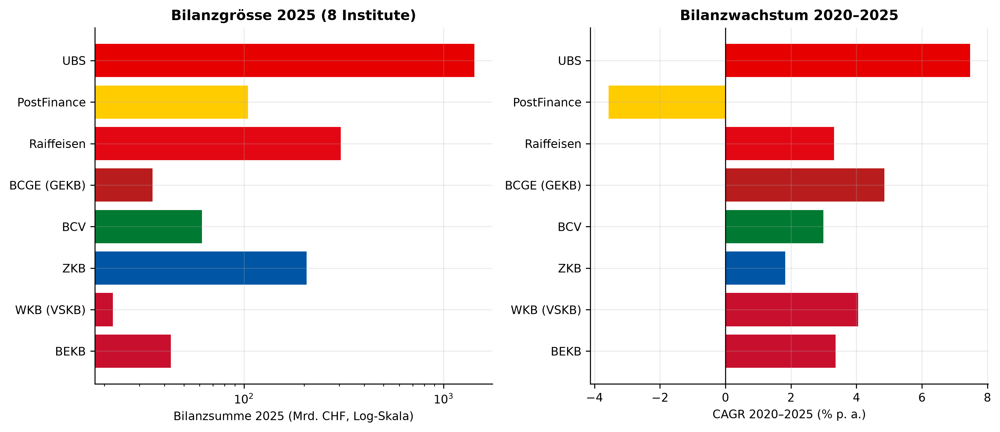

# XKB Geschäftsberichte Analysen (BEKB, VSKB, ZKB, BCV, GEKB, Raiffeisen, PostFinance, UBS)

> **Status:** Vollständig umgesetzt und verifiziert — **8 Schweizer Banken** (**458 PDFs** & **458 Markdown-Dateien**, **56 Einzelbank-Berichte & 104 Grafiken**, **7 Cross-Bank-Vergleichsberichte & 13 Benchmark-Grafiken**, **8 Vorsorgeeinrichtungen**).
> **Live-Portal:** [GitHub Pages](https://chatelao.github.io/xkb-geschaeftsbereichte-analysen/) · **Referenz-Architektur:** [`chatelao/bekb-geschaeftsbereichte-analysen`](https://github.com/chatelao/bekb-geschaeftsbereichte-analysen)

Strukturierte, vollständig reproduzierbare Längsschnitt-, Bilanz-, Risiko-, Effizienz-, Investoren- und Mitarbeiter-/Vorsorge-Analysen über eine gemeinsame, unit-getestete **«Hydrogen-First» Map-Validate-Reduce-Pipeline ([`shared/`](./shared/))**.

---

## Executive Scorecard 2025 / H1-2026 (8 Institute)

| Institut | Peer Group | Bilanzsumme 2025 (Mio. CHF) | Reingewinn 2025 (Mio. CHF) | CIR % | ROE % | FTE 2025 | CET1 % (H1-2026*) | Einzelberichte |
| :--- | :---: | :---: | :---: | :---: | :---: | :---: | :---: | :--- |
| **BEKB** | Kantonalbank | 42'977,0 | 175,4 | 51,26 % | 5,88 % | 1'058 | 18,04 % | [`bekb/reports/`](./bekb/reports/README.md) |
| **WKB (VSKB)** | Kantonalbank | 22'042,2 | 85,9 | 45,69 % | 5,07 % | 494 | 16,60 % | [`vskb/reports/`](./vskb/reports/README.md) |
| **ZKB** | KB / D-SIB | 206'177,0 | 1'241,0 | 55,71 % | 7,89 % | 5'809 | 20,10 % | [`zkb/reports/`](./zkb/reports/README.md) |
| **BCV** | Kantonalbank | 61'620,0 | 430,0 | 48,66 % | 11,00 % | 2'083 | 17,60 % | [`bcv/reports/`](./bcv/reports/README.md) |
| **BCGE (GEKB)** | Kantonalbank | 34'905,0 | 221,0 | 53,79 % | 8,84 % | 958 | 15,50 % | [`gekb/reports/`](./gekb/reports/README.md) |
| **Raiffeisen** | Inland-D-SIB | 305'611,0 | 1'208,0 | 56,72 % | 5,08 % | 10'972 | 24,70 % | [`raiffeisen/reports/`](./raiffeisen/reports/README.md) |
| **PostFinance** | Inland-D-SIB | 104'836,0 | 120,0 | 84,08 % | 1,82 % | 3'527 | 24,97 % | [`postfinance/reports/`](./postfinance/reports/README.md) |
| **UBS** | G-SIB (IFRS) | 1'426'570,6 | 6'842,7 | 81,09 % | 8,60 % | 103'177 | 14,41 %* | [`ubs/reports/`](./ubs/reports/README.md) |

*\*UBS CET1 per H1-2025. UBS-Beträge via SNB-Referenzkursen deterministisch von USD in CHF umgerechnet.*

---

## Institutsübergreifende Auswertung (`comparison/`)

- **[01 · Grösse, Wachstum & Geschäftsmodell](./comparison/reports/01_groesse_wachstum_und_geschaeftsmodell.md)**
- **[02 · Profitabilität, Effizienz & Produktivität](./comparison/reports/02_profitabilitaet_effizienz_und_produktivitaet.md)**
- **[03 · Kapitalisierung, Regulierung & Staatsgarantie](./comparison/reports/03_kapitalisierung_regulierung_und_staatsgarantie.md)**
- **[04 · Ausschüttung, Eigentümer & reale Vergütung](./comparison/reports/04_ausschuettung_eigentuemer_und_verguetung_real.md)**
- **[05 · Zinswenden, Saisonalität & Resilienz](./comparison/reports/05_zinswenden_saisonalitaet_und_resilienz.md)**
- **[06 · Investoren-Branchenvergleich](./comparison/reports/06_investoren_branchenvergleich.md)**
- **[07 · Mitarbeiter- & Vorsorge-Branchenvergleich (inkl. Pensionskassen)](./comparison/reports/07_mitarbeiter_und_vorsorge_branchenvergleich.md)**

---

## Pläne & Dokumentation

- **[`PLAN.md`](./PLAN.md)** – Master-Umsetzungsplan (Phasen P0–P9)
- **[`VERBESSERUNGSPLAN.md`](./VERBESSERUNGSPLAN.md)** – Qualitäts-Audit, Vorsorge-Erhebung & Branchenvergleiche (Phasen V1–V5)
