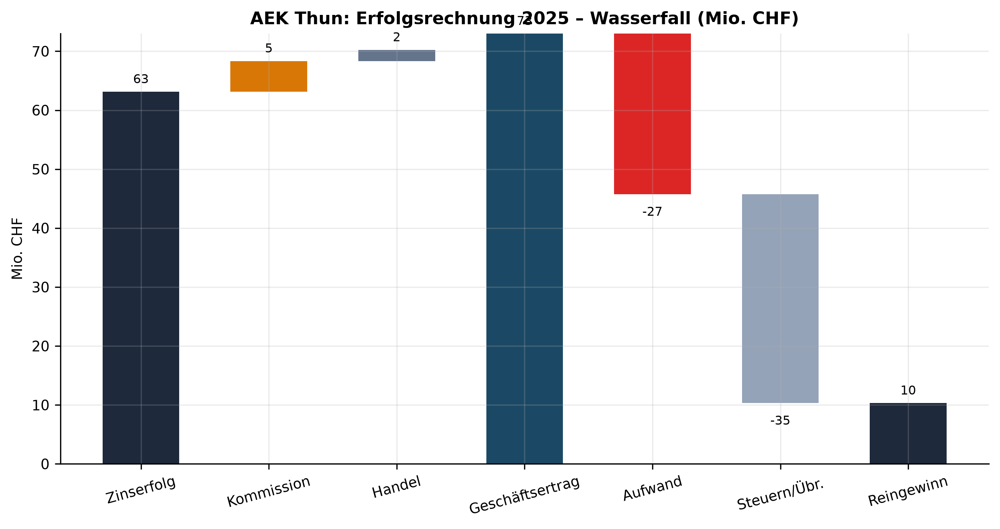
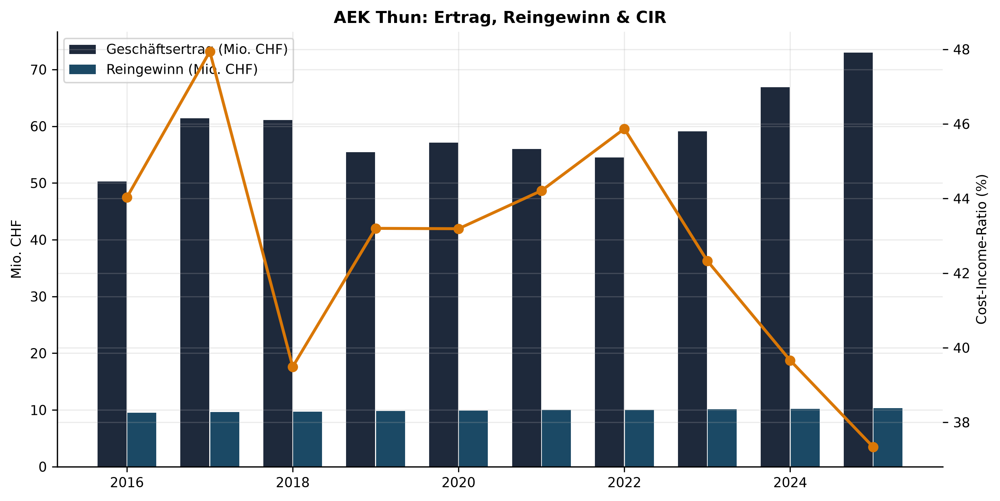

# 01 · Zinszyklen & Ertragsarchitektur (2016–2025): AEK BANK 1826 Genossenschaft

> **Scope:** `standalone` | **Standard:** `ARB_RVB` | **Währung:** Mio. CHF (harmonisierte Zeitreihe)

## 1. Management Summary
- Im Zeitraum **2016–2025** entwickelte sich der Geschäftsertrag von **50,3 Mio. CHF** auf **73,0 Mio. CHF** (CAGR **4,23 % p. a.**).
- Der Reingewinn erreichte im jüngsten Geschäftsjahr 2025 **10,3 Mio. CHF** (nach 9,5 Mio. CHF im Jahr 2016).
- Der Netto-Zinserfolg trägt aktuell **86,5 %** zum Gesamtertrag bei, das Kommissionsgeschäft **7,2 %** und das Handelsgeschäft **2,6 %**.

## 2. Quantitative Entwicklung
| Jahr | Zinserfolg (Mio.) | Kommission (Mio.) | Handel (Mio.) | Geschäftsertrag | Geschäftserfolg | Reingewinn | Zinsanteil |
| --- | --- | --- | --- | --- | --- | --- | --- |
| 2016 | 46,1 | 2,7 | 0,9 | 50,3 | 15,1 | 9,5 | 91,7 % |
| 2017 | 56,2 | 2,7 | 1,1 | 61,4 | 17,4 | 9,6 | 91,5 % |
| 2018 | 55,3 | 2,9 | 1,4 | 61,1 | 18,6 | 9,7 | 90,6 % |
| 2019 | 49,4 | 3,1 | 1,7 | 55,4 | 18,4 | 9,8 | 89,2 % |
| 2020 | 50,1 | 3,4 | 1,6 | 57,1 | 17,9 | 9,9 | 87,8 % |
| 2021 | 49,2 | 3,3 | 1,7 | 56,0 | 17,6 | 10,0 | 88,0 % |
| 2022 | 45,8 | 3,9 | 2,3 | 54,5 | 17,0 | 10,0 | 84,1 % |
| 2023 | 50,8 | 4,2 | 2,6 | 59,1 | 21,5 | 10,1 | 85,9 % |
| 2024 | 57,1 | 4,7 | 1,9 | 66,9 | 28,5 | 10,2 | 85,4 % |
| 2025 | 63,1 | 5,2 | 1,9 | 73,0 | 36,8 | 10,3 | 86,5 % |

## 3. Treiberanalyse & Wendepunkte
- **2025:** Inkrafttreten Basel III final per 01.01.2025

## 4. Fazit & Ausblick
- Die Ertragsarchitektur von AEK Thun spiegelt die Zinszyklen (Negativzinsphase 2015–2022, Zinswende 2022–2024, Zinssenkungen ab 2025) unmittelbar wider.
