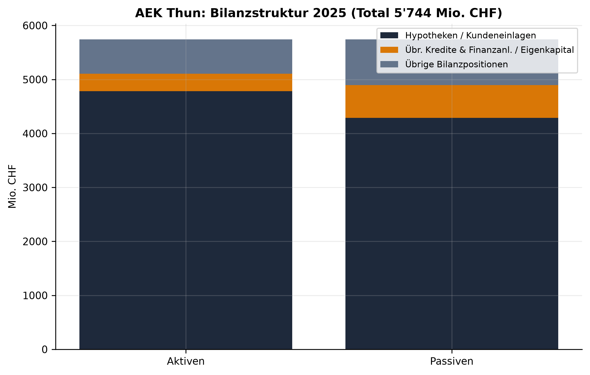
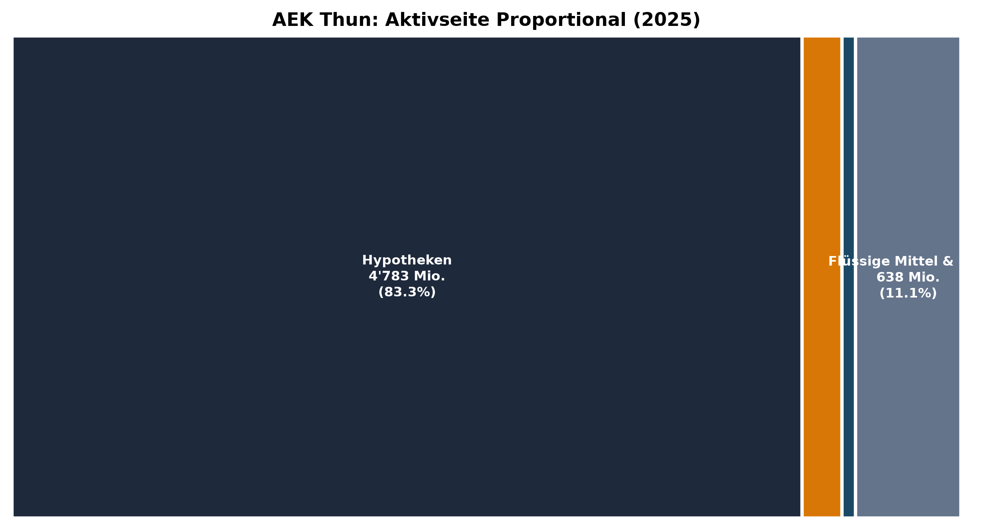
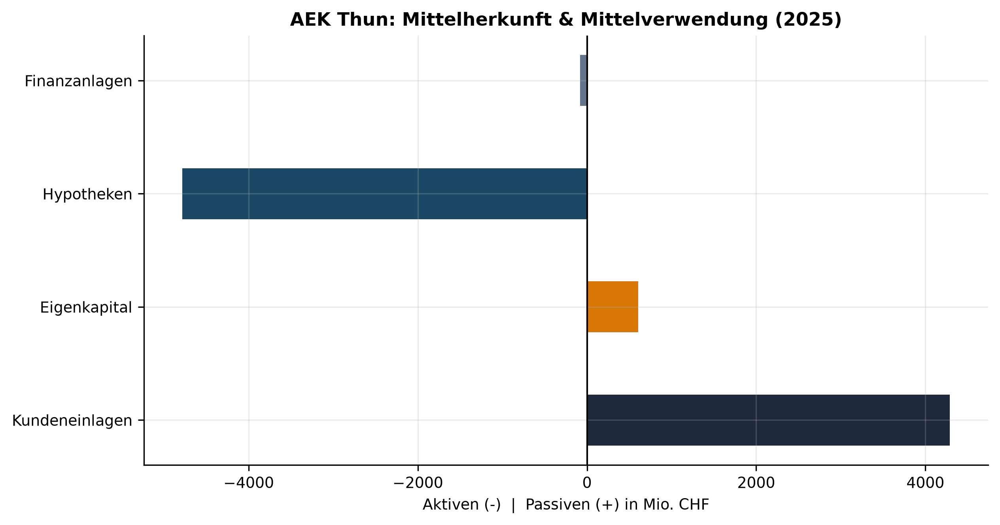
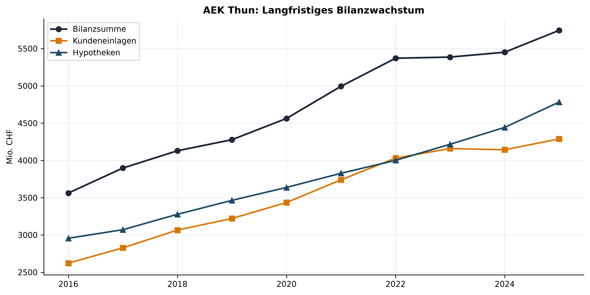

# 02 · Bilanzwachstum, Hypotheken & Refinanzierung (2016–2025): AEK BANK 1826 Genossenschaft

## 1. Management Summary
- Die Bilanzsumme wuchs von **3'562,2 Mio. CHF** (2016) auf **5'744,1 Mio. CHF** (2025, CAGR **5,45 %**).
- Die Hypothekarforderungen machen im Jahr 2025 **83,3 %** der Bilanzsumme aus.
- Die Kundeneinlagen belaufen sich 2025 auf **4'288,7 Mio. CHF**, das Eigenkapital auf **606,1 Mio. CHF** (Eigenkapitalquote **10,55 %**).

## 2. Quantitative Entwicklung
| Jahr | Bilanzsumme | Hypotheken | Finanzanlagen | Kundeneinlagen | Eigenkapital | Deckungsgrad |
| --- | --- | --- | --- | --- | --- | --- |
| 2016 | 3'562,2 | 2'956,2 | 114,9 | 2'622,2 | – | 81,4 % |
| 2017 | 3'897,7 | 3'070,8 | 99,3 | 2'827,1 | – | 83,8 % |
| 2018 | 4'129,3 | 3'277,4 | 75,2 | 3'065,9 | – | 86,4 % |
| 2019 | 4'278,0 | 3'464,2 | 61,3 | 3'221,1 | – | 86,7 % |
| 2020 | 4'562,6 | 3'637,8 | 67,3 | 3'435,4 | – | 88,5 % |
| 2021 | 4'993,9 | 3'827,8 | 57,0 | 3'739,5 | – | 91,1 % |
| 2022 | 5'370,1 | 4'000,4 | 73,1 | 4'031,1 | – | 93,8 % |
| 2023 | 5'385,7 | 4'216,7 | 82,1 | 4'159,3 | – | 93,4 % |
| 2024 | 5'450,8 | 4'442,7 | 90,2 | 4'142,7 | 636,9 | 88,0 % |
| 2025 | 5'744,1 | 4'783,3 | 82,2 | 4'288,7 | 606,1 | 85,4 % |

## 3. Treiberanalyse & Wendepunkte
- **2025:** Inkrafttreten Basel III final per 01.01.2025

## 4. Fazit & Ausblick
- Refinanzierungsbasis und Bilanzstruktur bleiben eng an Kundeneinlagen und die jeweilige Geschäftsmodell-Spezialisierung gekoppelt.
