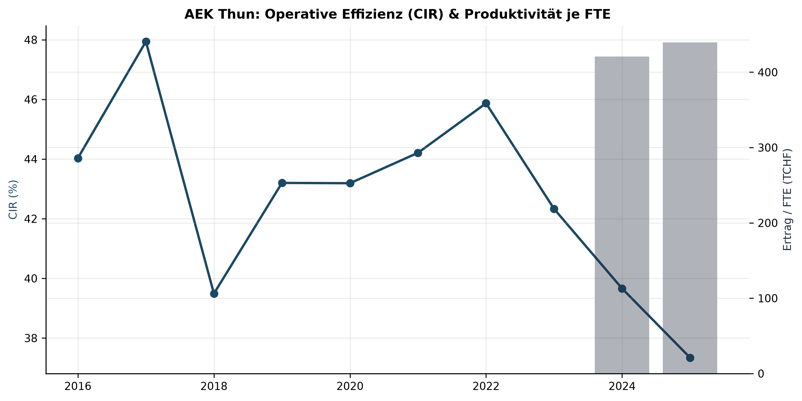

# 04 · Operative Effizienz & Transformation (2016–2025): AEK BANK 1826 Genossenschaft

## 1. Management Summary
- Die Cost-Income-Ratio (CIR) liegt im Jahr 2025 bei **37,34 %** (vs. 44,03 % im Jahr 2016), die Eigenkapitalrendite (ROE) bei **1,70 %**.
- Der Personalbestand umfasst 2025 **166,0 FTE** bei einem Ertrag pro Vollzeitstelle von **439,7 TCHF** und einem **Lohnkosten-/Produktivitätsverhältnis von 22,9 %** (bzw. **4,36×** Ertrag je CHF Personalaufwand).

## 2. Quantitative Entwicklung
| Jahr | CIR % | ROE % | FTE | Ertrag/FTE (TCHF) | Lohn/FTE (TCHF) | Lohn/Ertrag % | Ertrag/Lohn | Bilanz/FTE (Mio.) |
| --- | --- | --- | --- | --- | --- | --- | --- | --- |
| 2016 | 44,03 % | – % | – | – | – | – % | –× | – |
| 2017 | 47,94 % | – % | – | – | – | – % | –× | – |
| 2018 | 39,49 % | – % | – | – | – | – % | –× | – |
| 2019 | 43,20 % | – % | – | – | – | – % | –× | – |
| 2020 | 43,19 % | – % | – | – | – | – % | –× | – |
| 2021 | 44,21 % | – % | – | – | – | – % | –× | – |
| 2022 | 45,87 % | – % | – | – | – | – % | –× | – |
| 2023 | 42,33 % | – % | – | – | – | – % | –× | – |
| 2024 | 39,66 % | 1,60 % | 159,0 | 420,8 | 100,5 | 23,9 % | 4,19× | 34,28 |
| 2025 | 37,34 % | 1,70 % | 166,0 | 439,7 | 100,8 | 22,9 % | 4,36× | 34,60 |

## 3. Treiberanalyse & Wendepunkte
- **2025:** Inkrafttreten Basel III final per 01.01.2025

## 4. Fazit & Ausblick
- Digitalisierung und Skalierung steigern Bilanzsumme und Geschäftsvolumen pro Vollzeitstelle langfristig.
