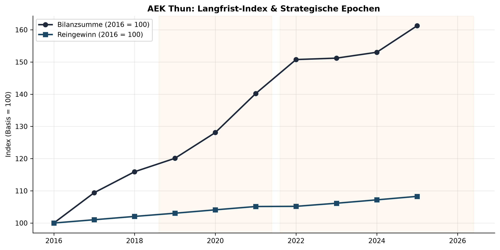
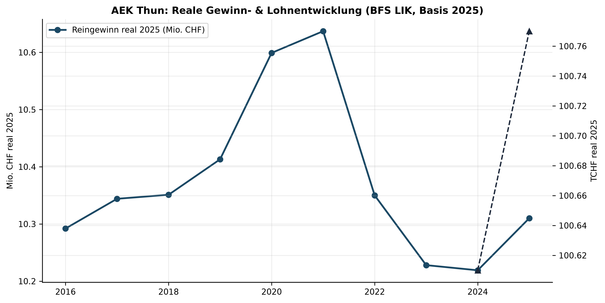

# 07 · Strategische Epochen, Governance, reale Vergütung & Vorsorge (2016–2025): AEK BANK 1826 Genossenschaft

> **Preisbasis:** Sämtliche Realgrössen sind mit dem offiziellen **BFS Landesindex der Konsumentenpreise (LIK, Dez. 1982 = 100)** deterministisch auf **reale CHF 2025** deflationiert.

## 1. Management Summary & Strategische Epochen
- **Epoche 1 (2019–2021):** SNB-Negativzinsen & Berner Oberland
- **Epoche 2 (2022–2026):** Zinswende & Basel III final

## 2. Reale Gewinn-, Lohn- & Vergütungsentwicklung (real 2025 CHF)
| Jahr | Gewinn nom. | Gewinn real 2025 | Lohn/FTE real (TCHF) | VR real (TCHF) | CEO real (TCHF) | GL real (TCHF) |
| --- | --- | --- | --- | --- | --- | --- |
| 2016 | 9,5 | 10,3 | – | – | – | – |
| 2017 | 9,6 | 10,3 | – | – | – | – |
| 2018 | 9,7 | 10,4 | – | – | – | – |
| 2019 | 9,8 | 10,4 | – | – | – | – |
| 2020 | 9,9 | 10,6 | – | – | – | – |
| 2021 | 10,0 | 10,6 | – | – | – | – |
| 2022 | 10,0 | 10,3 | – | – | – | – |
| 2023 | 10,1 | 10,2 | – | – | – | – |
| 2024 | 10,2 | 10,2 | 100,6 | – | – | – |
| 2025 | 10,3 | 10,3 | 100,8 | – | – | – |

## 3. Arbeitgeber-Attraktivität & Vorsorgeeinrichtung (Pensionskasse)
- **Vorsorgeeinrichtung:** Pensionskasse der AEK BANK 1826 (*Beitragsprimat (eigene rechtlich selbständige PK)*, Basis: `Swiss GAAP FER 16 / ARB`)
- **Versichertenstruktur:** Aktive **–**, Rentner **–** (Verhältnis Aktive/Rentner: **–**)
- **Deckungsgrad (BVG) / Reserven:** Deckungsgrad **110,0 %**, Arbeitgeberbeitragsreserve **2,2 Mio. CHF**, Sondereinlagen **0,6 Mio. CHF**
- **CEO-zu-Mitarbeitenden-Pay-Ratio (2025):** **–×** (CEO real 2025: – TCHF vs. Ø Personalaufwand/FTE: 100,8 TCHF)
- **Quelle:** `aek/.md/aek-geschaeftsbericht-2025-anhang.md (Anhang Vorsorgeeinrichtungen)` — Deckungsgrad per Ende Vorjahr (2024) 110,0 % (Sollwert Schwankungsreserve noch nicht erreicht); AGBR CHF 2,200 Mio. (2025 mit 3,25 % verzinst); Zuweisung an PK CHF 0,600 Mio.

## 4. Treiberanalyse, Strukturbrüche & Ausblick
- **2025:** Inkrafttreten Basel III final per 01.01.2025
- Die gemeinsame Inflationsbereinigung auf `real 2025 CHF` ermöglicht den unverzerrten Vergleich von Produktivität, Reallöhnen, Pay Ratio und Pensionskassen-Resilienz im Branchenvergleich (`comparison/reports/07_mitarbeiter_und_vorsorge_branchenvergleich.md`).
