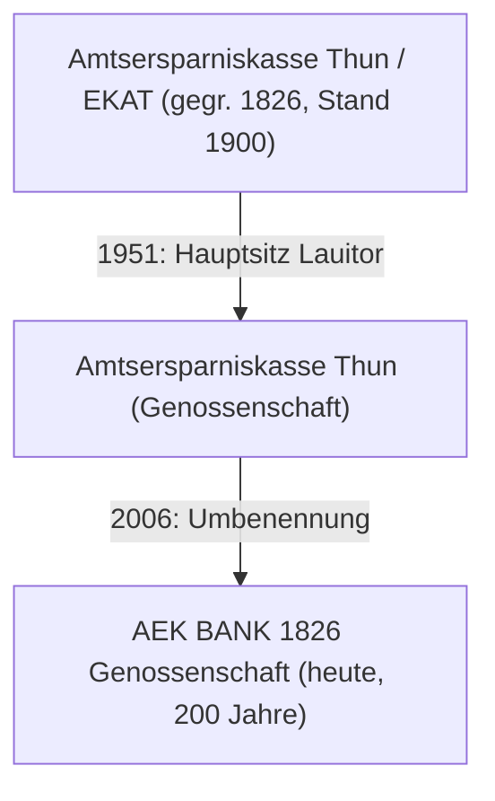

# 10 · Fusionsbaum & Institutsgeschichte seit 1900: AEK BANK 1826 Genossenschaft

> **Gründung / Ursprung:** 1826 (Ersparniskasse des Amtes Thun / Amtsersparniskasse Thun → 2006 AEK BANK 1826) | **Aktuelle Rechtsform:** `cooperative` | **FINMA-Kategorie:** 4

## 1. Überblick der Institutslinie (1900–2026)
Die AEK BANK 1826 wurde 1826 als «Ersparniskasse des Amtes Thun» (EKAT) gegründet und führte ab Ende des 19. Jahrhunderts den Namen «Amtsersparniskasse Thun». Seit 1900 wuchs die Genossenschaftsbank ohne Fusionen organisch im Raum Thun/Berner Oberland und heisst seit 2006 offiziell AEK BANK 1826.

## 2. Fusionsbaum (Mermaid-Diagramm seit 1900)

## 3. Chronologische Meilensteine (Fusionen, Übernahmen & Rechtsformwechsel)
| Jahr / Zeitraum | Institut / Ereignis | Typ | Bedeutung & Auswirkung |
| --- | --- | --- | --- |
| 1826 / 1900 | Amtsersparniskasse Thun (ehem. Ersparniskasse des Amtes Thun) | Ausgangslage 1900 | Selbsttragende Genossenschaftsbank (Statuten 1889); 1908 unter Top-10-Banken im Kanton Bern |
| 1951 | Neubau Hauptsitz am Thuner Lauitor | Infrastruktur | Zentraler Standort für die Expansion im Berner Oberland |
| 2006–2026 | Umbenennung in AEK BANK 1826 & 200-Jahr-Jubiläum | Rebranding | Organisches Wachstum auf >5,7 Mrd. CHF Bilanzsumme und 14 Niederlassungen |

- **Quellenbasis:** `AEK BANK 1826 Chronik (aekbank.ch/200/Geschichte); Geschäftsberichte (2016–2025)`
