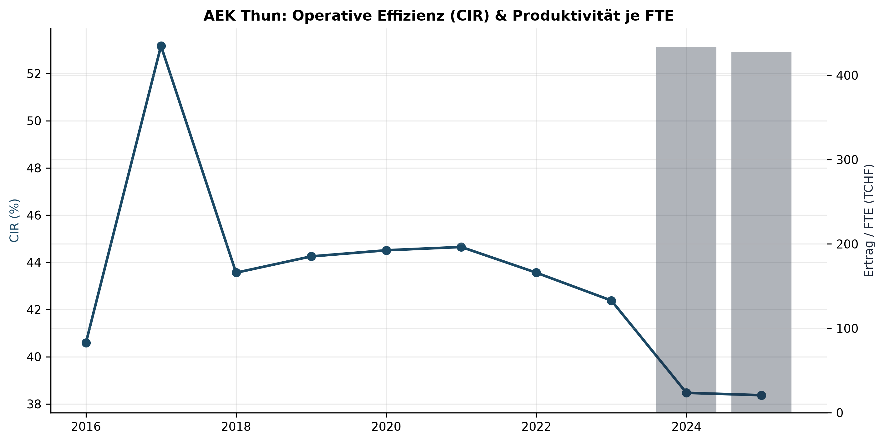

# 04 · Operative Effizienz & Transformation (2016–2025): AEK BANK 1826 Genossenschaft

## 1. Management Summary
- Die Cost-Income-Ratio (CIR) liegt im Jahr 2025 bei **38,37 %** (vs. 40,59 % im Jahr 2016), die Eigenkapitalrendite (ROE) bei **1,70 %**.
- Der Personalbestand umfasst 2025 **166,0 FTE** bei einem Ertrag pro Vollzeitstelle von **427,9 TCHF** und einem **Lohnkosten-/Produktivitätsverhältnis von 23,5 %** (bzw. **4,25×** Ertrag je CHF Personalaufwand).
- **Personalfluktuation:** Im Geschäftsbericht wird keine quantitative Personalfluktuationsquote ausgewiesen.

## 2. Quantitative Entwicklung
| Jahr | CIR % | ROE % | FTE | Fluktuation % | Ertrag/FTE (TCHF) | Lohn/FTE (TCHF) | Lohn/Ertrag % | Ertrag/Lohn | Bilanz/FTE (Mio.) |
| --- | --- | --- | --- | --- | --- | --- | --- | --- | --- |
| 2016 | 40,59 % | 8,16 % | – | – | – | – | – % | –× | – |
| 2017 | 53,17 % | 3,63 % | – | – | – | – | – % | –× | – |
| 2018 | 43,56 % | 3,55 % | – | – | – | – | – % | –× | – |
| 2019 | 44,25 % | 3,47 % | – | – | – | – | – % | –× | – |
| 2020 | 44,51 % | 3,40 % | – | – | – | – | – % | –× | – |
| 2021 | 44,65 % | 3,33 % | – | – | – | – | – % | –× | – |
| 2022 | 43,56 % | 3,24 % | – | – | – | – | – % | –× | – |
| 2023 | 42,38 % | 3,17 % | – | – | – | – | – % | –× | – |
| 2024 | 38,47 % | 1,60 % | 159,0 | – | 433,8 | 100,5 | 23,2 % | 4,32× | 34,28 |
| 2025 | 38,37 % | 1,70 % | 166,0 | – | 427,9 | 100,8 | 23,5 % | 4,25× | 34,60 |

## 3. Treiberanalyse & Wendepunkte
- **2025:** Inkrafttreten Basel III final per 01.01.2025

## 4. Fazit & Ausblick
- Digitalisierung und Skalierung steigern Bilanzsumme und Geschäftsvolumen pro Vollzeitstelle langfristig.
