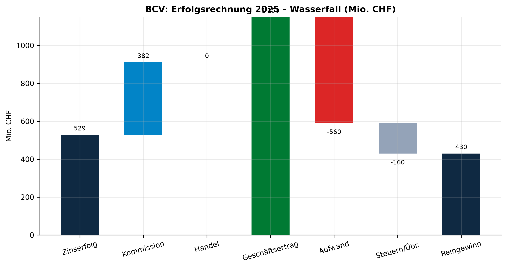
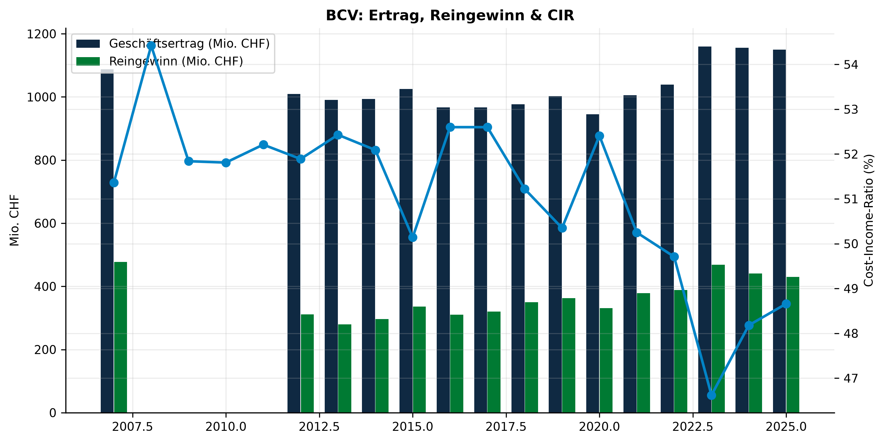

# 01 · Zinszyklen & Ertragsarchitektur (2007–2025): Banque Cantonale Vaudoise

> **Scope:** `consolidated` | **Standard:** `ARB_RVB` | **Währung:** Mio. CHF (harmonisierte Zeitreihe)

## 1. Management Summary
- Im Zeitraum **2007–2025** entwickelte sich der Geschäftsertrag von **1'087,5 Mio. CHF** auf **1'149,9 Mio. CHF** (CAGR **0,31 % p. a.**).
- Der Reingewinn erreichte im jüngsten Geschäftsjahr 2025 **430,0 Mio. CHF** (nach 477,3 Mio. CHF im Jahr 2007).
- Der Netto-Zinserfolg trägt aktuell **46,0 %** zum Gesamtertrag bei, das Kommissionsgeschäft **33,2 %** und das Handelsgeschäft **– %**.

## 2. Quantitative Entwicklung
| Jahr | Zinserfolg (Mio.) | Kommission (Mio.) | Handel (Mio.) | Geschäftsertrag | Geschäftserfolg | Reingewinn | Zinsanteil |
| --- | --- | --- | --- | --- | --- | --- | --- |
| 2007 | 505,0 | 384,8 | 73,5 | 1'087,5 | 529,0 | 477,3 | 46,4 % |
| 2008 | 0,5 | 0,3 | 0,0 | 0,9 | 0,4 | 0,4 | 54,3 % |
| 2009 | 0,5 | 0,3 | 0,1 | 1,0 | 0,5 | 0,3 | 52,0 % |
| 2010 | 0,5 | 0,4 | 0,1 | 1,0 | 0,5 | 0,3 | 51,3 % |
| 2011 | 0,5 | 0,4 | 0,1 | 1,0 | 0,5 | 0,3 | 50,7 % |
| 2012 | 519,3 | 347,0 | 113,1 | 1'009,8 | 485,8 | 311,0 | 51,4 % |
| 2013 | 501,5 | 341,3 | 112,8 | 990,6 | 471,2 | 280,0 | 50,6 % |
| 2014 | 503,8 | 343,4 | 106,4 | 993,2 | 475,8 | 296,0 | 50,7 % |
| 2015 | 489,2 | 332,3 | – | 1'025,6 | 398,7 | 336,0 | 47,7 % |
| 2016 | 482,5 | 307,9 | – | 967,1 | 383,4 | 310,0 | 49,9 % |
| 2017 | 497,8 | 316,4 | – | 966,6 | 386,5 | 320,0 | 51,5 % |
| 2018 | 496,1 | 317,2 | – | 976,5 | 402,9 | 350,0 | 50,8 % |
| 2019 | 496,9 | 322,9 | – | 1'002,0 | 418,9 | 363,0 | 49,6 % |
| 2020 | 474,4 | 310,2 | – | 945,2 | 372,7 | 331,0 | 50,2 % |
| 2021 | 472,6 | 357,3 | – | 1'005,4 | 428,8 | 379,0 | 47,0 % |
| 2022 | 461,7 | – | 188,7 | 1'039,4 | 447,7 | 388,0 | 44,4 % |
| 2023 | 596,7 | – | – | 1'160,0 | 541,5 | 469,0 | 51,4 % |
| 2024 | 555,0 | – | – | 1'155,5 | 515,0 | 441,0 | 48,0 % |
| 2025 | 528,9 | 382,0 | – | 1'149,9 | 502,8 | 430,0 | 46,0 % |

## 3. Treiberanalyse & Wendepunkte
- **2015:** Umstellung auf FINMA-RVB
- **2020:** Aktiensplit 1:10 (28.05.2020)
- **2025:** Basel III final & IRB Output Floor

## 4. Fazit & Ausblick
- Die Ertragsarchitektur von BCV spiegelt die Zinszyklen (Negativzinsphase 2015–2022, Zinswende 2022–2024, Zinssenkungen ab 2025) unmittelbar wider.
