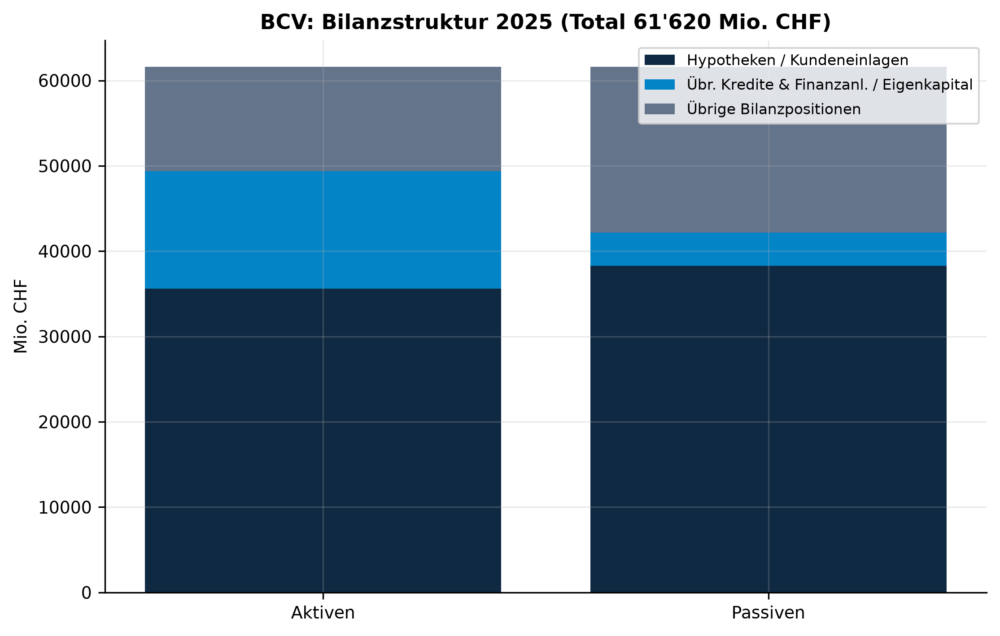
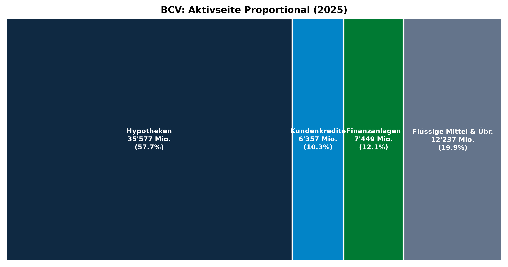
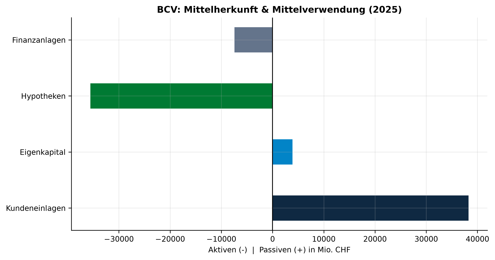
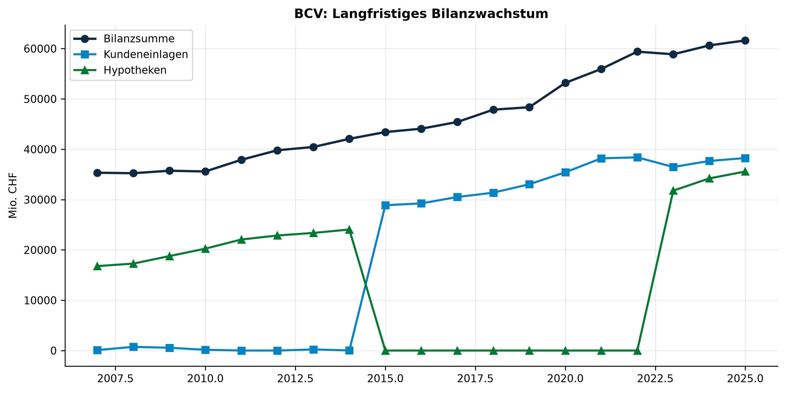

# 02 · Bilanzwachstum, Hypotheken & Refinanzierung (2007–2025): Banque Cantonale Vaudoise

## 1. Management Summary
- Die Bilanzsumme wuchs von **35'336,9 Mio. CHF** (2007) auf **61'620,0 Mio. CHF** (2025, CAGR **3,14 %**).
- Die Hypothekarforderungen machen im Jahr 2025 **57,7 %** der Bilanzsumme aus.
- Die Kundeneinlagen belaufen sich 2025 auf **38'257,0 Mio. CHF**, das Eigenkapital auf **3'909,0 Mio. CHF** (Eigenkapitalquote **6,34 %**).

## 2. Quantitative Entwicklung
| Jahr | Bilanzsumme | Hypotheken | Finanzanlagen | Kundeneinlagen | Eigenkapital | Deckungsgrad |
| --- | --- | --- | --- | --- | --- | --- |
| 2007 | 35'336,9 | 16'788,2 | 1'589,1 | 106,4 | 3'225,1 | 0,5 % |
| 2008 | 35'238,5 | 17'283,0 | 1'552,0 | 736,2 | 3'176,9 | 3,2 % |
| 2009 | 35'733,0 | 18'770,2 | 2'870,3 | 561,3 | 3'221,8 | 2,3 % |
| 2010 | 35'584,7 | 20'254,2 | 2'879,0 | 158,3 | 3'270,8 | 0,6 % |
| 2011 | 37'903,0 | 22'071,0 | 2'975,0 | 13,1 | 3'301,0 | 0,1 % |
| 2012 | 39'800,0 | 22'864,0 | 3'101,0 | 1,0 | 3'315,0 | 0,0 % |
| 2013 | 40'454,0 | 23'375,0 | 3'146,0 | 228,0 | 3'322,0 | 0,8 % |
| 2014 | 42'068,0 | 24'055,0 | 3'259,0 | 26,0 | 3'341,0 | 0,1 % |
| 2015 | 43'418,0 | 10,2 | 3'140,0 | 28'877,0 | – | 141'553,9 % |
| 2016 | 44'085,0 | 10,2 | 3'234,0 | 29'245,0 | – | 143'357,8 % |
| 2017 | 45'415,0 | 10,2 | 3'753,0 | 30'512,0 | 3'457,0 | 149'568,6 % |
| 2018 | 47'863,0 | 10,2 | 3'767,0 | 31'375,0 | 3'522,0 | 153'799,0 % |
| 2019 | 48'352,0 | 10,2 | 3'811,0 | 33'048,0 | 3'586,0 | 162'000,0 % |
| 2020 | 53'186,0 | 10,2 | 4'084,0 | 35'424,0 | 3'574,0 | 173'647,1 % |
| 2021 | 55'952,0 | 10,2 | 4'287,0 | 38'195,0 | 3'644,0 | 187'230,4 % |
| 2022 | 59'397,0 | 10,2 | 5'757,0 | 38'395,0 | 3'713,0 | 188'210,8 % |
| 2023 | 58'870,0 | 31'780,0 | 5'196,0 | 36'475,0 | – | 96,2 % |
| 2024 | 60'629,0 | 34'207,0 | 6'065,0 | 37'672,0 | – | 93,8 % |
| 2025 | 61'620,0 | 35'577,0 | 7'449,0 | 38'257,0 | 3'909,0 | 91,2 % |

## 3. Treiberanalyse & Wendepunkte
- **2015:** Umstellung auf FINMA-RVB
- **2020:** Aktiensplit 1:10 (28.05.2020)
- **2025:** Basel III final & IRB Output Floor

## 4. Fazit & Ausblick
- Refinanzierungsbasis und Bilanzstruktur bleiben eng an Kundeneinlagen und die jeweilige Geschäftsmodell-Spezialisierung gekoppelt.
