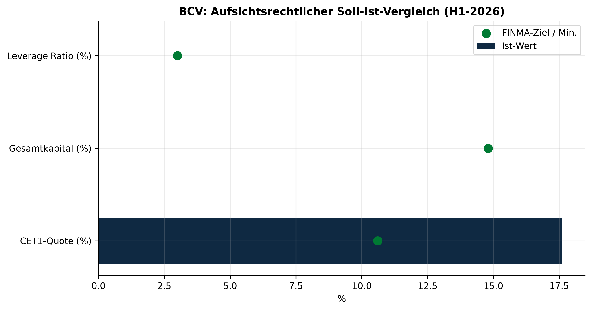
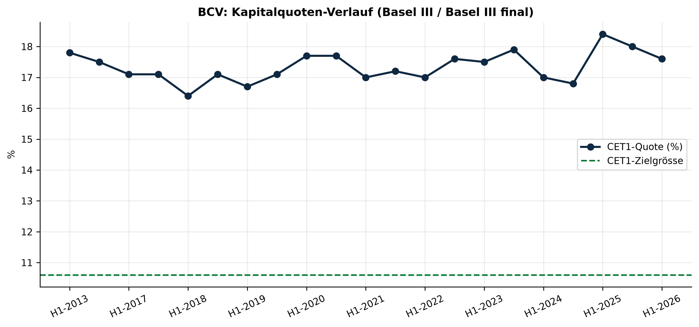

# 03 · Aufsichtsrechtliche Resilienz & Basel III: Banque Cantonale Vaudoise

> **FINMA-Kategorie:** Kategorie 3 | **CET1-Zielgrösse:** 10,60 % | **Gesamtkapital-Ziel:** 14,80 %

## 1. Management Summary
- Am jüngsten Offenlegungsstichtag (**H1-2026**, Regime: *Basel III final*) beträgt die **CET1-Quote 17,60 %** (Puffer über Ziel: **7,00 Prozentpunkte**).
- Die Gesamtkapitalquote liegt bei **– %**, die Leverage Ratio bei **– %**.
- Liquiditätsquoten: LCR **– %**, NSFR **– %** (Mindestanforderung je 100 %).

## 2. Quantitative Entwicklung (35 Stichtage)
| Periode | Regime | RWA (Mio.) | CET1 (Mio.) | CET1 % | Gesamtkap. % | Leverage % | LCR % | NSFR % |
| --- | --- | --- | --- | --- | --- | --- | --- | --- |
| H1-2009 | Basel III | – | – | – % | – % | – % | – % | – % |
| FY2009 | Basel III | – | – | – % | – % | – % | – % | – % |
| H1-2010 | Basel III | – | – | – % | – % | – % | – % | – % |
| FY2010 | Basel III | – | – | – % | – % | – % | – % | – % |
| H1-2011 | Basel III | – | – | – % | – % | – % | – % | – % |
| FY2011 | Basel III | – | – | – % | – % | – % | – % | – % |
| H1-2012 | Basel III | – | – | – % | – % | – % | – % | – % |
| FY2012 | Basel III | – | – | – % | – % | – % | – % | – % |
| H1-2013 | Basel III | – | 2,9 | 17,80 % | – % | – % | – % | – % |
| FY2013 | Basel III | – | 2,9 | – % | – % | – % | – % | – % |
| H1-2014 | Basel III | – | 2,9 | – % | – % | – % | – % | – % |
| FY2014 | Basel III | – | 2,9 | – % | – % | – % | – % | – % |
| H1-2015 | Basel III | – | 2,9 | – % | – % | – % | – % | – % |
| FY2015 | Basel III | – | 3,1 | – % | – % | – % | – % | – % |
| H1-2016 | Basel III | – | 3,1 | – % | – % | – % | – % | – % |
| FY2016 | Basel III | – | 3,1 | 17,50 % | – % | – % | – % | – % |
| H1-2017 | Basel III | – | 3,2 | 17,10 % | – % | – % | – % | – % |
| FY2017 | Basel III | 18,2 | 3,1 | 17,10 % | – % | 6,50 % | – % | – % |
| H1-2018 | Basel III | 18,9 | 3,1 | 16,40 % | – % | 6,40 % | – % | – % |
| FY2018 | Basel III | 18,4 | 3,2 | 17,10 % | – % | 6,20 % | – % | – % |
| H1-2019 | Basel III | 18,9 | 3,2 | 16,70 % | – % | 6,30 % | – % | – % |
| FY2019 | Basel III | 18,8 | 3,3 | 17,10 % | – % | 6,30 % | – % | – % |
| H1-2020 | Basel III | 18,1 | 3,3 | 17,70 % | – % | 6,10 % | – % | – % |
| FY2020 | Basel III | – | 3,3 | 17,70 % | – % | 5,80 % | – % | – % |
| H1-2021 | Basel III | 19,2 | 3,3 | 17,00 % | – % | 5,60 % | – % | – % |
| FY2021 | Basel III | – | 3,3 | 17,20 % | – % | 5,60 % | – % | – % |
| H1-2022 | Basel III | – | 3,3 | 17,00 % | – % | 5,40 % | – % | – % |
| FY2022 | Basel III | – | 3,4 | 17,60 % | – % | 5,50 % | – % | – % |
| H1-2023 | Basel III | – | 3,4 | 17,50 % | – % | 5,50 % | – % | – % |
| FY2023 | Basel III | 19,4 | 3,5 | 17,90 % | – % | 5,60 % | – % | – % |
| H1-2024 | Basel III | – | 3,5 | 17,00 % | – % | 5,40 % | – % | – % |
| FY2024 | Basel III | – | 3,6 | 16,80 % | – % | 5,50 % | – % | – % |
| H1-2025 | Basel III final | – | – | 18,40 % | – % | – % | – % | – % |
| FY2025 | Basel III final | – | – | 18,00 % | – % | – % | – % | – % |
| H1-2026 | Basel III final | – | – | 17,60 % | – % | – % | – % | – % |

## 3. Treiberanalyse & Wendepunkte
- Mit Inkrafttreten von **Basel III final** ab 01.01.2025 verändern sich risikogewichtete Aktiven (RWA) und RWA-Dichte durch angepasste Standard- bzw. Output-Floor-Vorgaben.

## 4. Fazit & Ausblick
- Die Eigenmittel- und Liquiditätspuffer übertreffen die regulatorischen Mindestanforderungen für FINMA-Kategorie 3 deutlich.
