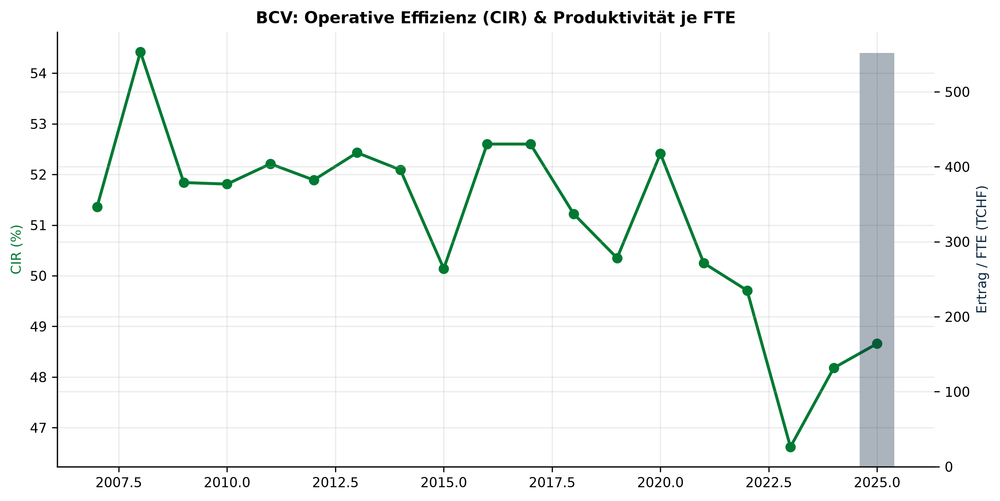

# 04 · Operative Effizienz & Transformation (2007–2025): Banque Cantonale Vaudoise

## 1. Management Summary
- Die Cost-Income-Ratio (CIR) liegt im Jahr 2025 bei **48,66 %** (vs. 51,36 % im Jahr 2007), die Eigenkapitalrendite (ROE) bei **11,00 %**.
- Der Personalbestand umfasst 2025 **2'083,0 FTE** bei einem Ertrag pro Vollzeitstelle von **552,0 TCHF** und einem **Lohnkosten-/Produktivitätsverhältnis von 34,2 %** (bzw. **2,92×** Ertrag je CHF Personalaufwand).

## 2. Quantitative Entwicklung
| Jahr | CIR % | ROE % | FTE | Ertrag/FTE (TCHF) | Lohn/FTE (TCHF) | Lohn/Ertrag % | Ertrag/Lohn | Bilanz/FTE (Mio.) |
| --- | --- | --- | --- | --- | --- | --- | --- | --- |
| 2007 | 51,36 % | 14,80 % | – | – | – | – % | –× | – |
| 2008 | 54,42 % | 0,01 % | – | – | – | – % | –× | – |
| 2009 | 51,84 % | 0,01 % | – | – | – | – % | –× | – |
| 2010 | 51,81 % | 0,01 % | – | – | – | – % | –× | – |
| 2011 | 52,21 % | 0,01 % | – | – | – | – % | –× | – |
| 2012 | 51,89 % | 9,38 % | – | – | – | – % | –× | – |
| 2013 | 52,43 % | 8,43 % | – | – | – | – % | –× | – |
| 2014 | 52,09 % | 8,86 % | – | – | – | – % | –× | – |
| 2015 | 50,14 % | – % | – | – | – | – % | –× | – |
| 2016 | 52,60 % | – % | – | – | – | – % | –× | – |
| 2017 | 52,60 % | 9,26 % | – | – | – | – % | –× | – |
| 2018 | 51,22 % | 9,94 % | – | – | – | – % | –× | – |
| 2019 | 50,35 % | 10,12 % | – | – | – | – % | –× | – |
| 2020 | 52,41 % | 9,26 % | – | – | – | – % | –× | – |
| 2021 | 50,25 % | 10,40 % | – | – | – | – % | –× | – |
| 2022 | 49,71 % | 10,45 % | – | – | – | – % | –× | – |
| 2023 | 46,62 % | – % | – | – | – | – % | –× | – |
| 2024 | 48,18 % | – % | – | – | – | – % | –× | – |
| 2025 | 48,66 % | 11,00 % | 2'083,0 | 552,0 | 188,8 | 34,2 % | 2,92× | 29,58 |

## 3. Treiberanalyse & Wendepunkte
- **2015:** Umstellung auf FINMA-RVB
- **2020:** Aktiensplit 1:10 (28.05.2020)
- **2025:** Basel III final & IRB Output Floor

## 4. Fazit & Ausblick
- Digitalisierung und Skalierung steigern Bilanzsumme und Geschäftsvolumen pro Vollzeitstelle langfristig.
