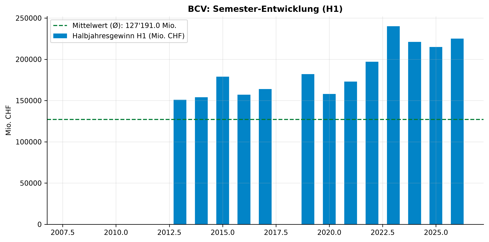

# 06 · Unterjährige Dynamik (Semesterberichte): Banque Cantonale Vaudoise

## 1. Management Summary
- Vorliegen von **19 Halbjahresabschlüssen**; jüngster Stichtag ist **H1-2026** mit einem Geschäftsertrag von **0,6 Mio. CHF** und einem Halbjahresgewinn von **225'000,0 Mio. CHF**.

## 2. Quantitative Entwicklung
| Periode | Bilanzsumme | Zinserfolg H1 | Geschäftsertrag H1 | Geschäftserfolg H1 | Reingewinn H1 |
| --- | --- | --- | --- | --- | --- |
| H1-2008 | 34'084,8 | 256,7 | 420,0 | 166,0 | 192,3 |
| H1-2009 | 36'109,4 | 252,8 | 478,8 | 227,8 | 136,4 |
| H1-2010 | 36'740,9 | 258,0 | 503,0 | 243,8 | 145,7 |
| H1-2011 | 37'555,4 | 254,6 | 503,1 | 233,8 | 154,3 |
| H1-2012 | 39,8 | 0,3 | 0,5 | 0,2 | 0,2 |
| H1-2013 | 40'388'000,0 | 0,2 | 0,5 | 0,2 | 151'000,0 |
| H1-2014 | 41'240'000,0 | 0,3 | 0,5 | 0,2 | 154'000,0 |
| H1-2015 | 43'353'000,0 | 0,2 | 0,5 | 0,3 | 179'000,0 |
| H1-2016 | 44'747'000,0 | 0,2 | 0,5 | 11'100,0 | 157'000,0 |
| H1-2017 | 45'079'000,0 | 0,3 | 0,5 | 11'900,0 | 164'000,0 |
| H1-2018 | 45,9 | 0,2 | 0,5 | 0,0 | 0,2 |
| H1-2019 | 47'135'000,0 | 0,3 | 0,5 | 15'700,0 | 182'000,0 |
| H1-2020 | 50'268'000,0 | 0,2 | 0,5 | 15'100,0 | 158'000,0 |
| H1-2021 | 55'564'000,0 | 0,2 | 0,5 | 19'400,0 | 173'000,0 |
| H1-2022 | 59'053'000,0 | 0,2 | 0,5 | 23'500,0 | 197'000,0 |
| H1-2023 | 58'936'000,0 | 0,3 | 0,6 | 35'900,0 | 240'000,0 |
| H1-2024 | 60'538'000,0 | 0,3 | 0,6 | 46'200,0 | 221'000,0 |
| H1-2025 | 61'219'000,0 | 0,3 | 0,6 | 71'600,0 | 215'000,0 |
| H1-2026 | 63'342'000,0 | 0,3 | 0,6 | 60'600,0 | 225'000,0 |

## 3. Treiberanalyse & Wendepunkte
- Der Vergleich von H1-Werten gegen die jeweiligen Gesamtjahresergebnisse (FY) zeigt die saisonale Ertragsverteilung und Reservebildung im zweiten Halbjahr.

## 4. Fazit & Ausblick
- Die Halbjahresberichte ermöglichen ein zeitnahes Monitoring der Zinsmargen- und Kreditvolumen-Dynamik bis H1-2026.
