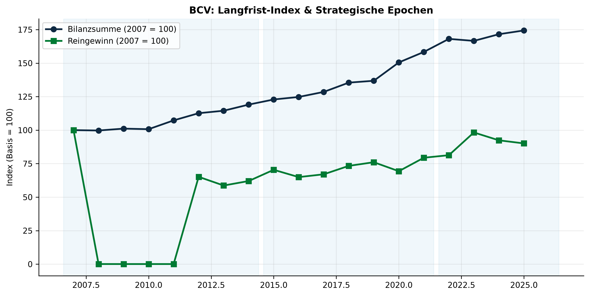
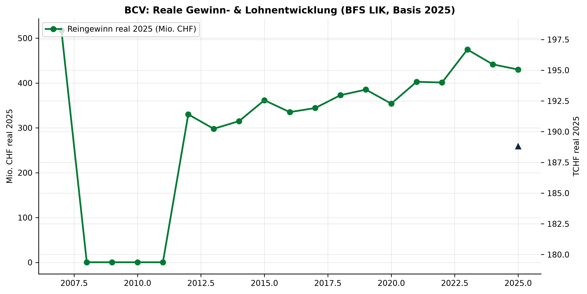

# 07 · Strategische Epochen, Governance, reale Vergütung & Vorsorge (2007–2025): Banque Cantonale Vaudoise

> **Preisbasis:** Sämtliche Realgrössen sind mit dem offiziellen **BFS Landesindex der Konsumentenpreise (LIK, Dez. 1982 = 100)** deterministisch auf **reale CHF 2025** deflationiert.

## 1. Management Summary & Strategische Epochen
- **Epoche 1 (2007–2014):** Post-Restrukturierung & Kapitalrückführung
- **Epoche 2 (2015–2021):** SNB-Negativzinsen, IRB & 1:10-Aktiensplit (2020)
- **Epoche 3 (2022–2026):** Zinswende & Basel III final Output Floor

## 2. Reale Gewinn-, Lohn- & Vergütungsentwicklung (real 2025 CHF)
| Jahr | Gewinn nom. | Gewinn real 2025 | Lohn/FTE real (TCHF) | VR real (TCHF) | CEO real (TCHF) | GL real (TCHF) |
| --- | --- | --- | --- | --- | --- | --- |
| 2007 | 477,3 | 517,6 | – | – | – | – |
| 2008 | 0,4 | 0,4 | – | – | – | – |
| 2009 | 0,3 | 0,3 | – | – | – | – |
| 2010 | 0,3 | 0,3 | – | – | – | – |
| 2011 | 0,3 | 0,3 | – | – | – | – |
| 2012 | 311,0 | 330,1 | – | – | – | – |
| 2013 | 280,0 | 297,9 | – | – | – | – |
| 2014 | 296,0 | 314,9 | – | – | – | – |
| 2015 | 336,0 | 361,6 | – | – | – | – |
| 2016 | 310,0 | 335,1 | – | – | – | – |
| 2017 | 320,0 | 344,1 | – | – | – | – |
| 2018 | 350,0 | 372,9 | – | – | – | – |
| 2019 | 363,0 | 385,2 | – | – | – | – |
| 2020 | 331,0 | 353,9 | – | – | – | – |
| 2021 | 379,0 | 402,7 | – | – | – | – |
| 2022 | 388,0 | 401,0 | – | – | – | – |
| 2023 | 469,0 | 474,6 | – | – | – | – |
| 2024 | 441,0 | 441,5 | – | – | – | – |
| 2025 | 430,0 | 430,0 | 188,8 | 1'380,0 | 1'620,0 | 7'850,0 |

## 3. Arbeitgeber-Attraktivität & Vorsorgeeinrichtung (Pensionskasse)
- **Vorsorgeeinrichtung:** Caisse de pensions de la Banque Cantonale Vaudoise (*Beitragsprimat (umhüllend / enveloppante)*, Basis: `Swiss GAAP FER 16 / ARB`)
- **Versichertenstruktur:** Aktive **2'210**, Rentner **1'479** (Verhältnis Aktive/Rentner: **1,49**)
- **Deckungsgrad (BVG) / Reserven:** Deckungsgrad **– %**, Arbeitgeberbeitragsreserve **0,0 Mio. CHF**, Sondereinlagen **0,0 Mio. CHF**
- **CEO-zu-Mitarbeitenden-Pay-Ratio (2025):** **8,6×** (CEO real 2025: 1'620,0 TCHF vs. Ø Personalaufwand/FTE: 188,8 TCHF)
- **Quelle:** `bcv/.md/bcv-geschaeftsbericht-2025.md (Annexe Institutions de prévoyance)` — Überdeckung per Ende 2025: 136,8 Mio. CHF (zuzüglich 62,6 Mio. CHF patronaler Fonds = 199,4 Mio. CHF); Arbeitgeberbeiträge 2025: 40,9 Mio. CHF (2024: 40,3 Mio. CHF).

## 4. Treiberanalyse, Strukturbrüche & Ausblick
- **2015:** Umstellung auf FINMA-RVB
- **2020:** Aktiensplit 1:10 (28.05.2020)
- **2025:** Basel III final & IRB Output Floor
- Die gemeinsame Inflationsbereinigung auf `real 2025 CHF` ermöglicht den unverzerrten Vergleich von Produktivität, Reallöhnen, Pay Ratio und Pensionskassen-Resilienz im Branchenvergleich (`comparison/reports/07_mitarbeiter_und_vorsorge_branchenvergleich.md`).
