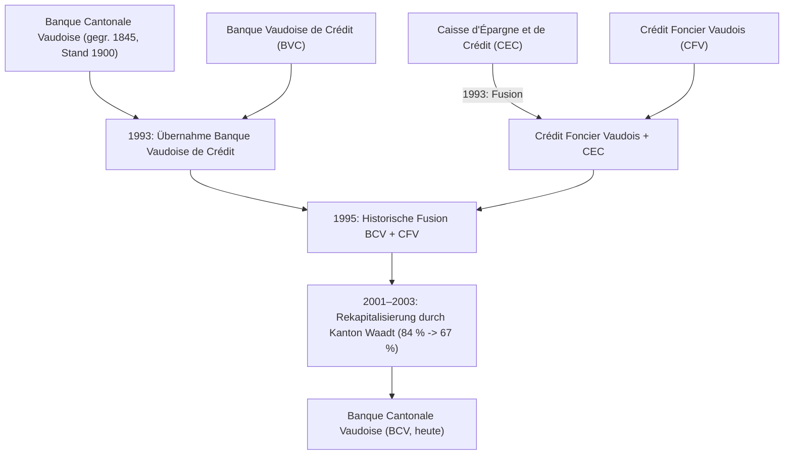

# 10 · Fusionsbaum & Institutsgeschichte seit 1900: Banque Cantonale Vaudoise

> **Gründung / Ursprung:** 1845 (Banque Cantonale Vaudoise) | **Aktuelle Rechtsform:** `listed_ag` | **FINMA-Kategorie:** 3

## 1. Überblick der Institutslinie (1900–2026)
Die Banque Cantonale Vaudoise (BCV, gegr. 1845) konsolidierte in den 1990er-Jahren den Waadtländer Bankenmarkt durch die Übernahme der Banque Vaudoise de Crédit (1993) und die historische Fusion mit dem Crédit Foncier Vaudois (1995), der zuvor 1993 mit der Caisse d'Épargne et de Crédit fusioniert hatte.

## 2. Fusionsbaum (Mermaid-Diagramm seit 1900)

## 3. Chronologische Meilensteine (Fusionen, Übernahmen & Rechtsformwechsel)
| Jahr / Zeitraum | Institut / Ereignis | Typ | Bedeutung & Auswirkung |
| --- | --- | --- | --- |
| 1845 / 1900 | Banque Cantonale Vaudoise (BCV) | Ausgangslage 1900 | Gegründet 1845 per Dekret; 1903 Bezug des Hauptsitzes Place Saint-François 14 |
| 1993 | Übernahme Banque Vaudoise de Crédit (BVC) | Akquisition | Integration der BVC in die BCV |
| 1993 | Fusion Crédit Foncier Vaudois (CFV) + Caisse d'Épargne et de Crédit (CEC) | Vorfusion | Konsolidierung der beiden Waadtländer Hypothekar- und Sparinstitute |
| 1995 | Fusion BCV + Crédit Foncier Vaudois (CFV) | Fusion | Zusammenschluss zur dominierenden Universalbank des Kantons Waadt |
| 2001–2003 | Rekapitalisierung & Bereinigung Handelsgeschäft | Restrukturierung | Kanton Waadt erhöht vorübergehend Beteiligung; Fokus auf Waadtländer Kernmarkt |

- **Quellenbasis:** `BCV Histoire (bcv.ch); Archives cantonales vaudoises`
