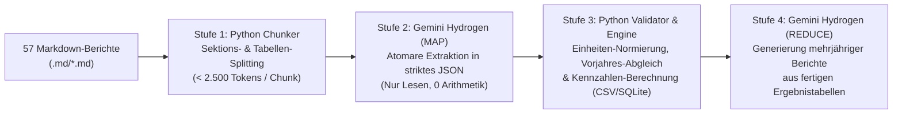

# Daten- und Analysestrategie: BEKB Geschäfts-, Semester- und Offenlegungsberichte (2003–2026)

> **Zielsetzung:** Strukturierte Extraktion, Normalisierung und mehrjährige Längsschnittanalyse über alle **57 BEKB-Berichte** (`.md/`), speziell optimiert für die zuverlässige Ausführung durch ein **kompaktes Sprachmodell (Gemini Hydrogen)**.

---

## 1. Datenbasis & Historische Besonderheiten (Domänen-Kontext)

Im Ordner `.md/` liegen **57 konvertierte Berichte** vor:
- **23 Geschäftsberichte (`2003`–`2025`)**: Vollständige Jahresberichte und Jahresrechnungen (ca. 300–470 KB pro Datei; Ausnahme: `2003`, `2006`, `2007` sind kompakte Kurzberichte mit ca. 30–48 KB).
- **14 Semesterberichte (`2013`–`2026`)**: Halbjahresabschlüsse per 30. Juni (ca. 12–46 KB pro Datei).
- **20 Offenlegungsberichte (`2015`–`2025` jährlich, `06-2018`–`06-2026` halbjährlich)**: Aufsichtsrechtliche Berichte nach FINMA-Rundschreiben / Basel III bzw. Basel III final (ca. 11–86 KB pro Datei).

### Kritische Datenbrüche & Fallstricke (wichtig für das Pre-Processing)
1. **Sprach- und Umfangsbrüche in den frühen Jahren (2003–2007):**
   - `bekb-geschaeftsbericht-2005.md` liegt auf **Französisch** vor (*Rapport et comptes annuels 2005*; Begriffe: *Total du bilan*, *Bénéfice brut*, *Créances hypothécaires*).
   - `bekb-geschaeftsbericht-2006.md` liegt auf **Englisch** als Kurzbericht vor (*The business year 2006 in brief*; Begriffe: *Balance sheet total*, *Annual net profit*, *Mortgage loans*).
   - `2003`, `2006` und `2007` sind Kurzfassungen. **Lösung:** Fehlende Detailpositionen der Jahre 2003, 2005, 2006 und 2007 werden automatisch über die **Vorjahresspalten** und **Mehrjahrestabellen** der Folgejahre (`2004`, `2008`, `2009`) rekonstruiert.
2. **Rechnungslegungswechsel (FINMA-RVB / ARB 2015):**
   - Ab Geschäftsjahr **2015** erfolgte die Umstellung auf die neuen Rechnungslegungsvorschriften für Banken (FINMA-RVB). Dabei wurde die zentrale Steuerungskennzahl **«Geschäftserfolg»** (statt *Bruttogewinn / Zwischenergebnis*) eingeführt und die Darstellung des Zinserfolgs (Brutto-Zinserfolg vs. Netto-Zinserfolg nach Wertberichtigungen) angepasst.
3. **Regulatorischer Wechsel (Basel III $\rightarrow$ Basel III final 2025):**
   - Ab `bekb-offenlegungsbericht-2025.md` und `06-2025.md` greift **Basel III final**, was die Berechnung der risikogewichteten Positionen (RWA) und die CET1-Quote strukturell beeinflusst.
4. **Einheiten-Heterogenität:**
   - In Fliesstexten und Kurzübersichten stehen Werte oft in **Mio. CHF** oder **Mrd. CHF**.
   - In den Tabellen der Jahresrechnung (Bilanz, Erfolgsrechnung, Anhang) und Offenlegungsberichte (KM1, OV1, CC1) stehen Beträge in **1'000 CHF (Tsd. CHF)**.

---

## 2. Architektur für ein einfacheres Modell («Gemini Hydrogen»)

Ein kleineres Modell wie **Gemini Hydrogen** hat typischerweise Einschränkungen bei:
1. **Grossen Kontextfenstern ("Lost in the Middle"):** Eine 450-KB-Markdown-Datei (~120.000 Tokens) überfordert die Aufmerksamkeit des Modells.
2. **Mehrschrittiger Arithmetik:** Gleichzeitiges Extrahieren, Einheiten-Umrechnen und Wachstumsraten-Berechnen führt zu Halluzinationen oder Rechenfehlern.
3. **Komplexen unstrukturierten Prompts:** Offene Fragen über mehrere Dokumente hinweg erzeugen unvollständige Antworten.

### Die 4-stufige «Hydrogen-First» Pipeline (Map-Validate-Reduce)



### Goldene Regeln für Gemini Hydrogen Prompts
1. **Ein Chunk = Eine Aufgabe = Ein JSON-Objekt:** Niemals ein ganzes Geschäftsberichts-Markdown übergeben, sondern nur den relevanten Abschnitt (z. B. nur die Tabelle `Erfolgsrechnung` + 20 Zeilen Kontext).
2. **Kein Rechnen im Modell:** Gemini Hydrogen extrahiert ausschliesslich Rohwerte (`raw_value`) und die in der Tabellenüberschrift genannte Einheit (`unit`: `"TCHF"`, `"Mio. CHF"`, `"%"`, `"Anzahl"`). Alle Quoten, Differenzen und Wachstumsraten berechnet Python.
3. **Vorjahres-Kreuzvalidierung (Self-Healing Data):** Jeder Bericht des Jahres $t$ wird angewiesen, sowohl den Wert für $t$ (`value_current_year`) als auch den in der Nachbarspalte abgedruckten Vorjahreswert $t-1$ (`value_prior_year`) zu extrahieren. Python gleicht danach `value_current_year(t-1)` automatisch mit `value_prior_year(t)` ab.
4. **Belegpflicht (`source_quote`):** Jedes extrahierte Feld enthält die originale Tabellenzeile als kurzes Zitat. Das verhindert Halluzinationen bei kleineren Modellen drastisch.

---

## 3. Kanonisches Datenmodell (KPI-Katalog für 2003–2026)

Alle Berichte werden in ein einheitliches tabellarisches Schema (`bekb_metrics_panel.csv` / `.json`) überführt:

### Dimension A: Erfolgsrechnung & Ertragskraft (Jahres- & Semesterberichte)
| Feldname (`metric_id`) | Beschreibung | Ankerbegriffe im Markdown (DE / FR / EN) | Standardeinheit |
| :--- | :--- | :--- | :--- |
| `net_interest_income` | Netto-Zinserfolg (bzw. Erfolg aus dem Zinsengeschäft) | `Netto-Zinserfolg`, `Erfolg aus dem Zinsengeschäft`, `Opérations d’intérêts` | TCHF |
| `commission_income` | Erfolg aus dem Kommissions- und Dienstleistungsgeschäft | `Erfolg aus dem Kommissions- und Dienstleistungsgeschäft`, `Opérations de commissions` | TCHF |
| `trading_income` | Erfolg aus dem Handelsgeschäft | `Erfolg aus dem Handelsgeschäft`, `Opérations de négoce` | TCHF |
| `total_operating_income` | Geschäftsertrag (Total Ertrag) | `Geschäftsertrag`, `Total Ertrag`, `Produit d’exploitation` | TCHF |
| `personnel_expenses` | Personalaufwand | `Personalaufwand`, `Charges de personnel` | TCHF |
| `general_expenses` | Sachaufwand | `Sachaufwand`, `Autres charges d’exploitation` | TCHF |
| `total_operating_expenses` | Geschäftsaufwand | `Geschäftsaufwand`, `Total Aufwand`, `Charges d’exploitation` | TCHF |
| `operating_profit` | Geschäftserfolg (ab 2015) / Bruttogewinn (bis 2014) | `Geschäftserfolg`, `Bruttogewinn`, `Bénéfice brut` | TCHF |
| `net_profit` | Jahresgewinn / Halbjahresgewinn | `Jahresgewinn`, `Gewinn`, `Halbjahresgewinn`, `Bénéfice annuel`, `Annual net profit` | TCHF |
| `taxes` | Steuern | `Steuern`, `Impôts` | TCHF |

### Dimension B: Bilanzstruktur & Kundenvolumen (Jahres- & Semesterberichte)
| Feldname (`metric_id`) | Beschreibung | Ankerbegriffe im Markdown | Standardeinheit |
| :--- | :--- | :--- | :--- |
| `total_assets` | Bilanzsumme | `Bilanzsumme`, `Total Aktiven`, `Total du bilan`, `Balance sheet total` | TCHF |
| `mortgage_loans` | Hypothekarforderungen | `Hypothekarforderungen`, `Créances hypothécaires`, `Mortgage loans` | TCHF |
| `customer_loans_other` | Forderungen gegenüber Kunden | `Forderungen gegenüber Kunden`, `Créances sur la clientèle` | TCHF |
| `customer_deposits` | Verpflichtungen aus Kundeneinlagen (inkl. Kassenobligationen) | `Verpflichtungen aus Kundeneinlagen`, `Verpflichtungen gegenüber Kunden`, `Kundengelder` | TCHF |
| `shareholders_equity` | Ausgewiesenes Eigenkapital (vor/nach Gewinnverwendung) | `Total Eigenkapital`, `Ausgewiesene eigene Mittel` | TCHF |
| `reserves_banking_risks` | Reserven für allgemeine Bankrisiken | `Reserven für allgemeine Bankrisiken` | TCHF |
| `assets_under_management` | Betreute Vermögen (Kundenvermögen / AuM) | `Betreute Vermögen`, `Kundenvermögen` | Mio. CHF |
| `net_new_money` | Netto-Neugeld (Net New Money) | `Netto-Neugeld`, `Neugeldzufluss` | Mio. CHF |

### Dimension C: Aufsichtsrechtliche Kennzahlen (Offenlegungsberichte `KM1`, `OV1`, `CC1`)
| Feldname (`metric_id`) | Beschreibung | Ankerbegriffe im Markdown | Standardeinheit |
| :--- | :--- | :--- | :--- |
| `rwa_total` | Risikogewichtete Positionen (RWA) | `Total risikogewichtete Positionen`, `RWA`, `KM1`, `OV1` | TCHF |
| `cet1_capital` | Hartes Kernkapital (CET1) | `Hartes Kernkapital (CET1)`, `Common Equity Tier 1` | TCHF |
| `total_capital` | Anrechenbare Gesamteigenmittel | `Anrechenbare Eigenmittel`, `Gesamtkapital` | TCHF |
| `cet1_ratio_pct` | Harte Kernkapitalquote (CET1-Quote) | `CET1-Quote`, `Quote hartes Kernkapital` | % |
| `total_capital_ratio_pct` | Gesamtkapitalquote | `Gesamtkapitalquote`, `Eigenmittelquote` | % |
| `leverage_ratio_pct` | Basel III Leverage Ratio | `Leverage Ratio`, `Höchstverschuldungsquote` | % |
| `lcr_pct` | Liquidity Coverage Ratio (Quote für kurzfristige Liquidität) | `LCR`, `Liquidity Coverage Ratio`, `Liquiditätsquote` | % |
| `nsfr_pct` | Net Stable Funding Ratio (ab 2021) | `NSFR`, `Net Stable Funding Ratio`, `Finanzierungsquote` | % |

### Dimension D: Aktie, Ausschüttung & Operatives (Geschäftsberichte)
| Feldname (`metric_id`) | Beschreibung | Ankerbegriffe im Markdown | Standardeinheit |
| :--- | :--- | :--- | :--- |
| `share_price_eoy` | Aktienkurs am Jahresende (31.12.) | `Aktienkurs`, `Jahresschlusskurs`, `Basisdaten der BEKB-Aktie` | CHF |
| `dividend_per_share` | Ordentliche Dividende (ggf. + Nennwertrückzahlung) | `Dividende`, `Ausschüttung pro Aktie`, `Nennwertrückzahlung` | CHF |
| `canton_share_pct` | Beteiligungsquote Kanton Bern | `Kanton Bern`, `Aktionärsstruktur` | % |
| `contribution_canton_total` | Finanzieller Beitrag an Kanton & Gemeinden (Dividende + Steuern + Abgeltung) | `Finanzieller Beitrag an den Kanton`, `Ablieferung` | Mio. CHF |
| `fte_count` | Personalbestand (teilzeitbereinigt / Vollzeitstellen) | `Personalbestand`, `Vollzeitstellen`, `Mitarbeitende` | Anzahl (FTE) |
| `branch_count` | Anzahl Niederlassungen / Standorte | `Niederlassungen`, `Standorte`, `Geschäftsstellen` | Anzahl |

---

## 4. Konkrete Umsetzungsschritte & Prompt-Schablonen für Gemini Hydrogen

### Schritt 1: Deterministisches Chunking-Skript (Python)
Ein leichtgewichtiges Python-Skript zerlegt jede `.md`-Datei anhand der Überschriften und Schlüsselwörter in 4 kleine Textblöcke (jeweils maximal 150–250 Zeilen):
1. `chunk_bilanz`: Zeilen rund um `## **Bilanz**` bzw. Tabellen mit `Hypothekarforderungen` und `Bilanzsumme`.
2. `chunk_erfolgsrechnung`: Zeilen rund um `## **Erfolgsrechnung**` bzw. Tabellen mit `Geschäftserfolg` / `Jahresgewinn`.
3. `chunk_aktie_kennzahlen`: Zeilen rund um `Basisdaten der BEKB-Aktie`, `Kennzahlen`, `Personalbestand`, `Dividende`.
4. `chunk_offenlegung_km1`: In Offenlegungsberichten die Tabellen `KM1` (*Grundlegende aufsichtsrechtliche Kennzahlen*) und `OV1` (*RWA*).
5. `chunk_lagebericht`: Die ersten 150 Zeilen des Lageberichts / Aktionärsbriefs für die qualitative Strategieanalyse.

### Schritt 2: Atomarer Extraktions-Prompt für Gemini Hydrogen (Map-Phase)

Dieser Prompt ist so konstruiert, dass Gemini Hydrogen **keine komplexen Schlussfolgerungen** ziehen muss, sondern als reiner Struktur-Parser arbeitet:

```text
SYSTEM:
Du bist ein präziser Finanzdaten-Extraktor. Du erhältst einen kurzen Textausschnitt aus einem BEKB-Bericht für das Berichtsjahr {YEAR} ({REPORT_TYPE}).
Regeln:
1. Extrahiere NUR Zahlen, die explizit im Text oder in der Tabelle stehen.
2. Rechne NICHT um und berechne KEINE Summen oder Quoten.
3. Übernimm Tausendertrennzeichen nicht in das Zahlenfeld (z. B. "41 893" -> 41893, "175,6" -> 175.6).
4. Wenn ein Wert im Ausschnitt nicht vorkommt, setze "value_current": null.
5. Gib AUSSCHLIESSLICH valides JSON gemäss Schema zurück.

USER:
Bericht: {FILENAME} (Berichtsjahr: {YEAR})
Textausschnitt:
---
{CHUNK_TEXT}
---

Extrahiere folgendes JSON-Format:
{
  "report_file": "{FILENAME}",
  "year": {YEAR},
  "period": "{PERIOD}",
  "default_table_unit": "TCHF oder Mio. CHF wie in der Tabellenüberschrift angegeben",
  "metrics": {
    "total_assets": {
      "value_current": null,
      "value_prior_year": null,
      "unit": "TCHF",
      "source_quote": ""
    },
    "mortgage_loans": {
      "value_current": null,
      "value_prior_year": null,
      "unit": "TCHF",
      "source_quote": ""
    },
    "customer_deposits": {
      "value_current": null,
      "value_prior_year": null,
      "unit": "TCHF",
      "source_quote": ""
    }
  }
}
```

### Schritt 3: Deterministische Python-Validierung & Kennzahlen-Berechnung
Nach dem Durchlauf von Gemini Hydrogen über alle Chunks führt ein Python-Skript folgende Berechnungen durch:
1. **Einheiten-Normalisierung:** Alle Werte mit `unit == "Mio. CHF"` werden für das Hauptpanel mit `1_000` auf `TCHF` normiert (bzw. für Management-Tabellen durch `1_000` in `Mio. CHF` umgerechnet).
2. **Lückenfüllung & Selbstheilung über Vorjahresspalten:**
   - Fehlt ein Wert in Jahr $t$ (z. B. wegen Kurzbericht 2003, 2006 oder 2007) oder weicht er ab, wird `value_prior_year` aus dem Bericht $t+1$ eingesetzt.
3. **Berechnung abgeleiteter Finanzkennzahlen (in Python, nicht im LLM!):**
   - **Cost-Income-Ratio (CIR):** $\text{CIR} = \frac{\text{Geschäftsaufwand}}{\text{Geschäftsertrag}} \times 100$
   - **Zinsmargen-Abhängigkeit:** $\text{Zinsanteil} = \frac{\text{Netto-Zinserfolg}}{\text{Geschäftsertrag}} \times 100$
   - **Kommissionsanteil:** $\text{Kommissionsanteil} = \frac{\text{Kommissionserfolg}}{\text{Geschäftsertrag}} \times 100$
   - **Kundengelder-Deckungsgrad (Refinanzierungsquote):** $\text{Deckungsgrad} = \frac{\text{Kundeneinlagen}}{\text{Kundenausleihungen (inkl. Hypotheken)}} \times 100$
   - **Hypothekaranteil an der Bilanzsumme:** $\frac{\text{Hypothekarforderungen}}{\text{Bilanzsumme}} \times 100$
   - **Eigenkapitalrendite (ROE):** $\frac{\text{Jahresgewinn}}{\text{Eigenkapital}} \times 100$
   - **RWA-Dichte:** $\frac{\text{RWA}}{\text{Bilanzsumme}} \times 100$
   - **Produktivität pro Vollzeitstelle (FTE):** $\frac{\text{Geschäftsertrag}}{\text{FTE}}$ und $\frac{\text{Geschäftserfolg}}{\text{FTE}}$

---

## 5. Daraus abzuleitende Aussagen & 7 Mehrjährige Berichte (Synthese-Katalog)

Aus dem konsolidierten Datensatz lassen sich **7 fokussierte Mehrjahresberichte** generieren. Jeder Bericht beantwortet spezifische strategische Leitfragen und kann von **Gemini Hydrogen** direkt aus einer vorbereiteten Markdown-Ergebnistabelle verfasst werden.

---

### Mehrjahresbericht 1: Zinszyklen & Ertragsarchitektur im Wandel (2003–2025)
- **Datenquellen:** Geschäftsberichte 2003–2025 (Erfolgsrechnung).
- **Untersuchte Phasen:**
  1. *Klassisches Zinsumfeld & Finanzkrise (2003–2014)*
  2. *SNB-Negativzins-Ära (2015–2022)*
  3. *Zinswende & Normalisierung (2023–2025)*
- **Abzuleitende Kernaussagen:**
  - Wie stark korreliert der Netto-Zinserfolg der BEKB mit dem SNB-Leitzins, und wie wurde die Zinsmarge in der Negativzinsphase durch Bilanzwachstum und Refinanzierungsmanagement verteidigt?
  - Inwieweit gelang die strategische Diversifikation hin zum zinsunabhängigen **Kommissions- und Dienstleistungsgeschäft** (Vermögensverwaltung, Anlagefonds, Mandate)?
  - Wie wirkte sich die Zinswende 2022–2024 auf den Sprung beim Zinserfolg und die anschliessende Normalisierung 2025 aus?

---

### Mehrjahresbericht 2: Bilanzwachstum, Hypothekarmarkt & Refinanzierungskraft (2003–2026)
- **Datenquellen:** Geschäftsberichte 2003–2025 + Semesterberichte 2013–2026 (Bilanz).
- **Abzuleitende Kernaussagen:**
  - Langfristiges Wachstum der Bilanzsumme (von rund 20 Mrd. CHF Anfang der 2000er-Jahre auf über 40 Mrd. CHF) im Vergleich zum Hypothekarwachstum.
  - **Selbstfinanzierungsgrad (Loan-to-Deposit Ratio):** Über welchen Zeitraum hinweg konnte die BEKB ihre Kundenausleihungen nahezu vollständig oder zu über 90–100 % durch eigene Kundengelder refinanzieren?
  - **Risikovorsorge & Kreditqualität:** Entwicklung der Wertberichtigungen für Ausfallrisiken und der Reserven für allgemeine Bankrisiken über Konjunkturzyklen (Finanzkrise 2008, COVID-19 2020, Zinsanstieg 2023).

---

### Mehrjahresbericht 3: Aufsichtsrechtliche Resilienz & Basel-III-Evolution (2015–2026)
- **Datenquellen:** Alle 20 Offenlegungsberichte (`2015`–`2025` sowie `06-2018`–`06-2026`).
- **Abzuleitende Kernaussagen:**
  - Entwicklung der **harten Kernkapitalquote (CET1)**, der **Gesamtkapitalquote** und der **Leverage Ratio** im 11-Jahres-Längsschnitt im Vergleich zu den regulatorischen Mindestanforderungen (FINMA-Kategorie 3) und der internen Zielgrösse der BEKB.
  - **Liquiditätspuffer:** Zeitreihe der *Liquidity Coverage Ratio (LCR)* und *Net Stable Funding Ratio (NSFR)* – Nachweis der strukturellen Liquiditätsstärke auch in Marktphasen hoher Unsicherheit (z. B. Schweizer Bankenkrise / CS-Übernahme Frühjahr 2023).
  - **Effekt von Basel III final (ab 2025/2026):** Quantifizierung des Struktureffekts der neuen RWA-Gewichtungen auf die ausgewiesene CET1- und Gesamtkapitalquote.

---

### Mehrjahresbericht 4: Operative Effizienz, Digitalisierung & Filialnetz-Transformation (2003–2025)
- **Datenquellen:** Geschäftsberichte 2003–2025 (Geschäftsaufwand, Personalbestand, Standorte, Lagebericht).
- **Abzuleitende Kernaussagen:**
  - **Vom Schalter zur Beratungsbank & App:** Rückbau bzw. Umbau des physischen Niederlassungsnetzes bei gleichzeitigem Ausbau digitaler Kanäle (Kundenportal, BEKB-App, Smart-Formate).
  - **Produktivitätskennzahlen:** Entwicklung von *Geschäftsertrag pro Vollzeitstelle (FTE)* und *betreutem Kundenvolumen pro FTE* über zwei Dekaden.
  - **Cost-Income-Ratio (CIR):** Langfristige Einhaltung des strategischen Zielbands (z. B. 50–55 % bzw. < 55 %) trotz steigender IT- und Regulatorik-Kosten.

---

### Mehrjahresbericht 5: BEKB-Aktie, Dividendenkontinuität & Wertschöpfung für den Kanton Bern (2003–2025)
- **Datenquellen:** Geschäftsberichte 2003–2025 (Kapitel *BEKB-Aktie*, *Ausschüttungspolitik*, *Gewinnverwendung*).
- **Abzuleitende Kernaussagen:**
  - **30 Jahre Dividendenerhöhung in Folge:** Quantitative Zeitreihe der Dividende pro Aktie, der Nennwertrückzahlungen (2006/2007), der Ausschüttungsquote (% des Jahresgewinns) und der Dividendenrendite.
  - **Volkswirtschaftlicher Rückfluss an die öffentliche Hand:** Kumulierte Summe aus Gewinnausschüttungen an den Hauptaktionär Kanton Bern (~51,5 % Beteiligung) sowie Kantons- und Gemeindesteuern über den gesamten Betrachtungszeitraum 2003–2025.
  - **Eigenkapitalbildung trotz Ausschüttung:** Wie viel Gewinn wurde kumuliert über Gewinnreserven und Reserven für allgemeine Bankrisiken zur Stärkung der Substanz thesauriert?

---

### Mehrjahresbericht 6: Unterjährige Dynamik & Halbjahres-Muster (Semesterberichte 2013–2026)
- **Datenquellen:** Alle 14 Semesterberichte (`2013`–`2026`) abgeglichen mit den Geschäftsberichten (`2013`–`2025`).
- **Abzuleitende Kernaussagen:**
  - **H1 vs. H2 Saisonalität:** Welchen Anteil am Jahres-Geschäftsertrag und am Jahresgewinn erwirtschaftet die BEKB typischerweise im 1. Semester (`H1 / FY`)?
  - **Bilanz- und Reservensteuerung im 2. Halbjahr:** Systematischer Vergleich zwischen Halbjahresergebnis und Gesamtjahresergebnis hinsichtlich der Dotierung bzw. Auflösung von Reserven für allgemeine Bankrisiken zum Jahresende.
  - **Aktuelle Indikation 2026:** Einordnung des Semesterberichts 2026 und des Offenlegungsberichts `06-2026` in den langfristigen Trend (Hochrechnung und Ausblick für das Gesamtjahr 2026).

---

### Mehrjahresbericht 7: Strategische Epochen, Nachhaltigkeit & Governance im Wandel (2003–2026)
- **Datenquellen:** Qualitative Kapitel (*Lagebericht*, *Strategie*, *Corporate Governance*, *Aktuell bei der BEKB*) aller Geschäfts- und Semesterberichte.
- **Abzuleitende Kernaussagen:**
  - **Epoche 1 (2003–2012): «Free Cash Flow / Netto erarbeitete Mittel (NEM)»** – Fokus auf das 10-Jahres-Finanzziel (800 Mio. bis 1 Mrd. CHF FCF), Wegfall der Staatsgarantie, Verbreiterung des Publikumsaktionariats (> 50'000 Aktionäre) und Aufbau der Region Solothurn.
  - **Epoche 2 (2013–2019): «Langfristige Ausrichtung & Kundennähe»** – Verzicht auf kurzfristige Gewinnmaximierung, Stärkung der Eigenmittel weit über FINMA-Vorgaben, Einführung des BEKB-Förderfonds und strukturierter Nachhaltigkeitsberichterstattung.
  - **Epoche 3 (2020–2026): «Strategie 2025 – Führende Finanzdienstleisterin, Nachhaltigkeit & Digitalisierung»** – Ökosystem-Ansatz (Wohnen, Vorsorge, KMU-Begleitung), nachhaltige Finanzierungen (Klima-/Energiemassnahmen), Modernisierung der digitalen Touchpoints (BEKB-App) und Generationenwechsel in Führung & Governance.

---

## 6. Prompt-Schablone für Gemini Hydrogen zur Berichtsgenerierung (Reduce-Phase)

Sobald das Python-Skript die konsolidierte Markdown-Tabelle für einen der 7 Mehrjahresberichte erzeugt hat, wird Gemini Hydrogen mit folgendem eng geführten Prompt aufgerufen:

```text
SYSTEM:
Du bist ein Finanzanalyst für Schweizer Kantonalbanken. Du erstellst einen sachlichen, präzisen Mehrjahresbericht über die Berner Kantonalbank (BEKB).
WICHTIGE REGELN:
1. Verwende AUSSCHLIESSLICH die Zahlen aus der bereitgestellten Datentabelle. Erfinde keine Zahlen hinzu.
2. Nenne bei jedem Trend das konkrete Jahr und den exakten Wert mit Einheit (z. B. "2015: 131,3 Mio. CHF").
3. Weise bei Zeitreihen über das Jahr 2015 hinweg auf die Umstellung der Rechnungslegung (FINMA-RVB) und ab 2025 bei Eigenmittelquoten auf "Basel III final" hin.
4. Gliedere den Bericht exakt in die 4 vorgegebenen Abschnitte.

USER:
Thema des Mehrjahresberichts: {REPORT_TITLE}
Berechnete Datentabelle (geprüft):
---
{PRECOMPUTED_MARKDOWN_TABLE}
---
Qualitative Stichpunkte aus den Lageberichten der jeweiligen Jahre:
---
{EXTRACTED_STRATEGY_BULLETS}
---

Erstelle den Bericht mit folgender Struktur:
1. **Management Summary (Kernaussagen in 3–5 Punkten)**
2. **Quantitative Entwicklung im Phasenvergleich (inkl. Markdown-Übersichtstabelle)**
3. **Treiberanalyse & Strukturelle Wendepunkte**
4. **Fazit & Ausblick (inkl. Einordnung der aktuellsten Zahlen 2025/2026)**
```

---

## 7. Empfohlener Implementierungs-Fahrplan im Repository

Um diese Strategie direkt automatisiert auszuführen, genügen drei modulare Skripte:
1. `scripts/chunk_reports.py`: Zerlegt die 57 `.md`-Dateien deterministisch in kleine JSON-Chunks (`data/chunks/*.json`) mit jeweils < 2.500 Tokens.
2. `scripts/extract_with_hydrogen.py`: Sendet jeden Chunk mit dem obigen Map-Prompt an Gemini Hydrogen und speichert die rohen JSON-Antworten (`data/extracted/*.json`).
3. `scripts/build_dataset_and_reports.py`: Führt die Einheiten-Normierung, die Vorjahres-Kreuzvalidierung und die Kennzahlenberechnung in Python durch, exportiert `data/bekb_panel_2003_2026.csv` und generiert über den Reduce-Prompt die 7 Mehrjahresberichte in `reports/`.
