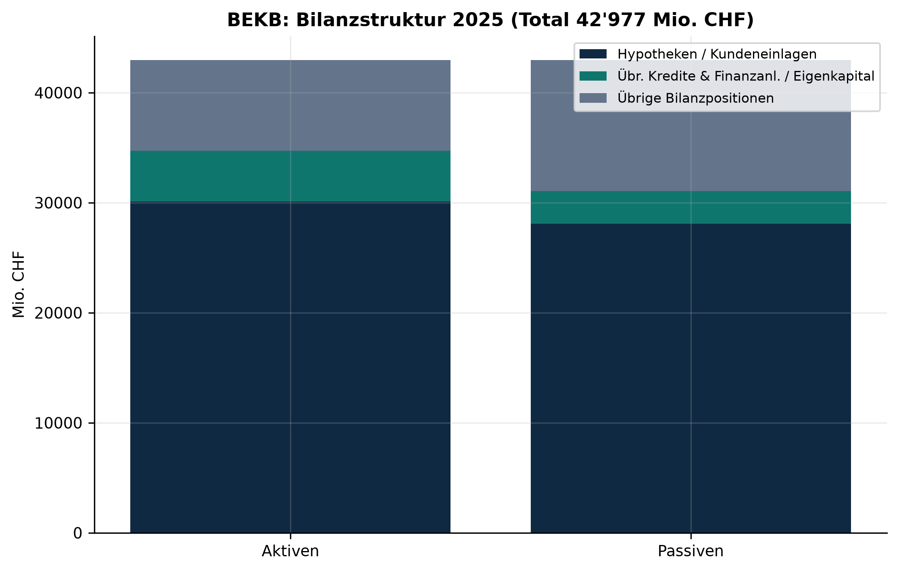
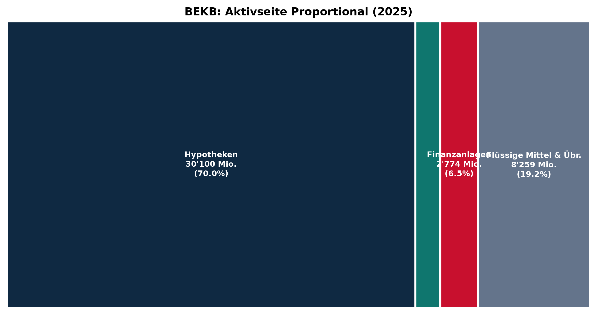
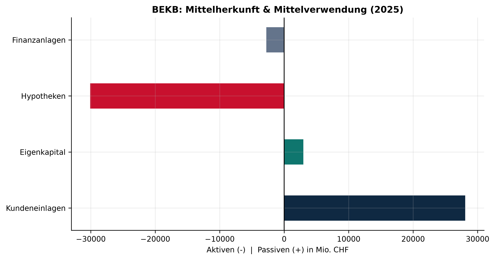
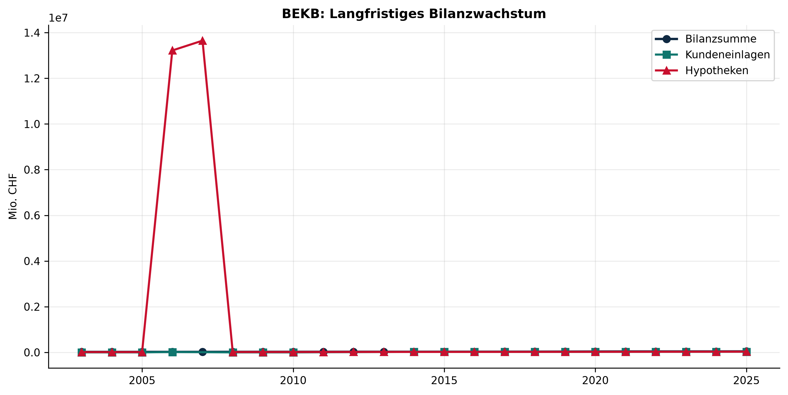

# 02 · Bilanzwachstum, Hypotheken & Refinanzierung (2003–2025): Berner Kantonalbank AG

## 1. Management Summary
- Die Bilanzsumme wuchs von **20'117,0 Mio. CHF** (2003) auf **42'977,0 Mio. CHF** (2025, CAGR **3,51 %**).
- Die Hypothekarforderungen machen im Jahr 2025 **70,0 %** der Bilanzsumme aus.
- Die Kundeneinlagen belaufen sich 2025 auf **28'086,7 Mio. CHF**, das Eigenkapital auf **2'981,5 Mio. CHF** (Eigenkapitalquote **6,94 %**).

## 2. Quantitative Entwicklung
| Jahr | Bilanzsumme | Hypotheken | Finanzanlagen | Kundeneinlagen | Eigenkapital | Deckungsgrad |
| --- | --- | --- | --- | --- | --- | --- |
| 2003 | 20'117,0 | 12'004,0 | – | 60,6 | – | 0,5 % |
| 2004 | 20'286,0 | 12'466,0 | 2'816,6 | 62,6 | 1'069,0 | 0,5 % |
| 2005 | 20'724,0 | 12'835,0 | 2'856,6 | 63,1 | 1'026,0 | 0,2 % |
| 2006 | 21'077,0 | 13'219'213,0 | – | 15'649,0 | – | 0,1 % |
| 2007 | 21'361,0 | 13'648'988,0 | 1'978'487,0 | – | – | – % |
| 2008 | 22'730,0 | 14'168,1 | 112,0 | 64,8 | – | 0,2 % |
| 2009 | 24'036,0 | 14'930,2 | 3'541,3 | 68,5 | – | 0,2 % |
| 2010 | 24'335,0 | 15'609,8 | – | 72,5 | – | 0,4 % |
| 2011 | 25'219,0 | 16'211,0 | 3'062,7 | – | – | – % |
| 2012 | 26'371,0 | 17'794,9 | 2'727,1 | – | – | – % |
| 2013 | 26'663,4 | 18'440,4 | 2'643,8 | – | – | – % |
| 2014 | 27'055,0 | 18'925,5 | 2'762,0 | 22'006,6 | – | 116,3 % |
| 2015 | 28'034,7 | 19'377,5 | 2'555,2 | 22'082,9 | – | 114,0 % |
| 2016 | 28'404,7 | 19'873,8 | 2'259,4 | 22'018,0 | – | 110,8 % |
| 2017 | 29'298,1 | 20'719,9 | 2'069,8 | 22'004,0 | – | 106,2 % |
| 2018 | 30'589,2 | 21'628,2 | 2'008,8 | 21'914,0 | – | 101,3 % |
| 2019 | 32'929,8 | 22'663,5 | 1'859,9 | 22'970,3 | – | 101,3 % |
| 2020 | 36'421,7 | 23'537,7 | 2'065,7 | 24'498,4 | 2'562,0 | 104,1 % |
| 2021 | 38'993,6 | 24'730,8 | 1'979,7 | 26'254,4 | – | 100,1 % |
| 2022 | 39'757,3 | 25'950,8 | 2'294,7 | 27'304,0 | – | 98,7 % |
| 2023 | 40'053,5 | 26'809,2 | 2'349,4 | 27'057,6 | – | 94,0 % |
| 2024 | 40'499,3 | 28'346,8 | 2'389,0 | 27'059,2 | 2'902,3 | 88,6 % |
| 2025 | 42'977,0 | 30'099,6 | 2'774,0 | 28'086,7 | 2'981,5 | 87,9 % |

## 3. Treiberanalyse & Wendepunkte
- **2015:** Umstellung auf FINMA-RVB sowie einmalige PK-Sanierungseinlage (83,8 Mio. CHF)
- **2025:** Inkrafttreten Basel III final per 01.01.2025

## 4. Fazit & Ausblick
- Refinanzierungsbasis und Bilanzstruktur bleiben eng an Kundeneinlagen und die jeweilige Geschäftsmodell-Spezialisierung gekoppelt.
