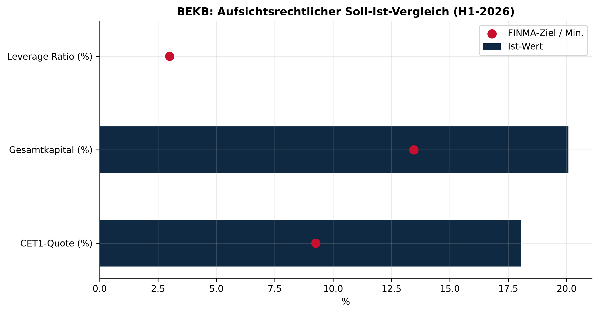
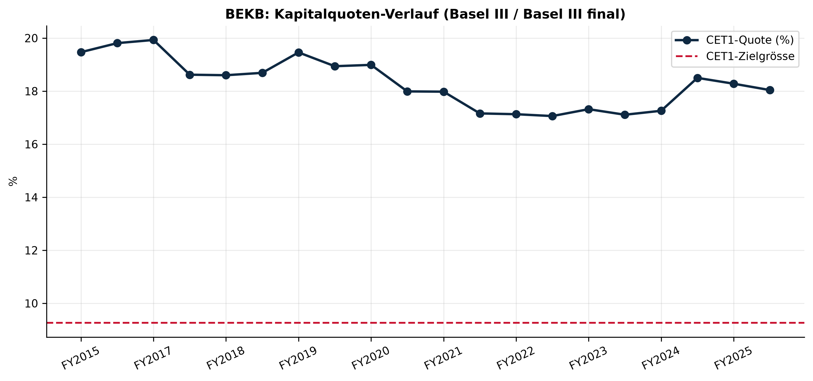

# 03 · Aufsichtsrechtliche Resilienz & Basel III: Berner Kantonalbank AG

> **FINMA-Kategorie:** Kategorie 3 | **CET1-Zielgrösse:** 9,26 % | **Gesamtkapital-Ziel:** 13,46 %

## 1. Management Summary
- Am jüngsten Offenlegungsstichtag (**H1-2026**, Regime: *Basel III final*) beträgt die **CET1-Quote 18,04 %** (Puffer über Ziel: **8,78 Prozentpunkte**).
- Die Gesamtkapitalquote liegt bei **20,08 %**, die Leverage Ratio bei **– %**.
- Liquiditätsquoten: LCR **141,2 %**, NSFR **144,0 %** (Mindestanforderung je 100 %).

## 2. Quantitative Entwicklung (20 Stichtage)
| Periode | Regime | RWA (Mio.) | CET1 (Mio.) | CET1 % | Gesamtkap. % | Leverage % | LCR % | NSFR % |
| --- | --- | --- | --- | --- | --- | --- | --- | --- |
| FY2015 | Basel III | – | – | 19,47 % | – % | 7,74 % | – % | – % |
| FY2016 | Basel III | – | – | 19,81 % | – % | 7,87 % | – % | – % |
| FY2017 | Basel III | – | – | 19,93 % | – % | – % | – % | – % |
| H1-2018 | Basel III | – | – | 18,62 % | – % | – % | – % | – % |
| FY2018 | Basel III | 13'379,9 | 2'489,0 | 18,60 % | 18,60 % | – % | – % | – % |
| H1-2019 | Basel III | 13'366,8 | 2'497,8 | 18,69 % | 18,69 % | – % | 145,8 % | – % |
| FY2019 | Basel III | 13'057,8 | 2'540,5 | 19,46 % | 19,46 % | – % | – % | – % |
| H1-2020 | Basel III | 13'412,4 | 2'540,0 | 18,94 % | 18,94 % | – % | 135,3 % | – % |
| FY2020 | Basel III | 13'420,3 | 2'548,4 | 18,99 % | 18,99 % | – % | – % | – % |
| H1-2021 | Basel III | 14'201,8 | 2'555,3 | 17,99 % | 17,99 % | – % | 191,7 % | – % |
| FY2021 | Basel III | 14'418,8 | 2'592,9 | 17,98 % | 18,97 % | – % | – % | 155,7 % |
| H1-2022 | Basel III | 15'160,9 | 2'601,0 | 17,16 % | 19,40 % | – % | 181,2 % | 156,0 % |
| FY2022 | Basel III | 15'466,6 | 2'649,8 | 17,13 % | 19,40 % | – % | – % | 156,8 % |
| H1-2023 | Basel III | 15'653,3 | 2'670,2 | 17,06 % | 19,29 % | – % | 204,3 % | 158,4 % |
| FY2023 | Basel III | 15'975,3 | 2'767,3 | 17,32 % | 19,57 % | – % | – % | 155,2 % |
| H1-2024 | Basel III | 16'323,7 | 2'793,6 | 17,11 % | 19,33 % | – % | 199,4 % | 152,9 % |
| FY2024 | Basel III | 16'658,1 | 2'875,3 | 17,26 % | 19,40 % | – % | – % | 148,8 % |
| H1-2025 | Basel III final | 15'661,5 | 2'896,8 | 18,50 % | 20,69 % | – % | 144,4 % | 143,0 % |
| FY2025 | Basel III final | 16'159,2 | 2'954,5 | 18,28 % | 20,39 % | – % | 141,9 % | 143,3 % |
| H1-2026 | Basel III final | 16'421,1 | 2'962,3 | 18,04 % | 20,08 % | – % | 141,2 % | 144,0 % |

## 3. Treiberanalyse & Wendepunkte
- Mit Inkrafttreten von **Basel III final** ab 01.01.2025 verändern sich risikogewichtete Aktiven (RWA) und RWA-Dichte durch angepasste Standard- bzw. Output-Floor-Vorgaben.

## 4. Fazit & Ausblick
- Die Eigenmittel- und Liquiditätspuffer übertreffen die regulatorischen Mindestanforderungen für FINMA-Kategorie 3 deutlich.
