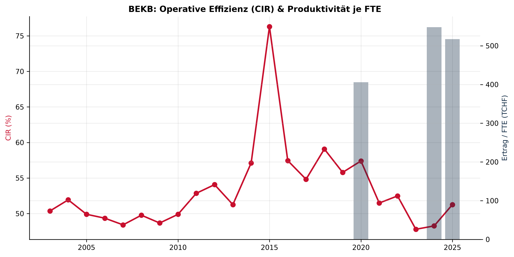

# 04 · Operative Effizienz & Transformation (2003–2025): Berner Kantonalbank AG

## 1. Management Summary
- Die Cost-Income-Ratio (CIR) liegt im Jahr 2025 bei **51,26 %** (vs. 50,36 % im Jahr 2003), die Eigenkapitalrendite (ROE) bei **5,88 %**.
- Der Personalbestand umfasst 2025 **1'058,0 FTE** bei einem Ertrag pro Vollzeitstelle von **517,3 TCHF** und einem **Lohnkosten-/Produktivitätsverhältnis von 28,1 %** (bzw. **3,56×** Ertrag je CHF Personalaufwand).

## 2. Quantitative Entwicklung
| Jahr | CIR % | ROE % | FTE | Ertrag/FTE (TCHF) | Lohn/FTE (TCHF) | Lohn/Ertrag % | Ertrag/Lohn | Bilanz/FTE (Mio.) |
| --- | --- | --- | --- | --- | --- | --- | --- | --- |
| 2003 | 50,36 % | – % | – | – | – | – % | –× | – |
| 2004 | 51,93 % | 6,99 % | – | – | – | – % | –× | – |
| 2005 | 49,90 % | 11,81 % | – | – | – | – % | –× | – |
| 2006 | 49,35 % | 8,99 % | – | – | – | – % | –× | – |
| 2007 | 48,41 % | – % | – | – | – | – % | –× | – |
| 2008 | 49,77 % | – % | – | – | – | – % | –× | – |
| 2009 | 48,67 % | – % | – | – | – | – % | –× | – |
| 2010 | 49,89 % | – % | – | – | – | – % | –× | – |
| 2011 | 52,85 % | – % | – | – | – | – % | –× | – |
| 2012 | 54,07 % | – % | – | – | – | – % | –× | – |
| 2013 | 51,26 % | – % | – | – | – | – % | –× | – |
| 2014 | 57,12 % | – % | – | – | – | – % | –× | – |
| 2015 | 76,30 % | 5,65 % | – | – | – | – % | –× | – |
| 2016 | 57,45 % | 5,40 % | – | – | – | – % | –× | – |
| 2017 | 54,82 % | 5,51 % | – | – | – | – % | –× | – |
| 2018 | 59,08 % | 5,46 % | – | – | – | – % | –× | – |
| 2019 | 55,79 % | – % | – | – | – | – % | –× | – |
| 2020 | 57,40 % | 5,79 % | 1'018,0 | 405,9 | 139,4 | 34,3 % | 2,91× | 35,78 |
| 2021 | 51,48 % | 5,73 % | – | – | – | – % | –× | – |
| 2022 | 52,48 % | 5,77 % | – | – | – | – % | –× | – |
| 2023 | 47,79 % | 6,06 % | – | – | – | – % | –× | – |
| 2024 | 48,26 % | 6,22 % | 1'009,0 | 548,2 | 143,2 | 26,1 % | 3,83× | 40,14 |
| 2025 | 51,26 % | 5,88 % | 1'058,0 | 517,3 | 145,4 | 28,1 % | 3,56× | 40,62 |

## 3. Treiberanalyse & Wendepunkte
- **2015:** Umstellung auf FINMA-RVB sowie einmalige PK-Sanierungseinlage (83,8 Mio. CHF)
- **2025:** Inkrafttreten Basel III final per 01.01.2025

## 4. Fazit & Ausblick
- Digitalisierung und Skalierung steigern Bilanzsumme und Geschäftsvolumen pro Vollzeitstelle langfristig.
