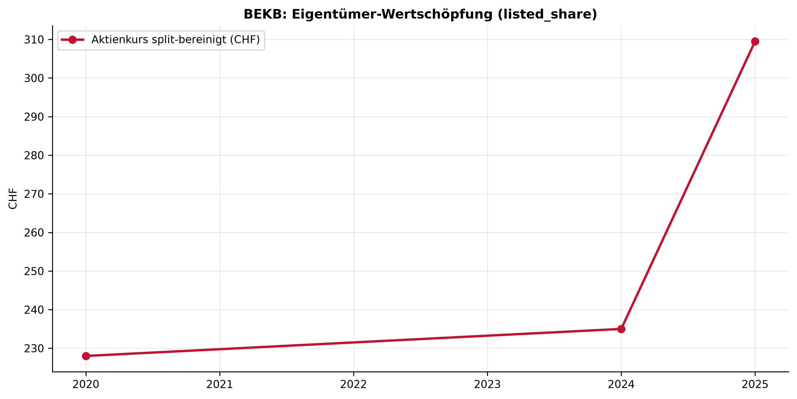

# 05 · Aktie, Dividenden & Investoren-Wertschöpfung (2003–2025): Berner Kantonalbank AG

> **Eigentümer-Modus:** `listed_share` | **Staatsgarantie:** Keine | **Ticker:** `BEKN`

## 1. Management Summary
- Im Geschäftsjahr 2025 erwirtschaftete BEKB einen Gewinn von **175,4 Mio. CHF** bei einem Eigenkapital von **2'981,5 Mio. CHF**.
- **Aktuelle Ausschüttung (2025):** Kurs **309.50 CHF**, Dividende **10.80 CHF** (Rendite **3,49 %**).

## 2. Quantitative Entwicklung
| Jahr | Reingewinn (Mio.) | Eigenkapital (Mio.) | Aktienkurs (split-ber.) | Dividende/Aktie | Div.-Rendite | Öff. Ablieferung (Mio.) |
| --- | --- | --- | --- | --- | --- | --- |
| 2003 | 71,1 | – | – | 3.00 | – % | – |
| 2004 | 74,7 | 1'069,0 | – | 0.00 | – % | – |
| 2005 | 121,2 | 1'026,0 | – | 3.50 | – % | – |
| 2006 | 92,2 | 1'026,0 | – | – | – % | – |
| 2007 | 103,8 | – | – | 3.50 | – % | – |
| 2008 | 112,7 | – | – | – | – % | – |
| 2009 | 118,0 | – | – | – | – % | – |
| 2010 | 124,4 | – | – | 5.10 | – % | – |
| 2011 | 130,1 | – | – | 5.30 | – % | – |
| 2012 | 128,1 | – | – | 5.30 | – % | – |
| 2013 | 130,1 | – | – | 5.50 | – % | – |
| 2014 | 130,4 | – | – | 5.80 | – % | – |
| 2015 | 131,3 | 2'323,4 | – | 6.00 | – % | – |
| 2016 | 129,4 | 2'397,4 | – | 6.20 | – % | – |
| 2017 | 137,4 | 2'494,7 | – | 6.60 | – % | – |
| 2018 | 140,8 | 2'577,1 | – | 6.20 | – % | – |
| 2019 | 142,9 | – | – | 8.40 | – % | – |
| 2020 | 148,4 | 2'562,0 | 228.00 | 8.80 | 3,86 % | 65,2 |
| 2021 | 154,9 | 2'705,6 | – | 9.20 | – % | – |
| 2022 | 159,6 | 2'766,3 | – | 9.60 | – % | – |
| 2023 | 174,9 | 2'887,5 | – | 10.00 | – % | – |
| 2024 | 180,7 | 2'902,3 | 235.00 | 10.40 | 4,43 % | 98,1 |
| 2025 | 175,4 | 2'981,5 | 309.50 | 10.80 | 3,49 % | 94,3 |

## 3. Treiberanalyse & Wendepunkte (Investoren-Perspektive)
- Bei kotierten Instituten mit Aktiensplits (z. B. BCV 1:10 im Jahr 2020) sind sämtliche historischen Kurs- und Dividendenreihen deterministisch split-bereinigt.
- Im Branchenvergleich (siehe `comparison/reports/06_investoren_branchenvergleich.md`) werden P/B, P/E, Dividendenrendite und Eigentümer-Ablieferungen über alle 19 Institute eingeordnet.

## 4. Fazit, Führungsleistung & Ausblick
- Stabile Ertragskraft sichert langfristig Dividendenkontinuität bzw. verlässliche Ablieferungen an Kanton, Post oder Genossenschafter.
- Die detaillierte Leistungsbilanz von CEO und Verwaltungsratspräsidium aus Investoren- und Eigentümersicht findet sich im [CEO & Chairman of the Board Achievement Report](./08_ceo_und_vrp_leistungsbericht.md).
