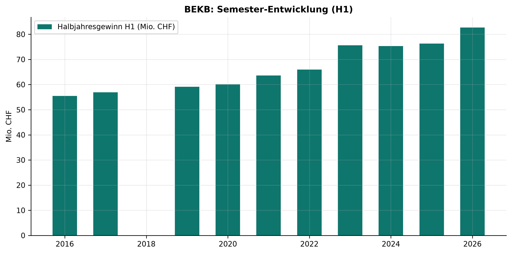

# 06 · Unterjährige Dynamik (Semesterberichte): Berner Kantonalbank AG

## 1. Management Summary
- Vorliegen von **14 Halbjahresabschlüssen**; jüngster Stichtag ist **H1-2026** mit einem Geschäftsertrag von **291,2 Mio. CHF** und einem Halbjahresgewinn von **82,6 Mio. CHF**.

## 2. Quantitative Entwicklung
| Periode | Bilanzsumme | Zinserfolg H1 | Geschäftsertrag H1 | Geschäftserfolg H1 | Reingewinn H1 |
| --- | --- | --- | --- | --- | --- |
| H1-2013 | 26'459,3 | 160,3 | 256,1 | 107,6 | – |
| H1-2014 | 27'075,9 | 154,3 | 225,1 | 92,7 | – |
| H1-2015 | 28'030,1 | 142,0 | 214,3 | 86,6 | – |
| H1-2016 | 28'714,8 | 150,4 | 215,2 | 72,9 | 55,4 |
| H1-2017 | 29'340,0 | 152,8 | 226,0 | 79,7 | 56,9 |
| H1-2018 | 30'317,7 | 135,7 | 210,4 | 65,5 | – |
| H1-2019 | 32'353,1 | 146,7 | 221,7 | 79,7 | 59,1 |
| H1-2020 | 35'429,8 | – | 201,7 | 64,1 | 60,1 |
| H1-2021 | 37'562,1 | 141,9 | 217,0 | 76,5 | 63,6 |
| H1-2022 | 39'187,8 | 165,1 | 244,3 | 81,1 | 66,0 |
| H1-2023 | 39'936,1 | 195,1 | 270,2 | 115,7 | 75,6 |
| H1-2024 | 39'816,0 | 188,7 | 270,5 | 118,0 | 75,3 |
| H1-2025 | 41'893,4 | 191,4 | 277,0 | 113,8 | 76,3 |
| H1-2026 | 44'654,9 | 183,3 | 291,2 | 127,8 | 82,6 |

## 3. Treiberanalyse & Wendepunkte
- Der Vergleich von H1-Werten gegen die jeweiligen Gesamtjahresergebnisse (FY) zeigt die saisonale Ertragsverteilung und Reservebildung im zweiten Halbjahr.

## 4. Fazit & Ausblick
- Die Halbjahresberichte ermöglichen ein zeitnahes Monitoring der Zinsmargen- und Kreditvolumen-Dynamik bis H1-2026.
