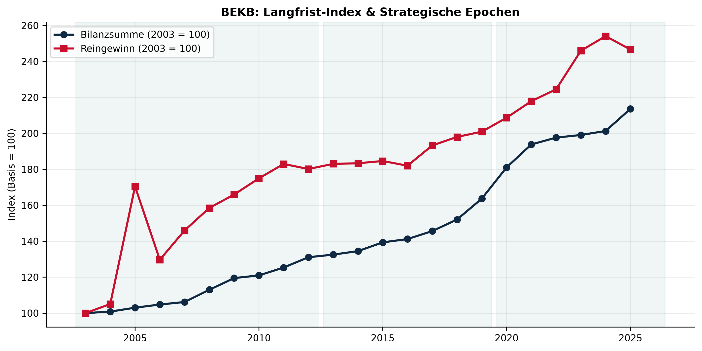
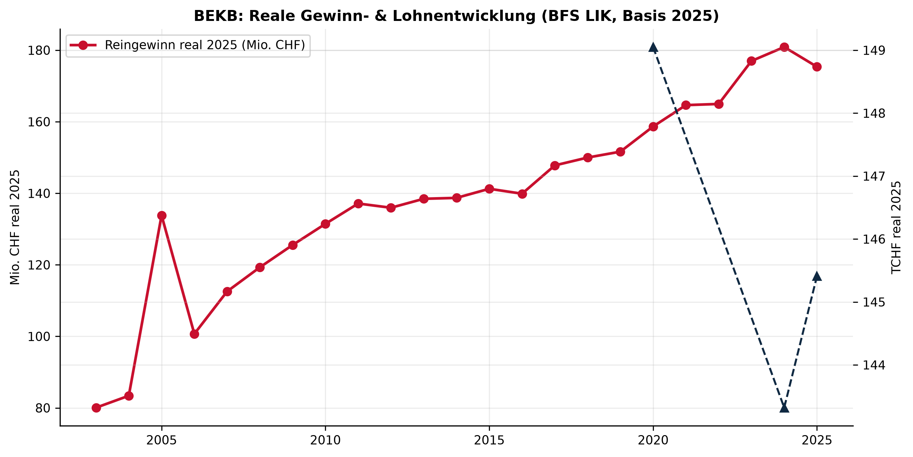

# 07 · Strategische Epochen, Governance, reale Vergütung & Vorsorge (2003–2025): Berner Kantonalbank AG

> **Preisbasis:** Sämtliche Realgrössen sind mit dem offiziellen **BFS Landesindex der Konsumentenpreise (LIK, Dez. 1982 = 100)** deterministisch auf **reale CHF 2025** deflationiert.

## 1. Management Summary & Strategische Epochen
- **Epoche 1 (2003–2012):** Stabilität & regionales Wachstum
- **Epoche 2 (2013–2019):** SNB-Negativzinsen & Eigenmittelaufbau
- **Epoche 3 (2020–2026):** Zinswende, Transformation & Basel III final

## 2. Reale Gewinn-, Lohn- & Vergütungsentwicklung (real 2025 CHF)
| Jahr | Gewinn nom. | Gewinn real 2025 | Lohn/FTE real (TCHF) | VR real (TCHF) | CEO real (TCHF) | GL real (TCHF) |
| --- | --- | --- | --- | --- | --- | --- |
| 2003 | 71,1 | 80,1 | – | – | – | – |
| 2004 | 74,7 | 83,4 | – | – | – | – |
| 2005 | 121,2 | 133,8 | – | – | – | – |
| 2006 | 92,2 | 100,7 | – | – | – | – |
| 2007 | 103,8 | 112,6 | – | – | – | – |
| 2008 | 112,7 | 119,3 | – | – | – | – |
| 2009 | 118,0 | 125,5 | – | – | – | – |
| 2010 | 124,4 | 131,4 | – | – | – | – |
| 2011 | 130,1 | 137,1 | – | – | – | – |
| 2012 | 128,1 | 136,0 | – | – | – | – |
| 2013 | 130,1 | 138,5 | – | – | – | – |
| 2014 | 130,4 | 138,7 | – | – | – | – |
| 2015 | 131,3 | 141,3 | – | – | – | – |
| 2016 | 129,4 | 139,9 | – | – | – | – |
| 2017 | 137,4 | 147,8 | – | – | – | – |
| 2018 | 140,8 | 150,0 | – | – | – | – |
| 2019 | 142,9 | 151,6 | – | – | – | – |
| 2020 | 148,4 | 158,7 | 149,1 | – | – | – |
| 2021 | 154,9 | 164,6 | – | – | – | – |
| 2022 | 159,6 | 165,0 | – | – | – | – |
| 2023 | 174,9 | 177,0 | – | – | – | – |
| 2024 | 180,7 | 180,9 | 143,3 | 1'472,7 | 993,2 | 4'306,1 |
| 2025 | 175,4 | 175,4 | 145,4 | 1'452,0 | 998,0 | 4'685,0 |

## 3. Arbeitgeber-Attraktivität & Vorsorgeeinrichtung (Pensionskasse)
- **Vorsorgeeinrichtung:** Pensionskasse der Berner Kantonalbank AG (*Beitragsprimat (umhüllend)*, Basis: `Swiss GAAP FER 16 / ARB`)
- **Versichertenstruktur:** Aktive **1'593**, Rentner **791** (Verhältnis Aktive/Rentner: **2,01**)
- **Deckungsgrad (BVG) / Reserven:** Deckungsgrad **133,3 %**, Arbeitgeberbeitragsreserve **0,0 Mio. CHF**, Sondereinlagen **83,8 Mio. CHF**
- **CEO-zu-Mitarbeitenden-Pay-Ratio (2025):** **6,9×** (CEO real 2025: 998,0 TCHF vs. Ø Personalaufwand/FTE: 145,4 TCHF)
- **Quelle:** `bekb/.md/bekb-geschaeftsbericht-2025.md (Anhang Tabelle 13, S. 150)` — Deckungsgrad Ende 2025: 133,3 % (2024: 126,0 %); Wertschwankungsreserve hat Zielwert mit 215,4 Mio. CHF erreicht; Beiträge 2025: 14,011 Mio. CHF.

## 4. Treiberanalyse, Strukturbrüche & Ausblick
- **2015:** Umstellung auf FINMA-RVB sowie einmalige PK-Sanierungseinlage (83,8 Mio. CHF)
- **2025:** Inkrafttreten Basel III final per 01.01.2025
- Die gemeinsame Inflationsbereinigung auf `real 2025 CHF` ermöglicht den unverzerrten Vergleich von Produktivität, Reallöhnen, Pay Ratio und Pensionskassen-Resilienz im Branchenvergleich (`comparison/reports/07_mitarbeiter_und_vorsorge_branchenvergleich.md`).
