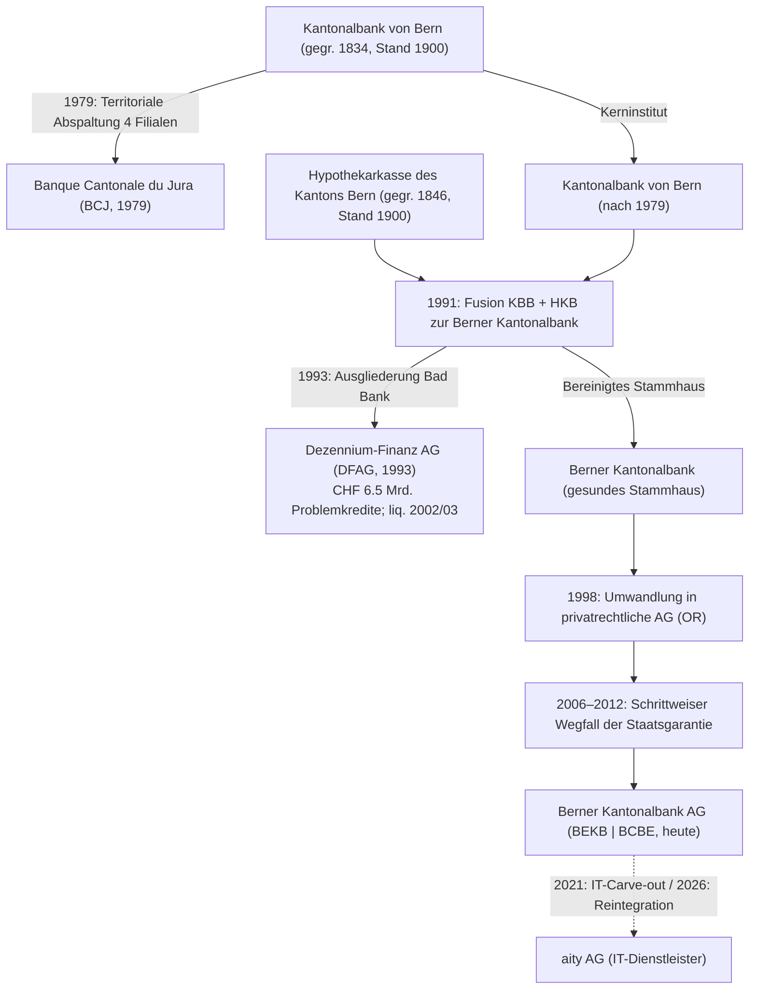

# 10 · Fusionsbaum & Institutsgeschichte seit 1900: Berner Kantonalbank AG

> **Gründung / Ursprung:** 1834 (Kantonalbank von Bern) / 1846 (Hypothekarkasse des Kantons Bern) | **Aktuelle Rechtsform:** `listed_ag` | **FINMA-Kategorie:** 3

## 1. Überblick der Institutslinie (1900–2026)
Die heutige Berner Kantonalbank AG (BEKB | BCBE) entstand 1991 aus dem Zusammenschluss der 1834 gegründeten Kantonalbank von Bern (KBB) und der 1846 gegründeten Hypothekarkasse des Kantons Bern (HKB). Historisch prägend waren zwei bedeutende Abspaltungen: 1979 wurden vier jurassische Filialen zur Gründung der Banque Cantonale du Jura (BCJ) abgetrennt, und 1993 wurden infolge der Immobilienkrise notleidende Kredite im Umfang von CHF 6.5 Mrd. in die kantonale Auffanggesellschaft (Bad Bank) Dezennium-Finanz AG (DFAG) ausgegliedert. 1998 wurde die BEKB als erste Kantonalbank der Schweiz in eine privatrechtliche Aktiengesellschaft nach OR umgewandelt.

## 2. Fusionsbaum (Mermaid-Diagramm seit 1900)

## 3. Chronologische Meilensteine (Fusionen, Übernahmen & Rechtsformwechsel)
| Jahr / Zeitraum | Institut / Ereignis | Typ | Bedeutung & Auswirkung |
| --- | --- | --- | --- |
| 1834 / 1900 | Kantonalbank von Bern (KBB) & Hypothekarkasse des Kantons Bern (HKB) | Ausgangslage 1900 | Zwei eigenständige bernische Staatsinstitute (Universal- vs. Hypothekarbank) |
| 1979 | Gründung Kanton Jura / Banque Cantonale du Jura (BCJ) | Territoriale Abspaltung | Übertragung von vier jurassischen Niederlassungen der KBB (Delsberg, Pruntrut, Freiberge) an die neu gegründete BCJ |
| 1991 | Fusion KBB + HKB → Berner Kantonalbank | Fusion | Grosser Rat beschliesst mit 136:0 Stimmen den Zusammenschluss beider bernischer Staatsbanken |
| 1993 | Ausgliederung Bad Bank Dezennium-Finanz AG (DFAG) | Bad Bank Carve-Out | Übertragung von CHF 6.5 Mrd. notleidenden Krediten/Immobilien an DFAG; Kanton fängt CHF 1.5 Mrd. Verlust auf, liquidiert 2002/03 |
| 1998 | Umwandlung in BEKB AG | Rechtsformwechsel | Erste Kantonalbank der Schweiz als privatrechtliche AG (Art. 620 OR); Kanton reduziert Anteil auf 51,5 % |
| 2006–2012 | Aufhebung der Staatsgarantie | Regulierung | Schrittweiser Übergang zu voller Eigenmittel- und Marktdisziplin ohne kantonale Haftung |
| 2021–2026 | IT-Carve-Out aity AG & Reintegration | IT-Spin-off | 2021 Ausgliederung der IT in aity AG; 11/2026 Beschluss zur vollständigen Reintegration in die BEKB bis 2028 |

- **Quellenbasis:** `BEKB Firmengeschichte (bekb.ch); Kanton Bern Beteiligungsberichte & DFAG-Schlussbericht`
