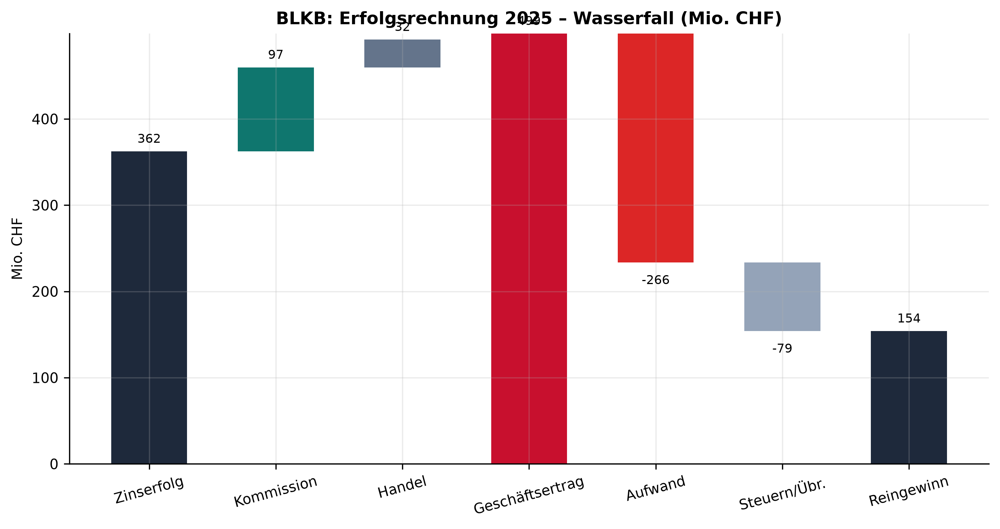
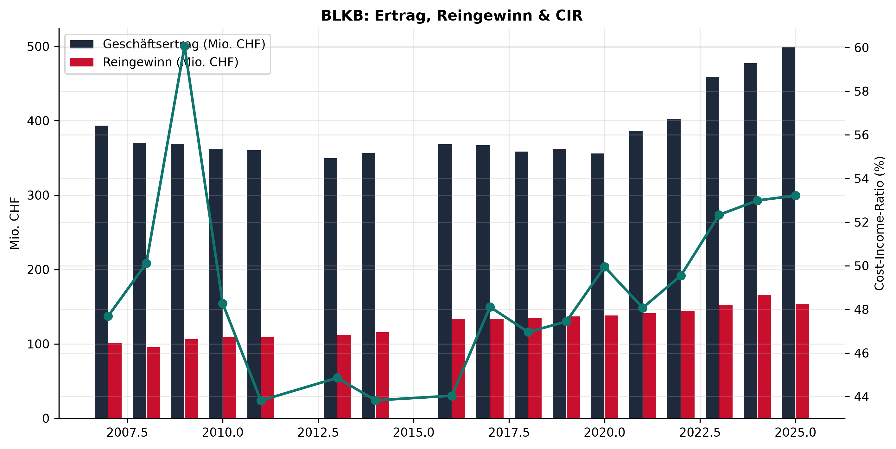

# 01 · Zinszyklen & Ertragsarchitektur (2007–2025): Basellandschaftliche Kantonalbank

> **Scope:** `consolidated` | **Standard:** `ARB_RVB` | **Währung:** Mio. CHF (harmonisierte Zeitreihe)

## 1. Management Summary
- Im Zeitraum **2007–2025** entwickelte sich der Geschäftsertrag von **393,5 Mio. CHF** auf **499,0 Mio. CHF** (CAGR **1,33 % p. a.**).
- Der Reingewinn erreichte im jüngsten Geschäftsjahr 2025 **154,0 Mio. CHF** (nach 100,6 Mio. CHF im Jahr 2007).
- Der Netto-Zinserfolg trägt aktuell **72,6 %** zum Gesamtertrag bei, das Kommissionsgeschäft **19,5 %** und das Handelsgeschäft **6,5 %**.

## 2. Quantitative Entwicklung
| Jahr | Zinserfolg (Mio.) | Kommission (Mio.) | Handel (Mio.) | Geschäftsertrag | Geschäftserfolg | Reingewinn | Zinsanteil |
| --- | --- | --- | --- | --- | --- | --- | --- |
| 2007 | 253,2 | 116,7 | 14,9 | 393,5 | 205,9 | 100,6 | 64,3 % |
| 2008 | 254,1 | 100,8 | 13,1 | 370,0 | 184,6 | 95,5 | 68,7 % |
| 2009 | 268,3 | 68,0 | 14,9 | 368,7 | 147,3 | 106,3 | 72,8 % |
| 2010 | 271,3 | 68,7 | 15,3 | 361,4 | 186,9 | 108,9 | 75,1 % |
| 2011 | 276,1 | 65,0 | 16,1 | 360,2 | 202,4 | 109,0 | 76,7 % |
| 2013 | 260,2 | 65,6 | 14,6 | 349,8 | 192,8 | 112,3 | 74,4 % |
| 2014 | 269,0 | 65,9 | 15,0 | 356,5 | 200,2 | 115,8 | 75,5 % |
| 2016 | 288,8 | 40,2 | 17,6 | 368,3 | 183,4 | 133,6 | 78,4 % |
| 2017 | 276,2 | 65,3 | 18,0 | 366,9 | 172,1 | 133,3 | 75,3 % |
| 2018 | 269,8 | 66,4 | 16,8 | 358,5 | 165,2 | 134,5 | 75,3 % |
| 2019 | 269,1 | 67,6 | 17,4 | 362,0 | 171,0 | 137,0 | 74,3 % |
| 2020 | 275,6 | 73,4 | 18,0 | 356,0 | 162,0 | 138,0 | 77,4 % |
| 2021 | 279,7 | 84,8 | 17,9 | 386,0 | 176,0 | 141,0 | 72,5 % |
| 2022 | 291,2 | 82,6 | 22,4 | 402,7 | 180,6 | 144,1 | 72,3 % |
| 2023 | 333,7 | 85,7 | 24,5 | 459,0 | 193,0 | 152,0 | 72,7 % |
| 2024 | 341,8 | 92,2 | 29,1 | 477,0 | 202,0 | 166,0 | 71,7 % |
| 2025 | 362,4 | 97,4 | 32,3 | 499,0 | 122,0 | 154,0 | 72,6 % |

## 3. Treiberanalyse & Wendepunkte
- **2015:** Einführung SNB-Negativzins & Rechnungslegungswechsel (ARB)
- **2025:** Inkrafttreten Basel III final & geordnete Liquidation radicant

## 4. Fazit & Ausblick
- Die Ertragsarchitektur von BLKB spiegelt die Zinszyklen (Negativzinsphase 2015–2022, Zinswende 2022–2024, Zinssenkungen ab 2025) unmittelbar wider.
