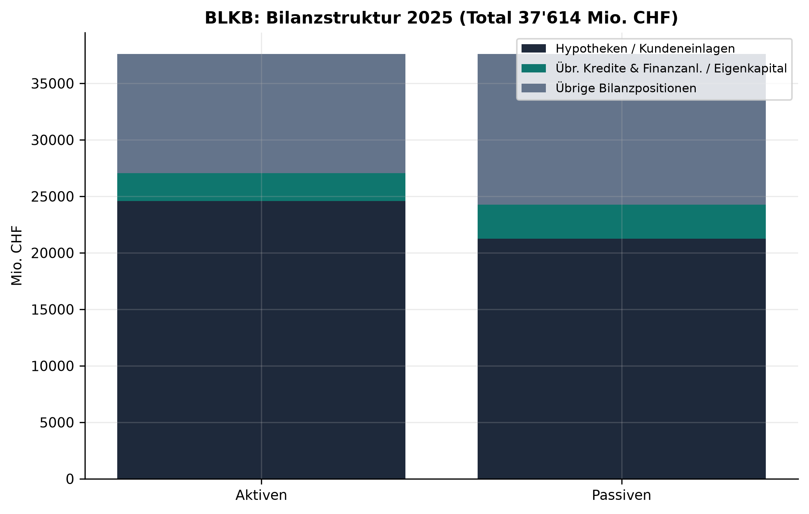
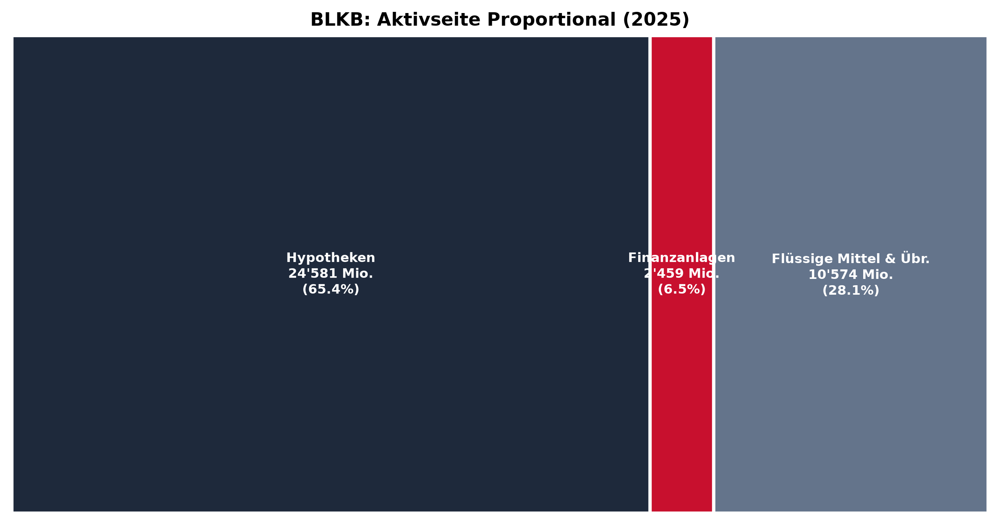
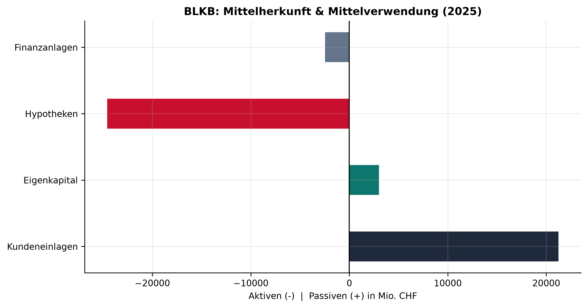
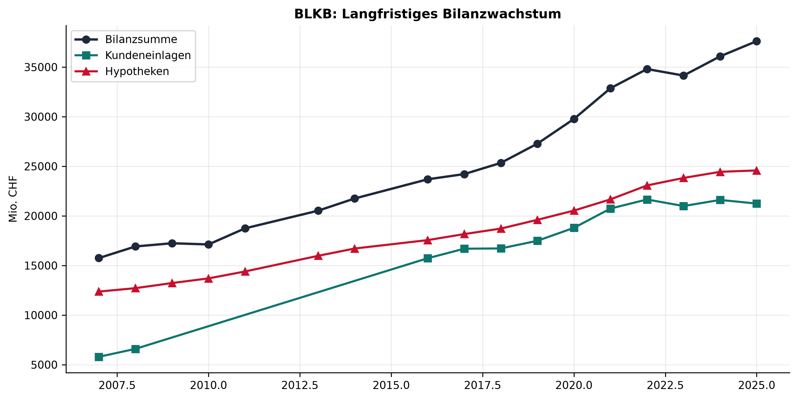

# 02 · Bilanzwachstum, Hypotheken & Refinanzierung (2007–2025): Basellandschaftliche Kantonalbank

## 1. Management Summary
- Die Bilanzsumme wuchs von **15'746,9 Mio. CHF** (2007) auf **37'614,0 Mio. CHF** (2025, CAGR **4,96 %**).
- Die Hypothekarforderungen machen im Jahr 2025 **65,3 %** der Bilanzsumme aus.
- Die Kundeneinlagen belaufen sich 2025 auf **21'240,0 Mio. CHF**, das Eigenkapital auf **3'013,7 Mio. CHF** (Eigenkapitalquote **8,01 %**).

## 2. Quantitative Entwicklung
| Jahr | Bilanzsumme | Hypotheken | Finanzanlagen | Kundeneinlagen | Eigenkapital | Deckungsgrad |
| --- | --- | --- | --- | --- | --- | --- |
| 2007 | 15'746,9 | 12'368,8 | 1'203,7 | 5'789,8 | – | 44,6 % |
| 2008 | 16'915,9 | 12'711,8 | 1'356,5 | 6'593,1 | – | 49,4 % |
| 2009 | 17'239,5 | 13'226,6 | 1'852,4 | – | – | – % |
| 2010 | 17'119,8 | 13'696,6 | 1'563,7 | – | – | – % |
| 2011 | 18'741,9 | 14'393,8 | 1'653,1 | – | – | – % |
| 2013 | 20'522,9 | 15'973,3 | 1'586,0 | – | – | – % |
| 2014 | 21'751,3 | 16'709,0 | 1'426,1 | – | – | – % |
| 2016 | 23'689,5 | 17'556,8 | 1'466,6 | 15'729,8 | 2'194,8 | 89,6 % |
| 2017 | 24'212,2 | 18'165,6 | 1'480,6 | 16'689,7 | 2'311,6 | 91,9 % |
| 2018 | 25'340,8 | 18'718,4 | 1'615,1 | 16'717,7 | 2'416,3 | 89,3 % |
| 2019 | 27'280,0 | 19'601,0 | 1'480,2 | 17'487,0 | – | 89,2 % |
| 2020 | 29'770,0 | 20'532,0 | 1'515,3 | 18'794,0 | – | 91,5 % |
| 2021 | 32'867,0 | 21'666,0 | 1'752,6 | 20'738,0 | – | 95,7 % |
| 2022 | 34'803,7 | 23'067,7 | 1'969,9 | 21'652,4 | – | 93,9 % |
| 2023 | 34'146,0 | 23'824,0 | 1'346,3 | 20'991,0 | – | 88,1 % |
| 2024 | 36'083,0 | 24'441,0 | 1'756,8 | 21'608,0 | 3'003,1 | 88,4 % |
| 2025 | 37'614,0 | 24'581,0 | 2'459,1 | 21'240,0 | 3'013,7 | 86,4 % |

## 3. Treiberanalyse & Wendepunkte
- **2015:** Einführung SNB-Negativzins & Rechnungslegungswechsel (ARB)
- **2025:** Inkrafttreten Basel III final & geordnete Liquidation radicant

## 4. Fazit & Ausblick
- Refinanzierungsbasis und Bilanzstruktur bleiben eng an Kundeneinlagen und die jeweilige Geschäftsmodell-Spezialisierung gekoppelt.
