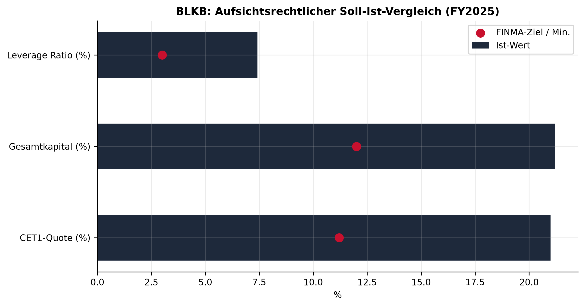
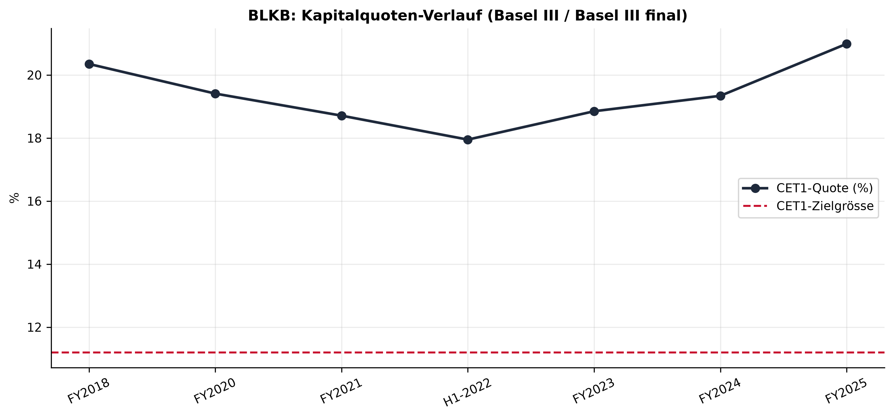

# 03 · Aufsichtsrechtliche Resilienz & Basel III: Basellandschaftliche Kantonalbank

> **FINMA-Kategorie:** Kategorie 3 | **CET1-Zielgrösse:** 11,20 % | **Gesamtkapital-Ziel:** 12,00 %

## 1. Management Summary
- Am jüngsten Offenlegungsstichtag (**FY2025**, Regime: *Basel III final*) beträgt die **CET1-Quote 20,99 %** (Puffer über Ziel: **9,79 Prozentpunkte**).
- Die Gesamtkapitalquote liegt bei **21,21 %**, die Leverage Ratio bei **7,42 %**.
- Liquiditätsquoten: LCR **153,9 %**, NSFR **144,8 %** (Mindestanforderung je 100 %).

## 2. Quantitative Entwicklung (11 Stichtage)
| Periode | Regime | RWA (Mio.) | CET1 (Mio.) | CET1 % | Gesamtkap. % | Leverage % | LCR % | NSFR % |
| --- | --- | --- | --- | --- | --- | --- | --- | --- |
| FY2014 | Basel III | – | – | – % | – % | – % | – % | – % |
| FY2015 | Basel III | – | – | – % | – % | – % | – % | – % |
| FY2016 | Basel III | – | – | – % | – % | – % | – % | – % |
| FY2017 | Basel III | – | – | – % | – % | – % | – % | – % |
| FY2018 | Basel III | – | 2'336,3 | 20,35 % | 20,35 % | – % | – % | – % |
| FY2020 | Basel III | 12'522,0 | 2'430,6 | 19,41 % | 19,41 % | – % | – % | – % |
| FY2021 | Basel III | 13'770,8 | 2'575,9 | 18,71 % | 18,95 % | – % | – % | 145,7 % |
| H1-2022 | Basel III | 14'352,6 | 2'576,7 | 17,95 % | 18,20 % | – % | 128,2 % | 147,8 % |
| FY2023 | Basel III | 14'572,5 | 2'746,3 | 18,85 % | 19,06 % | – % | – % | 145,5 % |
| FY2024 | Basel III | 14'626,6 | 2'829,2 | 19,34 % | 19,56 % | – % | – % | 145,6 % |
| FY2025 | Basel III final | 13'688,3 | 2'872,8 | 20,99 % | 21,21 % | 7,42 % | 153,9 % | 144,8 % |

## 3. Treiberanalyse & Wendepunkte
- Mit Inkrafttreten von **Basel III final** ab 01.01.2025 verändern sich risikogewichtete Aktiven (RWA) und RWA-Dichte durch angepasste Standard- bzw. Output-Floor-Vorgaben.

## 4. Fazit & Ausblick
- Die Eigenmittel- und Liquiditätspuffer übertreffen die regulatorischen Mindestanforderungen für FINMA-Kategorie 3 deutlich.
