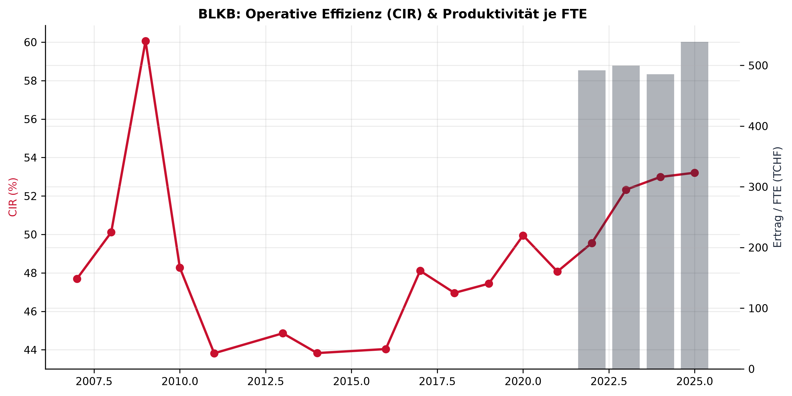

# 04 · Operative Effizienz & Transformation (2007–2025): Basellandschaftliche Kantonalbank

## 1. Management Summary
- Die Cost-Income-Ratio (CIR) liegt im Jahr 2025 bei **53,21 %** (vs. 47,69 % im Jahr 2007), die Eigenkapitalrendite (ROE) bei **5,11 %**.
- Der Personalbestand umfasst 2025 **926,0 FTE** bei einem Ertrag pro Vollzeitstelle von **538,9 TCHF** und einem **Lohnkosten-/Produktivitätsverhältnis von 31,8 %** (bzw. **3,14×** Ertrag je CHF Personalaufwand).
- **Personalfluktuation:** Jüngster offengelegter Wert liegt im Jahr **2025** bei **7,8 %** (*Natürliche / Netto-Fluktuationsrate (GRI G4-LA1 / GRI 401-1: exkl. Arbeitgeberkündigung, Pensionierungen, Schwangerschaften & Todesfälle; 2013–2025) bzw. einfache Fluktuationsrate (GRI G3 LA2, 2006–2012)*).

## 2. Quantitative Entwicklung
| Jahr | CIR % | ROE % | FTE | Fluktuation % | Ertrag/FTE (TCHF) | Lohn/FTE (TCHF) | Lohn/Ertrag % | Ertrag/Lohn | Bilanz/FTE (Mio.) |
| --- | --- | --- | --- | --- | --- | --- | --- | --- | --- |
| 2007 | 47,69 % | – % | – | 7,8 % | – | – | – % | –× | – |
| 2008 | 50,11 % | – % | – | 7,4 % | – | – | – % | –× | – |
| 2009 | 60,06 % | – % | – | 4,8 % | – | – | – % | –× | – |
| 2010 | 48,27 % | – % | – | 4,8 % | – | – | – % | –× | – |
| 2011 | 43,82 % | – % | – | – | – | – | – % | –× | – |
| 2013 | 44,86 % | – % | – | 3,3 % | – | – | – % | –× | – |
| 2014 | 43,83 % | – % | – | 4,1 % | – | – | – % | –× | – |
| 2016 | 44,04 % | 6,09 % | – | 4,6 % | – | – | – % | –× | – |
| 2017 | 48,11 % | 5,77 % | – | 5,0 % | – | – | – % | –× | – |
| 2018 | 46,96 % | 5,56 % | – | 5,3 % | – | – | – % | –× | – |
| 2019 | 47,44 % | – % | – | 6,3 % | – | – | – % | –× | – |
| 2020 | 49,95 % | – % | – | 5,3 % | – | – | – % | –× | – |
| 2021 | 48,07 % | – % | – | 5,6 % | – | – | – % | –× | – |
| 2022 | 49,55 % | – % | 819,0 | 6,3 % | 491,6 | 154,3 | 31,4 % | 3,19× | 42,50 |
| 2023 | 52,33 % | – % | 919,0 | 7,4 % | 499,5 | 165,1 | 33,1 % | 3,03× | 37,16 |
| 2024 | 52,99 % | 5,53 % | 983,0 | 5,8 % | 485,2 | 160,3 | 33,0 % | 3,03× | 36,71 |
| 2025 | 53,21 % | 5,11 % | 926,0 | 7,8 % | 538,9 | 171,6 | 31,8 % | 3,14× | 40,62 |

## 3. Treiberanalyse & Wendepunkte
- **2015:** Einführung SNB-Negativzins & Rechnungslegungswechsel (ARB)
- **2025:** Inkrafttreten Basel III final & geordnete Liquidation radicant

## 4. Fazit & Ausblick
- Digitalisierung und Skalierung steigern Bilanzsumme und Geschäftsvolumen pro Vollzeitstelle langfristig.
