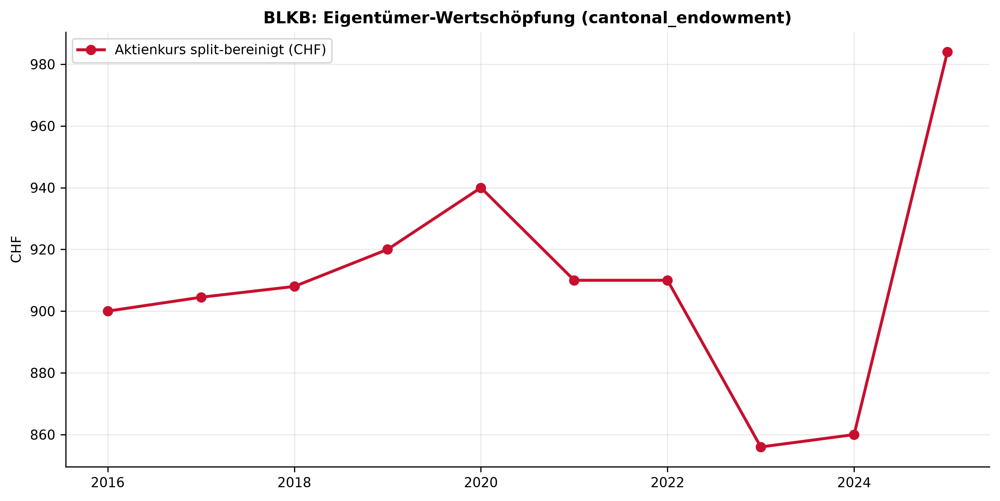

# 05 · Dotationskapital, Ausschüttung & Kanton (2007–2025): Basellandschaftliche Kantonalbank

> **Eigentümer-Modus:** `cantonal_endowment` | **Staatsgarantie:** Ja | **Ticker:** `BLKB`

## 1. Management Summary
- Im Geschäftsjahr 2025 erwirtschaftete BLKB einen Gewinn von **154,0 Mio. CHF** bei einem Eigenkapital von **3'013,7 Mio. CHF**.
- **Aktuelle Ausschüttung (2025):** Kurs **984.00 CHF**, Dividende **42.00 CHF** (Rendite **4,27 %**).

## 2. Quantitative Entwicklung
| Jahr | Reingewinn (Mio.) | Eigenkapital (Mio.) | Aktienkurs (split-ber.) | Dividende/Aktie | Div.-Rendite | Öff. Ablieferung (Mio.) |
| --- | --- | --- | --- | --- | --- | --- |
| 2007 | 100,6 | – | – | – | – % | 34,0 |
| 2008 | 95,5 | – | – | – | – % | 34,0 |
| 2009 | 106,3 | – | – | – | – % | 40,0 |
| 2010 | 108,9 | – | – | – | – % | 40,0 |
| 2011 | 109,0 | – | – | – | – % | 40,0 |
| 2013 | 112,3 | – | – | – | – % | 40,0 |
| 2014 | 115,8 | – | – | – | – % | 42,0 |
| 2016 | 133,6 | 2'194,8 | 900.00 | 35.00 | 3,89 % | 53,6 |
| 2017 | 133,3 | 2'311,6 | 904.50 | 35.00 | 3,87 % | 53,6 |
| 2018 | 134,5 | 2'416,3 | 908.00 | 35.00 | 3,85 % | 56,0 |
| 2019 | 137,0 | – | 920.00 | 35.00 | 3,80 % | 60,0 |
| 2020 | 138,0 | – | 940.00 | 35.00 | 3,72 % | 60,1 |
| 2021 | 141,0 | – | 910.00 | 35.00 | 3,85 % | 60,2 |
| 2022 | 144,1 | – | 910.00 | 35.00 | 3,85 % | 60,3 |
| 2023 | 152,0 | – | 856.00 | 40.00 | 4,67 % | 68,7 |
| 2024 | 166,0 | 3'003,1 | 860.00 | 42.00 | 4,88 % | 72,8 |
| 2025 | 154,0 | 3'013,7 | 984.00 | 42.00 | 4,27 % | 71,7 |

## 3. Treiberanalyse & Wendepunkte (Investoren-Perspektive)
- Bei kotierten Instituten mit Aktiensplits (z. B. BCV 1:10 im Jahr 2020) sind sämtliche historischen Kurs- und Dividendenreihen deterministisch split-bereinigt.
- Im Branchenvergleich (siehe `comparison/reports/06_investoren_branchenvergleich.md`) werden P/B, P/E, Dividendenrendite und Eigentümer-Ablieferungen über alle 19 Institute eingeordnet.

## 4. Fazit, Führungsleistung & Ausblick
- Stabile Ertragskraft sichert langfristig Dividendenkontinuität bzw. verlässliche Ablieferungen an Kanton, Post oder Genossenschafter.
- Die detaillierte Leistungsbilanz von CEO und Verwaltungsratspräsidium aus Investoren- und Eigentümersicht findet sich im [CEO & Chairman of the Board Achievement Report](./08_ceo_und_vrp_leistungsbericht.md).
