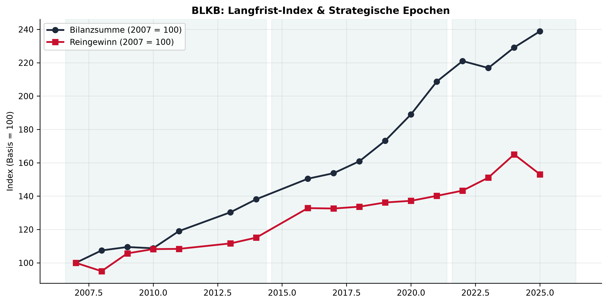
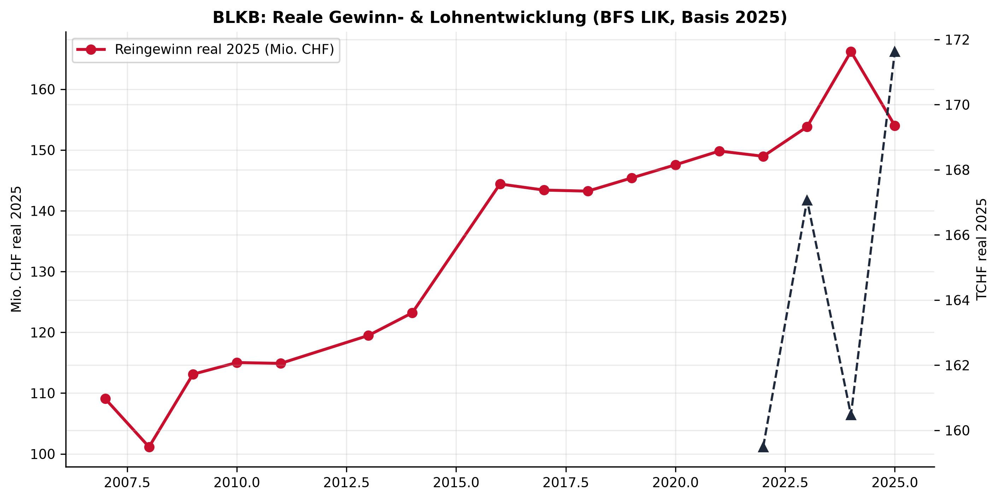

# 07 · Strategische Epochen, Governance, reale Vergütung & Vorsorge (2007–2025): Basellandschaftliche Kantonalbank

> **Preisbasis:** Sämtliche Realgrössen sind mit dem offiziellen **BFS Landesindex der Konsumentenpreise (LIK, Dez. 1982 = 100)** deterministisch auf **reale CHF 2025** deflationiert.

## 1. Management Summary & Strategische Epochen
- **Epoche 1 (2007–2014):** Finanzkrise & solides Baselbieter Wachstum
- **Epoche 2 (2015–2021):** SNB-Negativzinsen, Nachhaltigkeit & Digital-Offensive
- **Epoche 3 (2022–2026):** Zinswende, radicant-Exit (2025) & Basel III final

## 2. Reale Gewinn-, Lohn- & Vergütungsentwicklung (real 2025 CHF)
| Jahr | Gewinn nom. | Gewinn real 2025 | Lohn/FTE real (TCHF) | VR real (TCHF) | CEO real (TCHF) | GL real (TCHF) |
| --- | --- | --- | --- | --- | --- | --- |
| 2007 | 100,6 | 109,1 | – | – | – | – |
| 2008 | 95,5 | 101,1 | – | – | – | – |
| 2009 | 106,3 | 113,1 | – | – | – | – |
| 2010 | 108,9 | 115,0 | – | – | – | – |
| 2011 | 109,0 | 114,9 | – | – | – | – |
| 2013 | 112,3 | 119,5 | – | – | – | – |
| 2014 | 115,8 | 123,2 | – | – | – | – |
| 2016 | 133,6 | 144,4 | – | – | – | – |
| 2017 | 133,3 | 143,4 | – | – | – | – |
| 2018 | 134,5 | 143,2 | – | – | – | – |
| 2019 | 137,0 | 145,4 | – | – | – | – |
| 2020 | 138,0 | 147,6 | – | – | – | – |
| 2021 | 141,0 | 149,8 | – | – | – | – |
| 2022 | 144,1 | 149,0 | 159,5 | – | – | – |
| 2023 | 152,0 | 153,8 | 167,1 | – | – | – |
| 2024 | 166,0 | 166,2 | 160,5 | – | – | – |
| 2025 | 154,0 | 154,0 | 171,6 | – | – | – |

## 3. Arbeitgeber-Attraktivität & Vorsorgeeinrichtung (Pensionskasse)
- **Vorsorgeeinrichtung:** Pensionskasse der BLKB (Basellandschaftliche Pensionskasse BLPK) (*Beitragsprimat*, Basis: `Swiss GAAP FER 26 / ARB`)
- **Versichertenstruktur:** Aktive **–**, Rentner **–** (Verhältnis Aktive/Rentner: **–**)
- **Deckungsgrad (BVG) / Reserven:** Deckungsgrad **115,4 %**, Arbeitgeberbeitragsreserve **0,0 Mio. CHF**, Sondereinlagen **0,0 Mio. CHF**
- **CEO-zu-Mitarbeitenden-Pay-Ratio (2025):** **–×** (CEO real 2025: – TCHF vs. Ø Personalaufwand/FTE: 171,6 TCHF)
- **Quelle:** `blkb/.md/blkb-geschaeftsbericht-2025.md (Anhang Konzernrechnung Vorsorgeverpflichtungen)` — Vorsorgelösung bei der BLPK mit Deckungsgrad 115,4 % per 31.12.2025 (Wertschwankungsreserve vollständig geäufnet); Beiträge/Vorsorgeaufwand 2025: CHF 15,925 Mio.; radicant bank ag bei Nest Sammelstiftung (112,5 %).

## 4. Treiberanalyse, Strukturbrüche & Ausblick
- **2015:** Einführung SNB-Negativzins & Rechnungslegungswechsel (ARB)
- **2025:** Inkrafttreten Basel III final & geordnete Liquidation radicant
- Die gemeinsame Inflationsbereinigung auf `real 2025 CHF` ermöglicht den unverzerrten Vergleich von Produktivität, Reallöhnen, Pay Ratio und Pensionskassen-Resilienz im Branchenvergleich (`comparison/reports/07_mitarbeiter_und_vorsorge_branchenvergleich.md`).
