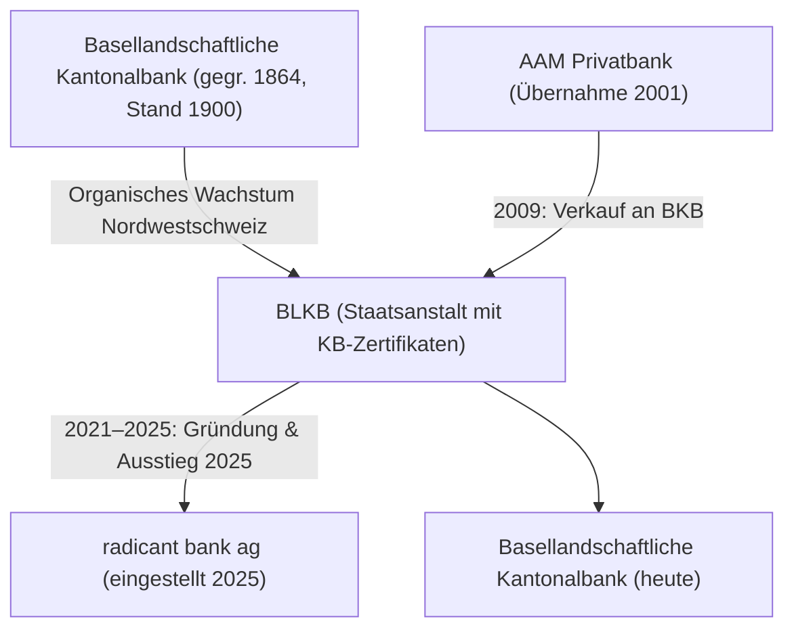

# 10 · Fusionsbaum & Institutsgeschichte seit 1900: Basellandschaftliche Kantonalbank

> **Gründung / Ursprung:** 1864 (Basellandschaftliche Kantonalbank, Liestal) | **Aktuelle Rechtsform:** `public_law` | **FINMA-Kategorie:** 3

## 1. Überblick der Institutslinie (1900–2026)
Die Basellandschaftliche Kantonalbank wurde 1864 durch Volksabstimmung im Kanton Basel-Landschaft gegründet und wuchs seither ohne Grossfusionen organisch zur führenden Bank der Nordwestschweiz. 2001 übernahm sie zur Auslandsexpansion die AAM Privatbank (2009 an die Basler Kantonalbank verkauft). 2021–2025 lancierte sie die Digitalbank-Tochter radicant, deren Betrieb 2025 zugunsten der Fokussierung auf das Stammgeschäft eingestellt wurde.

## 2. Fusionsbaum (Mermaid-Diagramm seit 1900)

## 3. Chronologische Meilensteine (Fusionen, Übernahmen & Rechtsformwechsel)
| Jahr / Zeitraum | Institut / Ereignis | Typ | Bedeutung & Auswirkung |
| --- | --- | --- | --- |
| 1864 / 1900 | Basellandschaftliche Kantonalbank | Gründung & Ausgangslage | Volksbeschluss vom 10. Juli 1864; Staatsbank des Kantons Basel-Landschaft in Liestal |
| 2001–2009 | Übernahme & Verkauf AAM Privatbank | Auslandsexpansion / Rückzug | 2001 Übernahme der AAM zur Auslandsexpansion, 2009 Verkauf an die Basler Kantonalbank |
| 2010 | Einführung Avaloq Banking System | IT-Modernisierung | Ablösung der Eigenentwicklung durch die Standardplattform Avaloq |
| 2021–2025 | Aufbau und Beendigung radicant bank ag | Strategische Bereinigung | Nachhaltigkeits-Digitalbank 2025 wertberichtigt (CHF 105,5 Mio.) und geordnet beendet |

- **Quellenbasis:** `BLKB Geschäftsberichte (2007–2025); BLKB Chronik`
