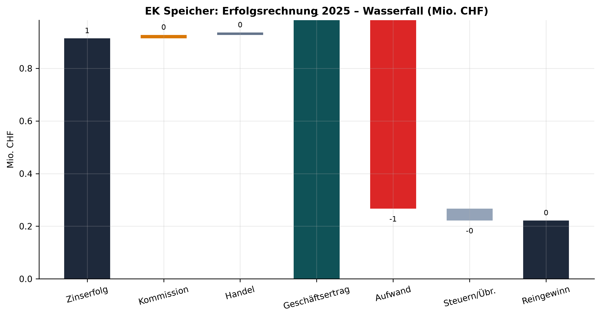
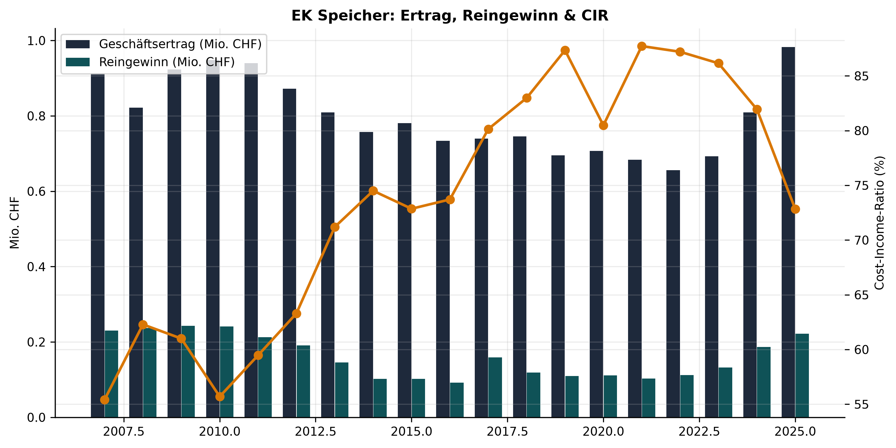

# 01 · Zinszyklen & Ertragsarchitektur (2007–2025): Ersparniskasse Speicher

> **Scope:** `standalone` | **Standard:** `ARB_RVB` | **Währung:** Mio. CHF (harmonisierte Zeitreihe)

## 1. Management Summary
- Im Zeitraum **2007–2025** entwickelte sich der Geschäftsertrag von **0,9 Mio. CHF** auf **1,0 Mio. CHF** (CAGR **0,41 % p. a.**).
- Der Reingewinn erreichte im jüngsten Geschäftsjahr 2025 **0,2 Mio. CHF** (nach 0,2 Mio. CHF im Jahr 2007).
- Der Netto-Zinserfolg trägt aktuell **93,0 %** zum Gesamtertrag bei, das Kommissionsgeschäft **1,3 %** und das Handelsgeschäft **0,9 %**.

## 2. Quantitative Entwicklung
| Jahr | Zinserfolg (Mio.) | Kommission (Mio.) | Handel (Mio.) | Geschäftsertrag | Geschäftserfolg | Reingewinn | Zinsanteil |
| --- | --- | --- | --- | --- | --- | --- | --- |
| 2007 | 0,9 | – | – | 0,9 | 0,4 | 0,2 | 97,8 % |
| 2008 | 0,8 | 0,0 | – | 0,8 | 0,3 | 0,2 | 97,8 % |
| 2009 | 0,9 | 0,0 | – | 0,9 | 0,4 | 0,2 | 98,2 % |
| 2010 | 0,9 | 0,0 | – | 0,9 | 0,4 | 0,2 | 98,6 % |
| 2011 | 0,9 | 0,0 | 10,7 | 0,9 | 0,4 | 0,2 | 98,1 % |
| 2012 | 0,9 | 0,0 | – | 0,9 | 0,3 | 0,2 | 97,6 % |
| 2013 | 0,8 | 0,0 | – | 0,8 | 0,2 | 0,1 | 97,2 % |
| 2014 | 0,7 | 0,0 | – | 0,8 | 0,2 | 0,1 | 98,9 % |
| 2015 | 0,8 | 0,0 | 0,0 | 0,8 | 0,2 | 0,1 | 96,9 % |
| 2016 | 0,7 | 0,0 | 0,0 | 0,7 | 0,2 | 0,1 | 96,2 % |
| 2017 | 0,7 | 0,0 | 0,0 | 0,7 | 0,1 | 0,2 | 93,2 % |
| 2018 | 0,7 | 0,0 | 0,0 | 0,7 | 0,1 | 0,1 | 92,4 % |
| 2019 | 0,6 | 0,0 | 0,0 | 0,7 | 0,1 | 0,1 | 92,2 % |
| 2020 | 0,7 | 0,0 | 0,0 | 0,7 | 0,1 | 0,1 | 92,4 % |
| 2021 | 0,6 | 0,0 | 0,0 | 0,7 | 0,1 | 0,1 | 92,2 % |
| 2022 | 0,6 | 0,0 | 0,0 | 0,7 | 0,1 | 0,1 | 92,5 % |
| 2023 | 0,6 | 0,0 | 0,0 | 0,7 | 0,1 | 0,1 | 90,0 % |
| 2024 | 0,7 | 0,0 | 0,0 | 0,8 | 0,1 | 0,2 | 91,2 % |
| 2025 | 0,9 | 0,0 | 0,0 | 1,0 | 0,3 | 0,2 | 93,0 % |

## 3. Treiberanalyse & Wendepunkte
- **2025:** Inkrafttreten Basel III final per 01.01.2025

## 4. Fazit & Ausblick
- Die Ertragsarchitektur von EK Speicher spiegelt die Zinszyklen (Negativzinsphase 2015–2022, Zinswende 2022–2024, Zinssenkungen ab 2025) unmittelbar wider.
