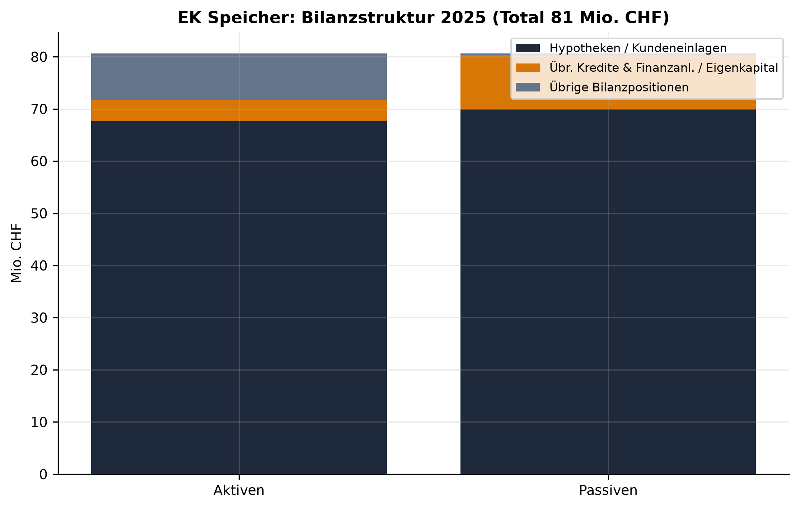
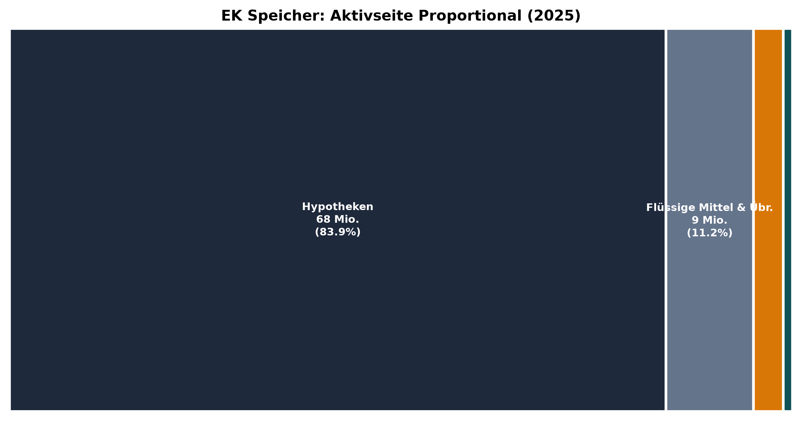
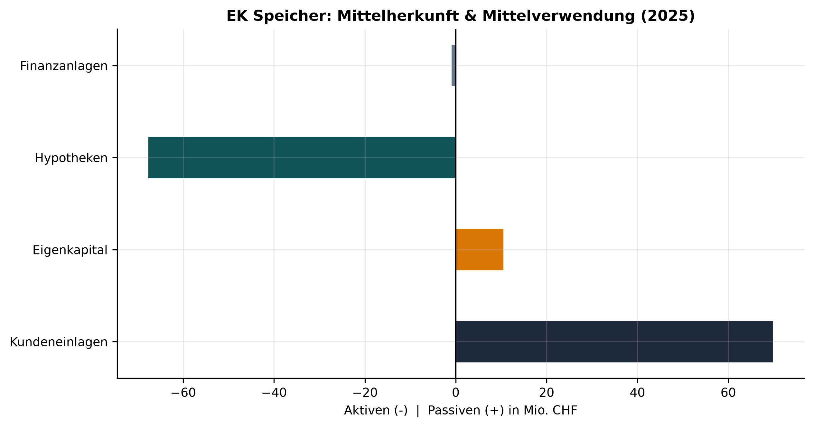
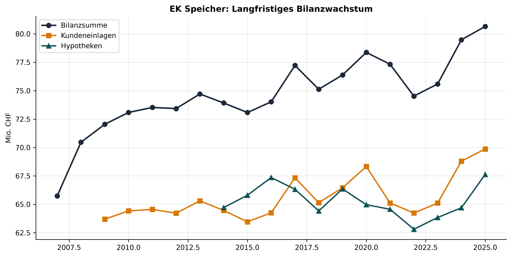

# 02 · Bilanzwachstum, Hypotheken & Refinanzierung (2007–2025): Ersparniskasse Speicher

## 1. Management Summary
- Die Bilanzsumme wuchs von **65,7 Mio. CHF** (2007) auf **80,7 Mio. CHF** (2025, CAGR **1,14 %**).
- Die Hypothekarforderungen machen im Jahr 2025 **83,8 %** der Bilanzsumme aus.
- Die Kundeneinlagen belaufen sich 2025 auf **69,9 Mio. CHF**, das Eigenkapital auf **10,5 Mio. CHF** (Eigenkapitalquote **13,02 %**).

## 2. Quantitative Entwicklung
| Jahr | Bilanzsumme | Hypotheken | Finanzanlagen | Kundeneinlagen | Eigenkapital | Deckungsgrad |
| --- | --- | --- | --- | --- | --- | --- |
| 2007 | 65,7 | – | – | – | 7,3 | – % |
| 2008 | 70,5 | – | – | – | 7,5 | – % |
| 2009 | 72,0 | – | – | 63,7 | 7,8 | – % |
| 2010 | 73,1 | – | – | 64,4 | 8,1 | 97,0 % |
| 2011 | 73,5 | – | – | 64,6 | 8,4 | 98,1 % |
| 2012 | 73,4 | – | – | 64,2 | 8,7 | – % |
| 2013 | 74,7 | – | – | 65,3 | 8,8 | – % |
| 2014 | 73,9 | 64,7 | – | 64,5 | 6,1 | 99,6 % |
| 2015 | 73,1 | 65,8 | 1,6 | 63,5 | 2,9 | 94,7 % |
| 2016 | 74,0 | 67,4 | 1,7 | 64,3 | 2,9 | 94,9 % |
| 2017 | 77,2 | 66,3 | 1,7 | 67,3 | 2,9 | 101,0 % |
| 2018 | 75,1 | 64,4 | 2,0 | 65,1 | 2,9 | 99,4 % |
| 2019 | 76,4 | 66,4 | 1,5 | 66,5 | 9,6 | 98,5 % |
| 2020 | 78,4 | 65,0 | 1,5 | 68,3 | 9,7 | 103,4 % |
| 2021 | 77,3 | 64,6 | 1,5 | 65,1 | 9,8 | 99,2 % |
| 2022 | 74,5 | 62,8 | 2,3 | 64,2 | 10,0 | 97,5 % |
| 2023 | 75,6 | 63,8 | 1,7 | 65,1 | 10,1 | 97,3 % |
| 2024 | 79,5 | 64,7 | 1,7 | 68,8 | 10,3 | 101,5 % |
| 2025 | 80,7 | 67,6 | 0,9 | 69,9 | 10,5 | 98,8 % |

## 3. Treiberanalyse & Wendepunkte
- **2025:** Inkrafttreten Basel III final per 01.01.2025

## 4. Fazit & Ausblick
- Refinanzierungsbasis und Bilanzstruktur bleiben eng an Kundeneinlagen und die jeweilige Geschäftsmodell-Spezialisierung gekoppelt.
