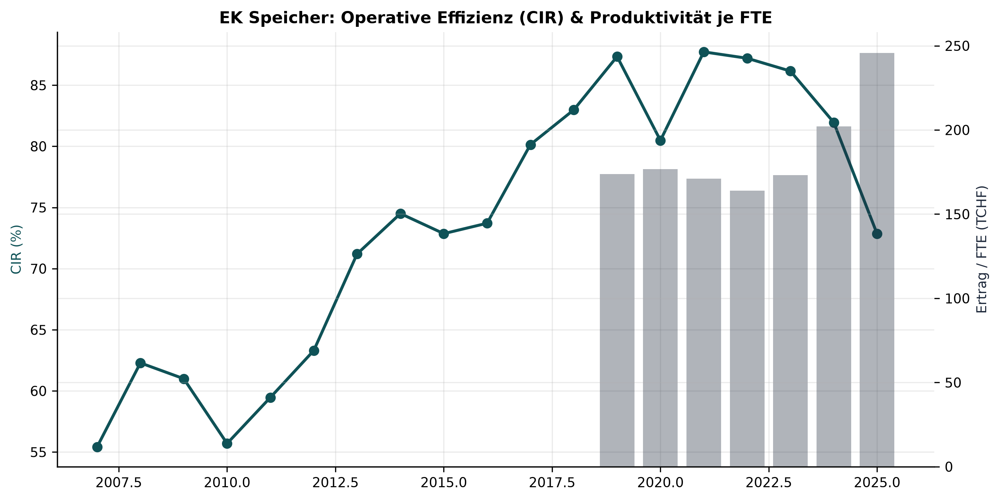

# 04 · Operative Effizienz & Transformation (2007–2025): Ersparniskasse Speicher

## 1. Management Summary
- Die Cost-Income-Ratio (CIR) liegt im Jahr 2025 bei **72,84 %** (vs. 55,42 % im Jahr 2007), die Eigenkapitalrendite (ROE) bei **2,11 %**.
- Der Personalbestand umfasst 2025 **4,0 FTE** bei einem Ertrag pro Vollzeitstelle von **245,8 TCHF** und einem **Lohnkosten-/Produktivitätsverhältnis von 35,1 %** (bzw. **2,85×** Ertrag je CHF Personalaufwand).

## 2. Quantitative Entwicklung
| Jahr | CIR % | ROE % | FTE | Ertrag/FTE (TCHF) | Lohn/FTE (TCHF) | Lohn/Ertrag % | Ertrag/Lohn | Bilanz/FTE (Mio.) |
| --- | --- | --- | --- | --- | --- | --- | --- | --- |
| 2007 | 55,42 % | 3,17 % | – | – | – | – % | –× | – |
| 2008 | 62,29 % | 3,14 % | – | – | – | – % | –× | – |
| 2009 | 61,00 % | 3,12 % | – | – | – | – % | –× | – |
| 2010 | 55,70 % | 2,96 % | – | – | – | – % | –× | – |
| 2011 | 59,47 % | 2,53 % | – | – | – | – % | –× | – |
| 2012 | 63,30 % | 2,20 % | – | – | – | – % | –× | – |
| 2013 | 71,20 % | 1,66 % | – | – | – | – % | –× | – |
| 2014 | 74,50 % | 1,68 % | – | – | – | – % | –× | – |
| 2015 | 72,86 % | 3,58 % | – | – | – | – % | –× | – |
| 2016 | 73,71 % | 3,21 % | – | – | – | – % | –× | – |
| 2017 | 80,14 % | 5,48 % | – | – | – | – % | –× | – |
| 2018 | 82,98 % | 4,10 % | – | – | – | – % | –× | – |
| 2019 | 87,34 % | 1,15 % | 4,0 | 173,8 | 75,0 | 43,2 % | 2,32× | 19,10 |
| 2020 | 80,48 % | 1,14 % | 4,0 | 176,8 | 72,0 | 40,7 % | 2,45× | 19,59 |
| 2021 | 87,72 % | 1,05 % | 4,0 | 171,0 | 73,0 | 42,7 % | 2,34× | 19,33 |
| 2022 | 87,20 % | 1,12 % | 4,0 | 164,0 | 73,0 | 44,5 % | 2,25× | 18,63 |
| 2023 | 86,15 % | 1,31 % | 4,0 | 173,2 | 76,8 | 44,3 % | 2,26× | 18,90 |
| 2024 | 81,95 % | 1,82 % | 4,0 | 202,2 | 80,0 | 39,6 % | 2,53× | 19,87 |
| 2025 | 72,84 % | 2,11 % | 4,0 | 245,8 | 86,2 | 35,1 % | 2,85× | 20,16 |

## 3. Treiberanalyse & Wendepunkte
- **2025:** Inkrafttreten Basel III final per 01.01.2025

## 4. Fazit & Ausblick
- Digitalisierung und Skalierung steigern Bilanzsumme und Geschäftsvolumen pro Vollzeitstelle langfristig.
