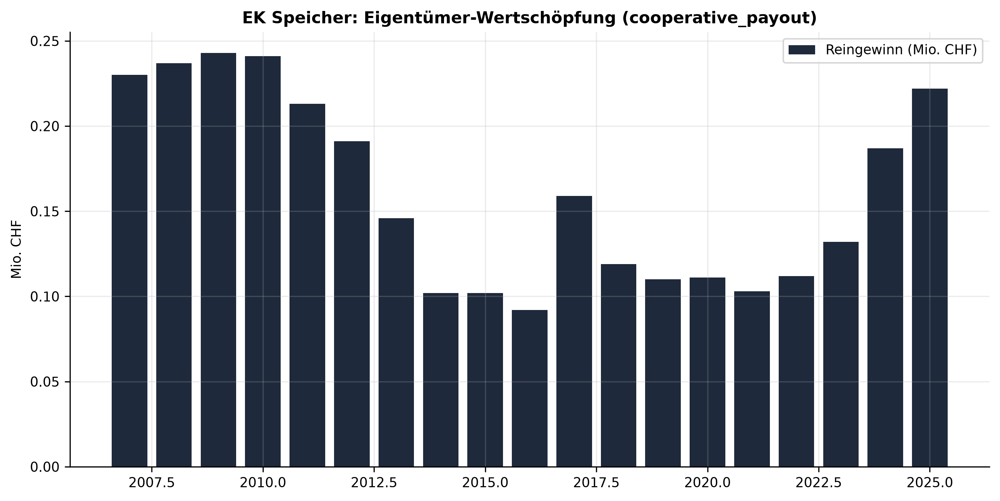

# 05 · Genossenschaftskapital, Mitglieder & Ausschüttung (2007–2025): Ersparniskasse Speicher

> **Eigentümer-Modus:** `cooperative_payout` | **Staatsgarantie:** Keine | **Ticker:** `nicht kotiert`

## 1. Management Summary
- Im Geschäftsjahr 2025 erwirtschaftete EK Speicher einen Gewinn von **0,2 Mio. CHF** bei einem Eigenkapital von **10,5 Mio. CHF**.
- **Eigenkapitalrendite (2025):** ROE **2,11 %** bei einem Eigenkapital von **10,5 Mio. CHF**.

## 2. Quantitative Entwicklung
| Jahr | Reingewinn (Mio.) | Eigenkapital (Mio.) | Aktienkurs (split-ber.) | Dividende/Aktie | Div.-Rendite | Öff. Ablieferung (Mio.) |
| --- | --- | --- | --- | --- | --- | --- |
| 2007 | 0,2 | 7,3 | – | – | – % | – |
| 2008 | 0,2 | 7,5 | – | – | – % | – |
| 2009 | 0,2 | 7,8 | – | – | – % | – |
| 2010 | 0,2 | 8,1 | – | – | – % | – |
| 2011 | 0,2 | 8,4 | – | – | – % | – |
| 2012 | 0,2 | 8,7 | – | – | – % | – |
| 2013 | 0,1 | 8,8 | – | – | – % | – |
| 2014 | 0,1 | 6,1 | – | – | – % | – |
| 2015 | 0,1 | 2,9 | – | – | – % | – |
| 2016 | 0,1 | 2,9 | – | – | – % | – |
| 2017 | 0,2 | 2,9 | – | – | – % | – |
| 2018 | 0,1 | 2,9 | – | – | – % | – |
| 2019 | 0,1 | 9,6 | – | – | – % | – |
| 2020 | 0,1 | 9,7 | – | – | – % | – |
| 2021 | 0,1 | 9,8 | – | – | – % | – |
| 2022 | 0,1 | 10,0 | – | – | – % | – |
| 2023 | 0,1 | 10,1 | – | – | – % | – |
| 2024 | 0,2 | 10,3 | – | – | – % | – |
| 2025 | 0,2 | 10,5 | – | – | – % | – |

## 3. Treiberanalyse & Wendepunkte (Investoren-Perspektive)
- Bei kotierten Instituten mit Aktiensplits (z. B. BCV 1:10 im Jahr 2020) sind sämtliche historischen Kurs- und Dividendenreihen deterministisch split-bereinigt.
- Im Branchenvergleich (siehe `comparison/reports/06_investoren_branchenvergleich.md`) werden P/B, P/E, Dividendenrendite und Eigentümer-Ablieferungen über alle 19 Institute eingeordnet.

## 4. Fazit, Führungsleistung & Ausblick
- Stabile Ertragskraft sichert langfristig Dividendenkontinuität bzw. verlässliche Ablieferungen an Kanton, Post oder Genossenschafter.
- Die detaillierte Leistungsbilanz von CEO und Verwaltungsratspräsidium aus Investoren- und Eigentümersicht findet sich im [CEO & Chairman of the Board Achievement Report](./08_ceo_und_vrp_leistungsbericht.md).
