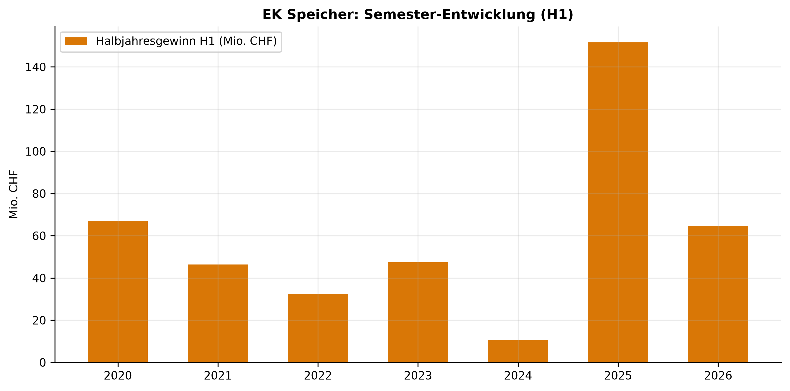

# 06 · Unterjährige Dynamik (Semesterberichte): Ersparniskasse Speicher

## 1. Management Summary
- Vorliegen von **7 Halbjahresabschlüssen**; jüngster Stichtag ist **H1-2026** mit einem Geschäftsertrag von **– Mio. CHF** und einem Halbjahresgewinn von **64,8 Mio. CHF**.

## 2. Quantitative Entwicklung
| Periode | Bilanzsumme | Zinserfolg H1 | Geschäftsertrag H1 | Geschäftserfolg H1 | Reingewinn H1 |
| --- | --- | --- | --- | --- | --- |
| H1-2020 | 77'408,2 | 331,3 | – | 79,0 | 67,0 |
| H1-2021 | 78'395,8 | 316,9 | – | 53,9 | 46,4 |
| H1-2022 | 74'271,3 | 298,9 | – | 38,9 | 32,4 |
| H1-2023 | 74'514,3 | 310,0 | – | 54,5 | 47,5 |
| H1-2024 | 77'913,1 | 295,1 | – | 12,5 | 10,5 |
| H1-2025 | 77'974,4 | 476,0 | – | 187,2 | 151,6 |
| H1-2026 | 82'415,1 | 383,3 | – | 75,1 | 64,8 |

## 3. Treiberanalyse & Wendepunkte
- Der Vergleich von H1-Werten gegen die jeweiligen Gesamtjahresergebnisse (FY) zeigt die saisonale Ertragsverteilung und Reservebildung im zweiten Halbjahr.

## 4. Fazit & Ausblick
- Die Halbjahresberichte ermöglichen ein zeitnahes Monitoring der Zinsmargen- und Kreditvolumen-Dynamik bis H1-2026.
