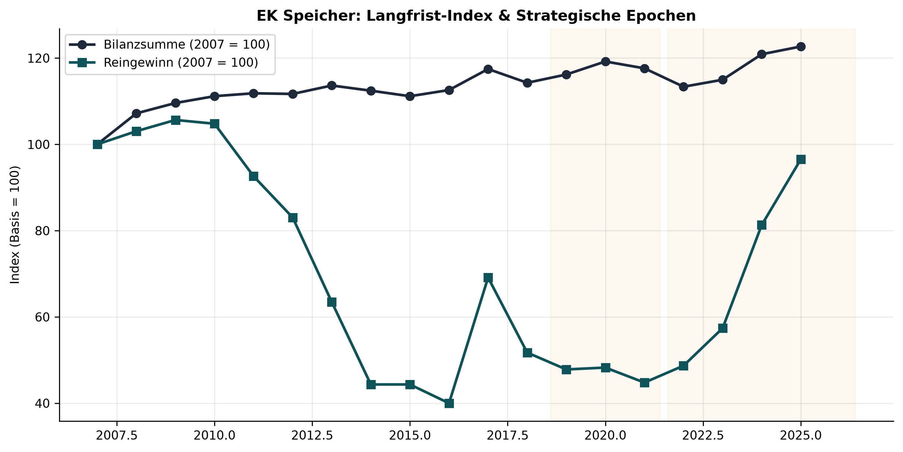
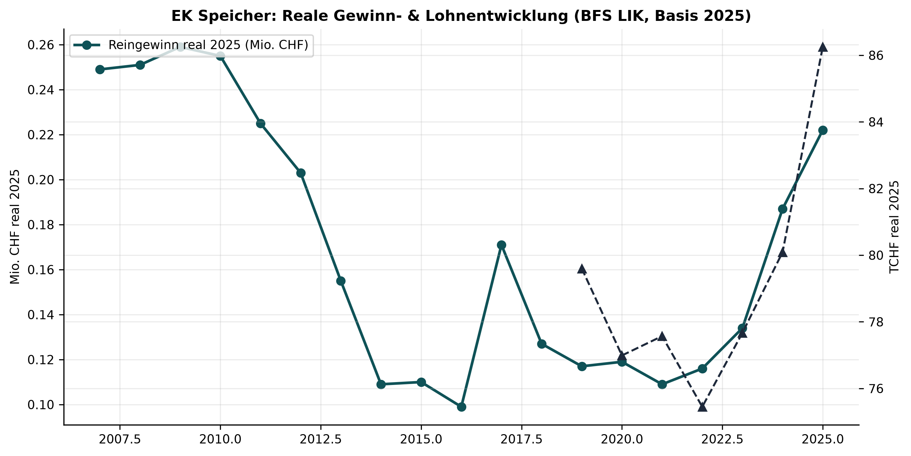

# 07 · Strategische Epochen, Governance, reale Vergütung & Vorsorge (2007–2025): Ersparniskasse Speicher

> **Preisbasis:** Sämtliche Realgrössen sind mit dem offiziellen **BFS Landesindex der Konsumentenpreise (LIK, Dez. 1982 = 100)** deterministisch auf **reale CHF 2025** deflationiert.

## 1. Management Summary & Strategische Epochen
- **Epoche 1 (2019–2021):** SNB-Negativzinsen & Regionales Spargeschäft
- **Epoche 2 (2022–2026):** Zinswende & Basel III final

## 2. Reale Gewinn-, Lohn- & Vergütungsentwicklung (real 2025 CHF)
| Jahr | Gewinn nom. | Gewinn real 2025 | Lohn/FTE real (TCHF) | VR real (TCHF) | CEO real (TCHF) | GL real (TCHF) |
| --- | --- | --- | --- | --- | --- | --- |
| 2007 | 0,2 | 0,2 | – | – | – | – |
| 2008 | 0,2 | 0,3 | – | – | – | – |
| 2009 | 0,2 | 0,3 | – | – | – | – |
| 2010 | 0,2 | 0,3 | – | – | – | – |
| 2011 | 0,2 | 0,2 | – | – | – | – |
| 2012 | 0,2 | 0,2 | – | – | – | – |
| 2013 | 0,1 | 0,2 | – | – | – | – |
| 2014 | 0,1 | 0,1 | – | – | – | – |
| 2015 | 0,1 | 0,1 | – | – | – | – |
| 2016 | 0,1 | 0,1 | – | – | – | – |
| 2017 | 0,2 | 0,2 | – | – | – | – |
| 2018 | 0,1 | 0,1 | – | – | – | – |
| 2019 | 0,1 | 0,1 | 79,6 | – | – | – |
| 2020 | 0,1 | 0,1 | 77,0 | – | – | – |
| 2021 | 0,1 | 0,1 | 77,6 | – | – | – |
| 2022 | 0,1 | 0,1 | 75,5 | – | – | – |
| 2023 | 0,1 | 0,1 | 77,7 | – | – | – |
| 2024 | 0,2 | 0,2 | 80,1 | – | – | – |
| 2025 | 0,2 | 0,2 | 86,2 | – | – | – |

## 3. Arbeitgeber-Attraktivität & Vorsorgeeinrichtung (Pensionskasse)
- **Vorsorgeeinrichtung:** ASGA Pensionskasse des Gewerbes (angeschlossen) (*Beitragsprimat (Sammelstiftung)*, Basis: `Swiss GAAP FER 16 / ARB`)
- **Versichertenstruktur:** Aktive **4**, Rentner **–** (Verhältnis Aktive/Rentner: **–**)
- **Deckungsgrad (BVG) / Reserven:** Deckungsgrad **121,7 %**, Arbeitgeberbeitragsreserve **0,0 Mio. CHF**, Sondereinlagen **0,0 Mio. CHF**
- **CEO-zu-Mitarbeitenden-Pay-Ratio (2025):** **–×** (CEO real 2025: – TCHF vs. Ø Personalaufwand/FTE: 86,2 TCHF)
- **Quelle:** `eks/.md/eks-geschaeftsbericht-2025.md (Anhang Vorsorgeverpflichtungen)` — 4 Mitarbeitende bei der ASGA Pensionskasse des Gewerbes (St. Gallen) versichert; Deckungsgrad Ende 2025: 121,68 % (2024: 120,50 %); bezahlte Beiträge 2025: CHF 20'035 (0,020 Mio. CHF).

## 4. Treiberanalyse, Strukturbrüche & Ausblick
- **2025:** Inkrafttreten Basel III final per 01.01.2025
- Die gemeinsame Inflationsbereinigung auf `real 2025 CHF` ermöglicht den unverzerrten Vergleich von Produktivität, Reallöhnen, Pay Ratio und Pensionskassen-Resilienz im Branchenvergleich (`comparison/reports/07_mitarbeiter_und_vorsorge_branchenvergleich.md`).
