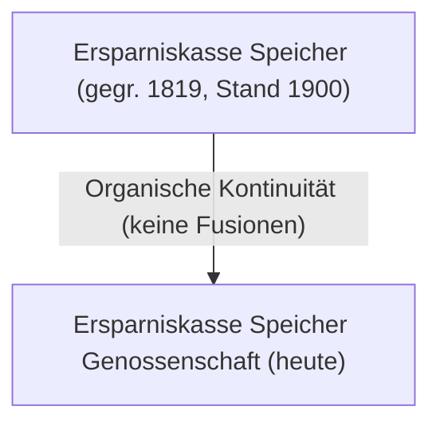

# 10 · Fusionsbaum & Institutsgeschichte seit 1900: Ersparniskasse Speicher

> **Gründung / Ursprung:** 1819 (Ersparniskasse Speicher) | **Aktuelle Rechtsform:** `cooperative` | **FINMA-Kategorie:** 5

## 1. Überblick der Institutslinie (1900–2026)
Die Ersparniskasse Speicher (EKS) wurde 1819 im Kanton Appenzell Ausserrhoden gegründet und ist seit 1900 als unabhängige Genossenschaftsbank ohne Fusionen oder Übernahmen organisch gewachsen. Sie gehört zu den ältesten und kleinsten eigenständigen Regionalbanken der Schweiz.

## 2. Fusionsbaum (Mermaid-Diagramm seit 1900)

## 3. Chronologische Meilensteine (Fusionen, Übernahmen & Rechtsformwechsel)
| Jahr / Zeitraum | Institut / Ereignis | Typ | Bedeutung & Auswirkung |
| --- | --- | --- | --- |
| 1819 / 1900 | Ersparniskasse Speicher (Genossenschaft) | Ausgangslage 1900 | Gemeinnützige Dorf- und Regionalsparkasse in Speicher (AR) |
| 1900–2026 | Eigenständiges Wachstum ohne Fusionen | Kontinuität | Bewusste Unabhängigkeit als Lokalbank mit ~4 FTE und >80 Mio. CHF Bilanzsumme |

- **Quellenbasis:** `Ersparniskasse Speicher Geschäftsberichte (2007–2025)`
