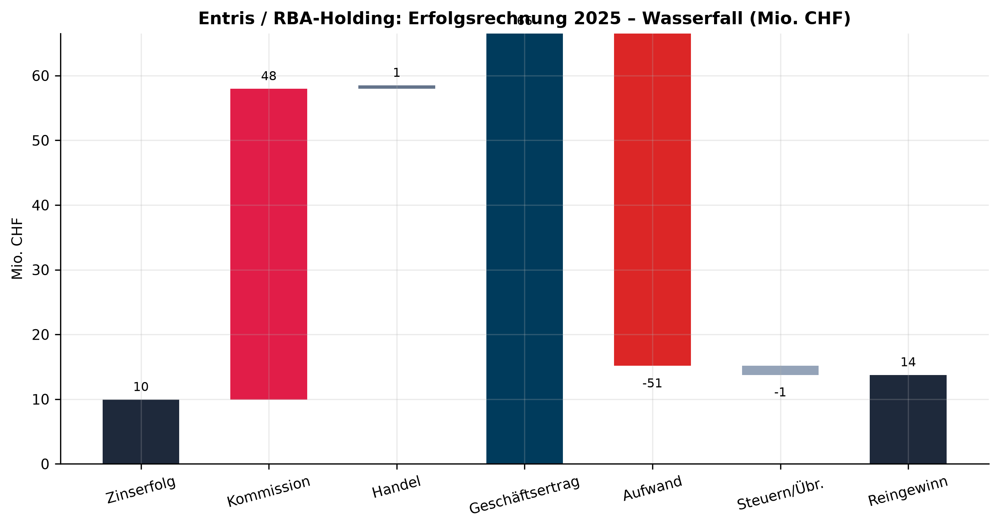
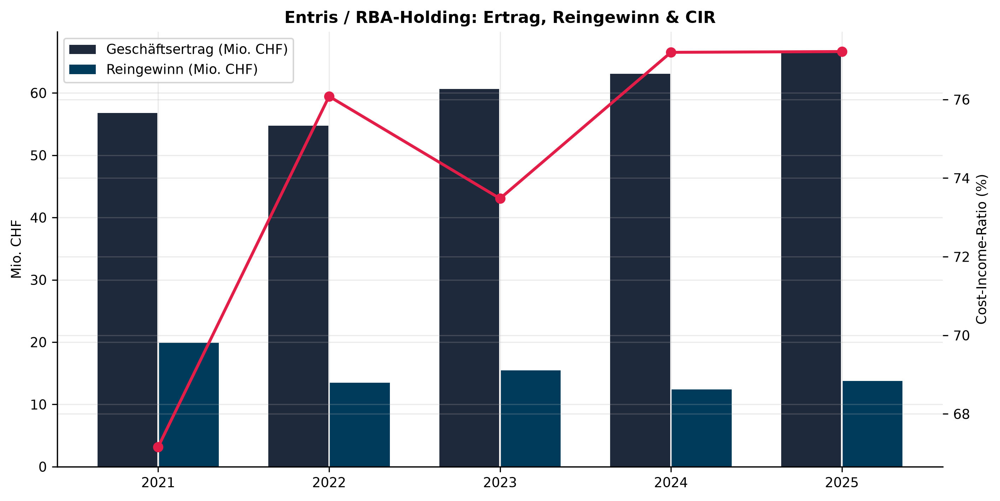

# 01 · Zinszyklen & Ertragsarchitektur (2021–2025): Entris Holding AG (ehem. RBA-Holding AG)

> **Scope:** `consolidated` | **Standard:** `ARB_RVB` | **Währung:** Mio. CHF (harmonisierte Zeitreihe)

## 1. Management Summary
- Im Zeitraum **2021–2025** entwickelte sich der Geschäftsertrag von **56,8 Mio. CHF** auf **66,5 Mio. CHF** (CAGR **4,03 % p. a.**).
- Der Reingewinn erreichte im jüngsten Geschäftsjahr 2025 **13,8 Mio. CHF** (nach 19,9 Mio. CHF im Jahr 2021).
- Der Netto-Zinserfolg trägt aktuell **14,9 %** zum Gesamtertrag bei, das Kommissionsgeschäft **72,2 %** und das Handelsgeschäft **0,8 %**.

## 2. Quantitative Entwicklung
| Jahr | Zinserfolg (Mio.) | Kommission (Mio.) | Handel (Mio.) | Geschäftsertrag | Geschäftserfolg | Reingewinn | Zinsanteil |
| --- | --- | --- | --- | --- | --- | --- | --- |
| 2021 | 11,6 | 35,1 | 0,6 | 56,8 | 17,6 | 19,9 | 20,5 % |
| 2022 | 10,1 | 36,5 | 0,5 | 54,7 | 12,6 | 13,5 | 18,4 % |
| 2023 | 13,3 | 38,7 | 0,6 | 60,7 | 15,3 | 15,5 | 22,0 % |
| 2024 | 12,9 | 41,2 | 0,8 | 63,1 | 13,4 | 12,4 | 20,5 % |
| 2025 | 9,9 | 48,0 | 0,5 | 66,5 | 15,2 | 13,8 | 14,9 % |

## 3. Treiberanalyse & Wendepunkte
- **2023:** SNB-Zinswende & starker Zuwachs bei Girogeldern / Zinserträgen
- **2025:** Inkrafttreten Basel III final per 01.01.2025

## 4. Fazit & Ausblick
- Die Ertragsarchitektur von Entris / RBA-Holding spiegelt die Zinszyklen (Negativzinsphase 2015–2022, Zinswende 2022–2024, Zinssenkungen ab 2025) unmittelbar wider.
