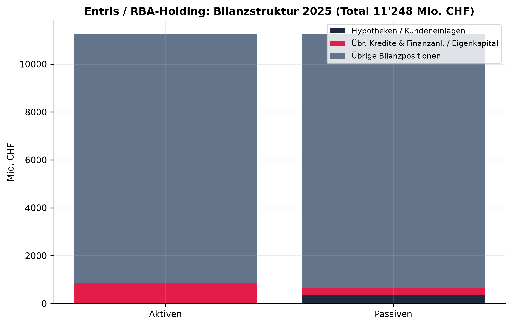
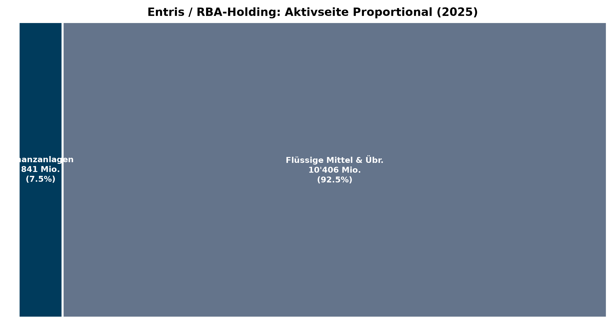
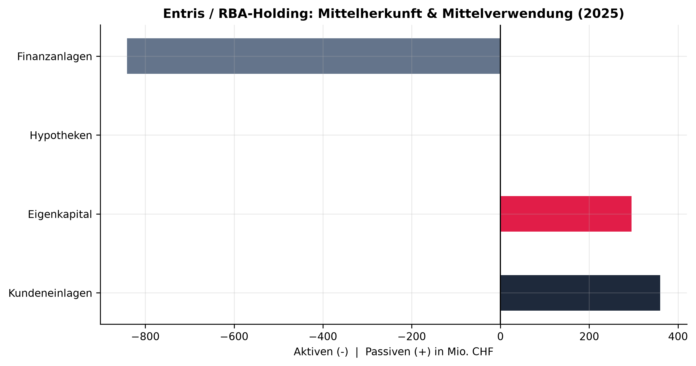
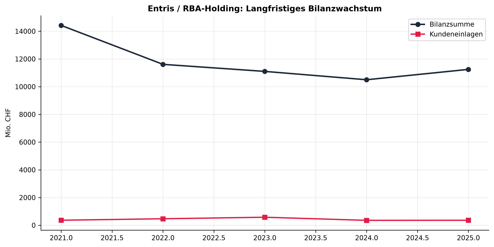

# 02 · Bilanzwachstum, Hypotheken & Refinanzierung (2021–2025): Entris Holding AG (ehem. RBA-Holding AG)

## 1. Management Summary
- Die Bilanzsumme wuchs von **14'420,4 Mio. CHF** (2021) auf **11'247,9 Mio. CHF** (2025, CAGR **-6,02 %**).
- Die Hypothekarforderungen machen im Jahr 2025 **– %** der Bilanzsumme aus.
- Die Kundeneinlagen belaufen sich 2025 auf **360,1 Mio. CHF**, das Eigenkapital auf **295,1 Mio. CHF** (Eigenkapitalquote **2,62 %**).

## 2. Quantitative Entwicklung
| Jahr | Bilanzsumme | Hypotheken | Finanzanlagen | Kundeneinlagen | Eigenkapital | Deckungsgrad |
| --- | --- | --- | --- | --- | --- | --- |
| 2021 | 14'420,4 | – | 662,1 | 363,9 | 288,0 | 23'310,8 % |
| 2022 | 11'610,4 | – | 816,2 | 469,4 | 283,5 | 278,6 % |
| 2023 | 11'102,4 | – | 811,7 | 579,5 | 289,0 | 5'009,4 % |
| 2024 | 10'499,9 | – | 731,4 | 355,4 | 291,3 | 43'983,0 % |
| 2025 | 11'247,9 | – | 841,1 | 360,1 | 295,1 | 53'033,9 % |

## 3. Treiberanalyse & Wendepunkte
- **2023:** SNB-Zinswende & starker Zuwachs bei Girogeldern / Zinserträgen
- **2025:** Inkrafttreten Basel III final per 01.01.2025

## 4. Fazit & Ausblick
- Refinanzierungsbasis und Bilanzstruktur bleiben eng an Kundeneinlagen und die jeweilige Geschäftsmodell-Spezialisierung gekoppelt.
