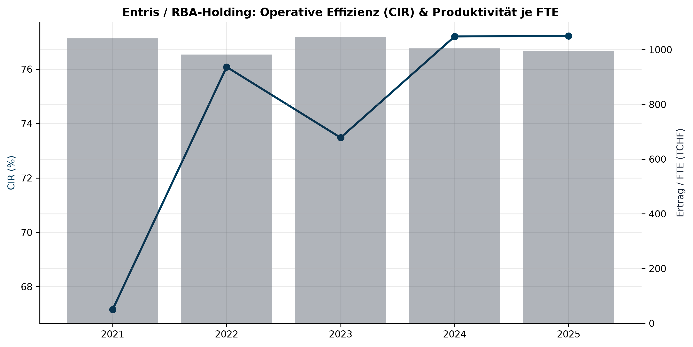

# 04 · Operative Effizienz & Transformation (2021–2025): Entris Holding AG (ehem. RBA-Holding AG)

## 1. Management Summary
- Die Cost-Income-Ratio (CIR) liegt im Jahr 2025 bei **77,22 %** (vs. 67,16 % im Jahr 2021), die Eigenkapitalrendite (ROE) bei **4,66 %**.
- Der Personalbestand umfasst 2025 **66,7 FTE** bei einem Ertrag pro Vollzeitstelle von **996,9 TCHF** und einem **Lohnkosten-/Produktivitätsverhältnis von 18,8 %** (bzw. **5,31×** Ertrag je CHF Personalaufwand).

## 2. Quantitative Entwicklung
| Jahr | CIR % | ROE % | FTE | Ertrag/FTE (TCHF) | Lohn/FTE (TCHF) | Lohn/Ertrag % | Ertrag/Lohn | Bilanz/FTE (Mio.) |
| --- | --- | --- | --- | --- | --- | --- | --- | --- |
| 2021 | 67,16 % | 6,91 % | 54,5 | 1'041,6 | 180,0 | 17,3 % | 5,79× | 264,59 |
| 2022 | 76,08 % | 4,76 % | 55,7 | 982,4 | 186,7 | 19,0 % | 5,26× | 208,45 |
| 2023 | 73,48 % | 5,36 % | 57,9 | 1'047,8 | 185,6 | 17,7 % | 5,64× | 191,75 |
| 2024 | 77,20 % | 4,25 % | 62,8 | 1'004,8 | 187,2 | 18,6 % | 5,37× | 167,20 |
| 2025 | 77,22 % | 4,66 % | 66,7 | 996,9 | 187,6 | 18,8 % | 5,31× | 168,63 |

## 3. Treiberanalyse & Wendepunkte
- **2023:** SNB-Zinswende & starker Zuwachs bei Girogeldern / Zinserträgen
- **2025:** Inkrafttreten Basel III final per 01.01.2025

## 4. Fazit & Ausblick
- Digitalisierung und Skalierung steigern Bilanzsumme und Geschäftsvolumen pro Vollzeitstelle langfristig.
