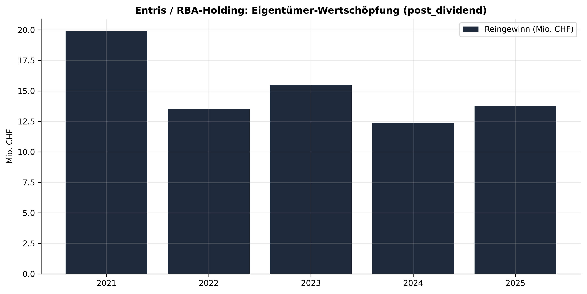

# 05 · Dividendenablieferung an Post AG & Eigentümerwert (2021–2025): Entris Holding AG (ehem. RBA-Holding AG)

> **Eigentümer-Modus:** `post_dividend` | **Staatsgarantie:** Keine | **Ticker:** `nicht kotiert`

## 1. Management Summary
- Im Geschäftsjahr 2025 erwirtschaftete Entris / RBA-Holding einen Gewinn von **13,8 Mio. CHF** bei einem Eigenkapital von **295,1 Mio. CHF**.
- **Eigenkapitalrendite (2025):** ROE **4,66 %** bei einem Eigenkapital von **295,1 Mio. CHF**.

## 2. Quantitative Entwicklung
| Jahr | Reingewinn (Mio.) | Eigenkapital (Mio.) | Aktienkurs (split-ber.) | Dividende/Aktie | Div.-Rendite | Öff. Ablieferung (Mio.) |
| --- | --- | --- | --- | --- | --- | --- |
| 2021 | 19,9 | 288,0 | – | – | – % | – |
| 2022 | 13,5 | 283,5 | – | – | – % | – |
| 2023 | 15,5 | 289,0 | – | – | – % | – |
| 2024 | 12,4 | 291,3 | – | – | – % | – |
| 2025 | 13,8 | 295,1 | – | – | – % | – |

## 3. Treiberanalyse & Wendepunkte (Investoren-Perspektive)
- Bei kotierten Instituten mit Aktiensplits (z. B. BCV 1:10 im Jahr 2020) sind sämtliche historischen Kurs- und Dividendenreihen deterministisch split-bereinigt.
- Im Branchenvergleich (siehe `comparison/reports/06_investoren_branchenvergleich.md`) werden P/B, P/E, Dividendenrendite und Eigentümer-Ablieferungen über alle 8 Institute eingeordnet.

## 4. Fazit, Führungsleistung & Ausblick
- Stabile Ertragskraft sichert langfristig Dividendenkontinuität bzw. verlässliche Ablieferungen an Kanton, Post oder Genossenschafter.
- Die detaillierte Leistungsbilanz von CEO und Verwaltungsratspräsidium aus Investoren- und Eigentümersicht findet sich im [CEO & Chairman of the Board Achievement Report](./08_ceo_und_vrp_leistungsbericht.md).
