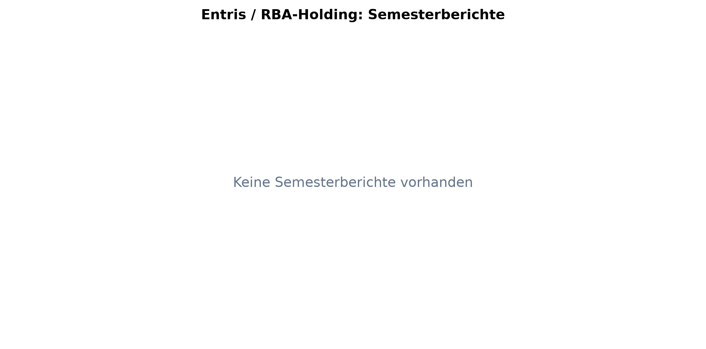

# 06 · Unterjährige Dynamik (Semesterberichte): Entris Holding AG (ehem. RBA-Holding AG)

## 1. Management Summary
- Vorliegen von **0 Halbjahresabschlüssen**; jüngster Stichtag ist **–** mit einem Geschäftsertrag von **– Mio. CHF** und einem Halbjahresgewinn von **– Mio. CHF**.

## 2. Quantitative Entwicklung
| Periode | Bilanzsumme | Zinserfolg H1 | Geschäftsertrag H1 | Geschäftserfolg H1 | Reingewinn H1 |
| --- | --- | --- | --- | --- | --- |

## 3. Treiberanalyse & Wendepunkte
- Der Vergleich von H1-Werten gegen die jeweiligen Gesamtjahresergebnisse (FY) zeigt die saisonale Ertragsverteilung und Reservebildung im zweiten Halbjahr.

## 4. Fazit & Ausblick
- Die Halbjahresberichte ermöglichen ein zeitnahes Monitoring der Zinsmargen- und Kreditvolumen-Dynamik bis H1-2026.
