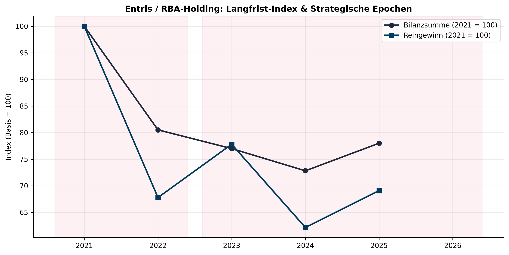
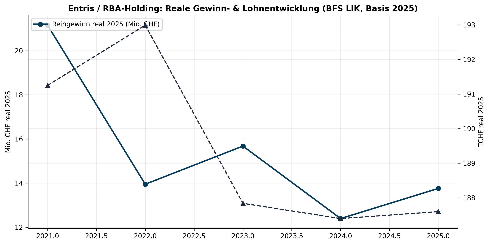

# 07 · Strategische Epochen, Governance, reale Vergütung & Vorsorge (2021–2025): Entris Holding AG (ehem. RBA-Holding AG)

> **Preisbasis:** Sämtliche Realgrössen sind mit dem offiziellen **BFS Landesindex der Konsumentenpreise (LIK, Dez. 1982 = 100)** deterministisch auf **reale CHF 2025** deflationiert.

## 1. Management Summary & Strategische Epochen
- **Epoche 1 (2021–2022):** SNB-Negativzinsen & Girozentralbank-Infrastruktur
- **Epoche 2 (2023–2026):** Zinswende, EntriX Payment & B2B-Plattformausbau

## 2. Reale Gewinn-, Lohn- & Vergütungsentwicklung (real 2025 CHF)
| Jahr | Gewinn nom. | Gewinn real 2025 | Lohn/FTE real (TCHF) | VR real (TCHF) | CEO real (TCHF) | GL real (TCHF) |
| --- | --- | --- | --- | --- | --- | --- |
| 2021 | 19,9 | 21,2 | 191,2 | – | – | – |
| 2022 | 13,5 | 13,9 | 193,0 | – | – | – |
| 2023 | 15,5 | 15,7 | 187,8 | – | – | – |
| 2024 | 12,4 | 12,4 | 187,4 | – | – | – |
| 2025 | 13,8 | 13,8 | 187,6 | – | – | – |

## 3. Arbeitgeber-Attraktivität & Vorsorgeeinrichtung (Pensionskasse)
- Keine Vorsorgedaten hinterlegt.

## 4. Treiberanalyse, Strukturbrüche & Ausblick
- **2023:** SNB-Zinswende & starker Zuwachs bei Girogeldern / Zinserträgen
- **2025:** Inkrafttreten Basel III final per 01.01.2025
- Die gemeinsame Inflationsbereinigung auf `real 2025 CHF` ermöglicht den unverzerrten Vergleich von Produktivität, Reallöhnen, Pay Ratio und Pensionskassen-Resilienz im Branchenvergleich (`comparison/reports/07_mitarbeiter_und_vorsorge_branchenvergleich.md`).
