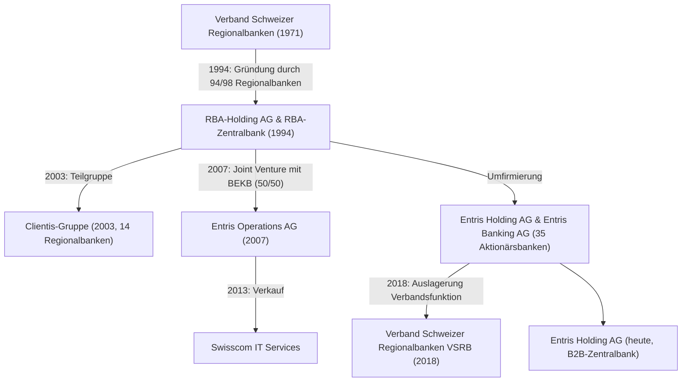

# 10 · Fusionsbaum & Institutsgeschichte seit 1900: Entris Holding AG (ehem. RBA-Holding AG)

> **Gründung / Ursprung:** 1971 (Verband) → 1994 (RBA-Holding AG) → Entris Holding AG / Entris Banking AG | **Aktuelle Rechtsform:** `unlisted_ag` | **FINMA-Kategorie:** 4

## 1. Überblick der Institutslinie (1900–2026)
Die Entris Holding AG entstand am 1. September 1994 als RBA-Holding AG durch den Zusammenschluss von 94/98 unabhängigen Schweizer Regionalbanken und Sparkassen (infolge der Immobilienkrise der 1990er-Jahre, auf Basis des 1971 gegründeten Verbandes Schweizer Regionalbanken). 2003 bildete sich innerhalb der Gruppe die Clientis-Gruppe, 2007 folgte Entris Operations (2013 an Swisscom verkauft), und 2018 wurde die Interessenvertretung an den neu gegründeten Verband Schweizer Regionalbanken (VSRB) ausgelagert.

## 2. Fusionsbaum (Mermaid-Diagramm seit 1900)

## 3. Chronologische Meilensteine (Fusionen, Übernahmen & Rechtsformwechsel)
| Jahr / Zeitraum | Institut / Ereignis | Typ | Bedeutung & Auswirkung |
| --- | --- | --- | --- |
| 1971 | Gründung Verband Schweizer Regionalbanken | Dachverband | Gesamtschweizerische Organisation der regionalen Verbände |
| 1994 / 1996 | Gründung RBA-Holding AG durch 94/98 Regionalbanken | Gründung & Übertragung | Schaffung eines Sicherheits-, Liquiditäts- und Dienstleistungsnetzes; 1996 Übertragung Verbandsfunktion |
| 2003 | Gründung Clientis-Gruppe innerhalb der RBA-Gruppe | Allianz | 14 selbstständige Regionalbanken bündeln Refinanzierung & Markenauftritt |
| 2007 / 2013 | Entris Operations AG (50 % BEKB) → Verkauf an Swisscom | Joint Venture & Verkauf | Bündelung und spätere Auslagerung des Kernbanken-IT-Betriebs an Swisscom |
| 2015–2018 | Entris Holding AG / Entris Banking AG & Gründung VSRB (2018) | Reorganisation | Öffnung für Drittbanken (2017) & Auslagerung Lobbying an VSRB (2018) |

- **Quellenbasis:** `Entris Holding Geschäftsberichte (2021–2025); VSRB Chronik`
