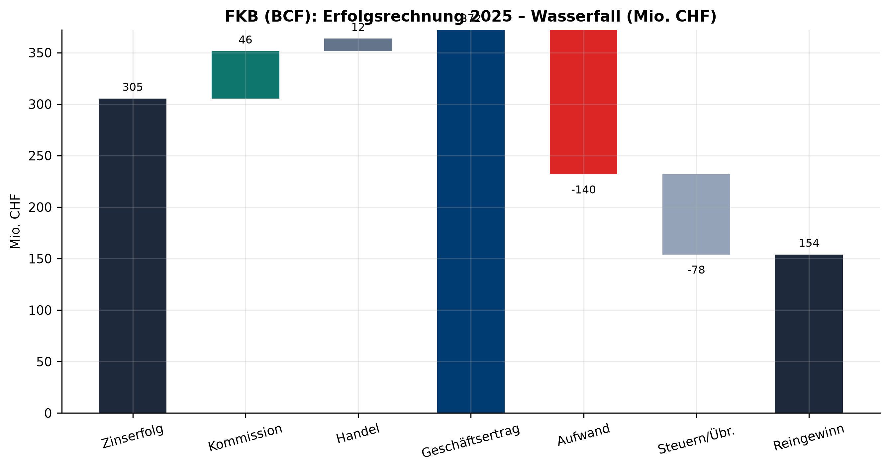
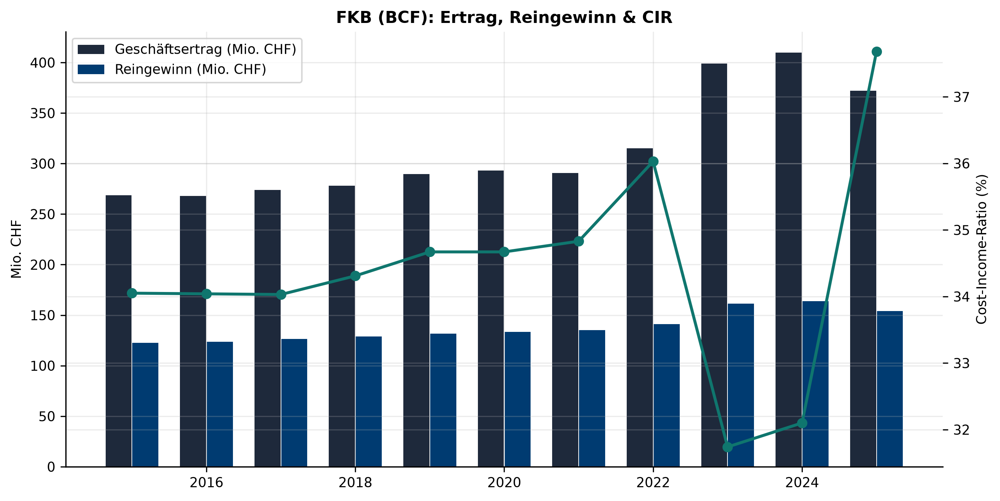

# 01 · Zinszyklen & Ertragsarchitektur (2015–2025): Freiburger Kantonalbank

> **Scope:** `standalone` | **Standard:** `ARB_RVB` | **Währung:** Mio. CHF (harmonisierte Zeitreihe)

## 1. Management Summary
- Im Zeitraum **2015–2025** entwickelte sich der Geschäftsertrag von **268,7 Mio. CHF** auf **372,1 Mio. CHF** (CAGR **3,31 % p. a.**).
- Der Reingewinn erreichte im jüngsten Geschäftsjahr 2025 **154,0 Mio. CHF** (nach 122,7 Mio. CHF im Jahr 2015).
- Der Netto-Zinserfolg trägt aktuell **82,1 %** zum Gesamtertrag bei, das Kommissionsgeschäft **12,3 %** und das Handelsgeschäft **3,3 %**.

## 2. Quantitative Entwicklung
| Jahr | Zinserfolg (Mio.) | Kommission (Mio.) | Handel (Mio.) | Geschäftsertrag | Geschäftserfolg | Reingewinn | Zinsanteil |
| --- | --- | --- | --- | --- | --- | --- | --- |
| 2015 | 221,1 | 31,8 | 11,0 | 268,7 | 152,6 | 122,7 | 82,3 % |
| 2016 | 222,8 | 30,0 | 11,1 | 268,0 | 158,5 | 123,7 | 83,1 % |
| 2017 | 229,0 | 30,7 | 10,8 | 273,9 | 164,6 | 126,4 | 83,6 % |
| 2018 | 234,6 | 29,7 | 9,6 | 278,1 | 152,6 | 128,8 | 84,4 % |
| 2019 | 244,0 | 31,2 | 10,0 | 289,5 | 165,6 | 131,6 | 84,3 % |
| 2020 | 247,8 | 31,6 | 8,4 | 293,2 | 162,0 | 133,3 | 84,5 % |
| 2021 | 242,7 | 34,9 | 9,7 | 290,8 | 163,4 | 135,1 | 83,4 % |
| 2022 | 259,2 | 40,1 | 10,9 | 315,0 | 173,8 | 141,1 | 82,3 % |
| 2023 | 350,9 | 39,3 | 10,9 | 399,1 | 224,3 | 161,5 | 87,9 % |
| 2024 | 351,7 | 42,4 | 11,7 | 410,0 | 236,5 | 163,7 | 85,8 % |
| 2025 | 305,5 | 45,9 | 12,2 | 372,1 | 187,8 | 154,0 | 82,1 % |

## 3. Treiberanalyse & Wendepunkte
- **2015:** Umstellung auf FINMA-RVB
- **2025:** Inkrafttreten Basel III final per 01.01.2025

## 4. Fazit & Ausblick
- Die Ertragsarchitektur von FKB (BCF) spiegelt die Zinszyklen (Negativzinsphase 2015–2022, Zinswende 2022–2024, Zinssenkungen ab 2025) unmittelbar wider.
