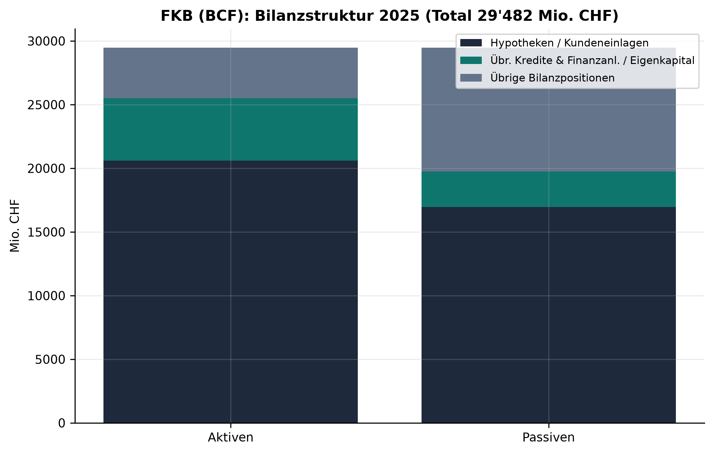
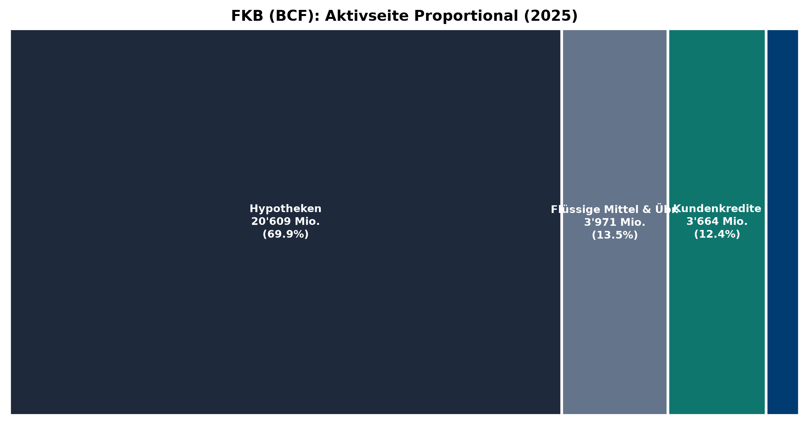
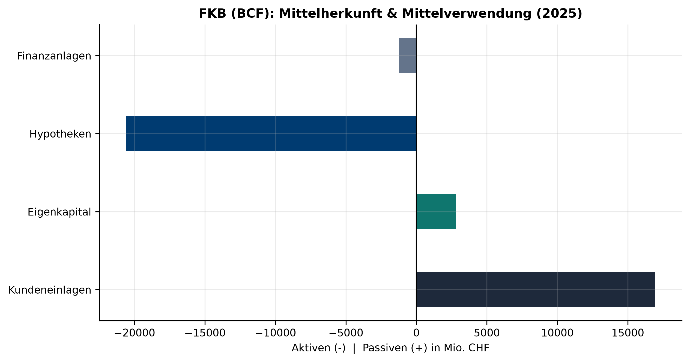
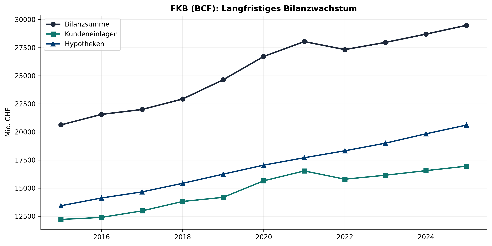

# 02 · Bilanzwachstum, Hypotheken & Refinanzierung (2015–2025): Freiburger Kantonalbank

## 1. Management Summary
- Die Bilanzsumme wuchs von **20'623,2 Mio. CHF** (2015) auf **29'482,3 Mio. CHF** (2025, CAGR **3,64 %**).
- Die Hypothekarforderungen machen im Jahr 2025 **69,9 %** der Bilanzsumme aus.
- Die Kundeneinlagen belaufen sich 2025 auf **16'953,3 Mio. CHF**, das Eigenkapital auf **2'806,8 Mio. CHF** (Eigenkapitalquote **9,52 %**).

## 2. Quantitative Entwicklung
| Jahr | Bilanzsumme | Hypotheken | Finanzanlagen | Kundeneinlagen | Eigenkapital | Deckungsgrad |
| --- | --- | --- | --- | --- | --- | --- |
| 2015 | 20'623,2 | 13'433,9 | 893,5 | 12'214,0 | 1'725,4 | 74,0 % |
| 2016 | 21'560,8 | 14'123,7 | 954,1 | 12'396,7 | 1'822,1 | 72,4 % |
| 2017 | 21'996,5 | 14'666,4 | 1'054,9 | 12'976,8 | 1'922,9 | 73,8 % |
| 2018 | 22'926,7 | 15'427,9 | 1'111,2 | 13'813,3 | 2'010,5 | 74,6 % |
| 2019 | 24'639,4 | 16'242,3 | 1'164,9 | 14'180,5 | 2'107,1 | 73,2 % |
| 2020 | 26'714,3 | 17'045,5 | 1'322,3 | 15'651,2 | 2'212,4 | 77,3 % |
| 2021 | 28'034,8 | 17'704,4 | 1'370,1 | 16'529,5 | 2'306,5 | 79,7 % |
| 2022 | 27'324,7 | 18'321,2 | 1'474,5 | 15'793,4 | 2'417,7 | 73,2 % |
| 2023 | 27'960,4 | 18'999,0 | 1'461,6 | 16'148,8 | 2'574,1 | 71,2 % |
| 2024 | 28'700,2 | 19'832,2 | 1'425,6 | 16'554,8 | 2'725,8 | 70,4 % |
| 2025 | 29'482,3 | 20'608,6 | 1'238,6 | 16'953,3 | 2'806,8 | 69,8 % |

## 3. Treiberanalyse & Wendepunkte
- **2015:** Umstellung auf FINMA-RVB
- **2025:** Inkrafttreten Basel III final per 01.01.2025

## 4. Fazit & Ausblick
- Refinanzierungsbasis und Bilanzstruktur bleiben eng an Kundeneinlagen und die jeweilige Geschäftsmodell-Spezialisierung gekoppelt.
