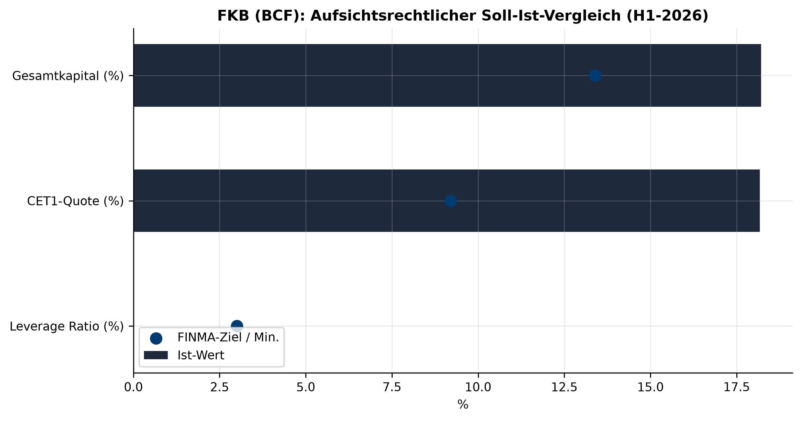
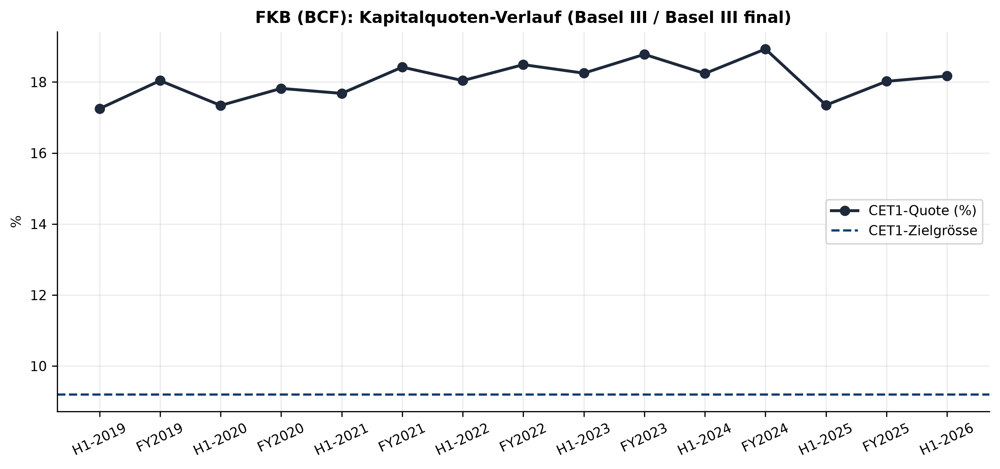

# 03 · Aufsichtsrechtliche Resilienz & Basel III: Freiburger Kantonalbank

> **FINMA-Kategorie:** Kategorie 3 | **CET1-Zielgrösse:** 9,20 % | **Gesamtkapital-Ziel:** 13,40 %

## 1. Management Summary
- Am jüngsten Offenlegungsstichtag (**H1-2026**, Regime: *Basel III final*) beträgt die **CET1-Quote 18,17 %** (Puffer über Ziel: **8,97 Prozentpunkte**).
- Die Gesamtkapitalquote liegt bei **18,21 %**, die Leverage Ratio bei **– %**.
- Liquiditätsquoten: LCR **164,0 %**, NSFR **126,0 %** (Mindestanforderung je 100 %).

## 2. Quantitative Entwicklung (15 Stichtage)
| Periode | Regime | RWA (Mio.) | CET1 (Mio.) | CET1 % | Gesamtkap. % | Leverage % | LCR % | NSFR % |
| --- | --- | --- | --- | --- | --- | --- | --- | --- |
| H1-2019 | Basel III | 11'407,4 | 1'967,5 | 17,25 % | 18,05 % | – % | 138,0 % | – % |
| FY2019 | Basel III | 11'406,7 | 2'058,1 | 18,04 % | 18,04 % | – % | – % | – % |
| H1-2020 | Basel III | 11'867,9 | 2'058,1 | 17,34 % | 17,34 % | – % | 154,0 % | – % |
| FY2020 | Basel III | 12'065,8 | 2'150,4 | 17,82 % | 17,82 % | – % | – % | – % |
| H1-2021 | Basel III | 12'165,0 | 2'150,4 | 17,68 % | 17,70 % | – % | 186,0 % | – % |
| FY2021 | Basel III | 12'225,4 | 2'251,5 | 18,42 % | 18,44 % | – % | – % | 137,0 % |
| H1-2022 | Basel III | 12'483,0 | 2'251,5 | 18,04 % | 18,06 % | – % | 204,0 % | 145,0 % |
| FY2022 | Basel III | 12'765,9 | 2'360,7 | 18,49 % | 18,51 % | – % | – % | 139,0 % |
| H1-2023 | Basel III | 12'932,9 | 2'360,7 | 18,25 % | 18,27 % | – % | 182,0 % | 135,0 % |
| FY2023 | Basel III | 13'310,0 | 2'499,1 | 18,78 % | 18,85 % | – % | – % | 132,0 % |
| H1-2024 | Basel III | 13'700,4 | 2'499,1 | 18,24 % | 18,32 % | – % | 224,0 % | 132,0 % |
| FY2024 | Basel III | 13'879,0 | 2'627,8 | 18,93 % | 18,97 % | – % | – % | 131,0 % |
| H1-2025 | Basel III final | 15'149,8 | 2'627,8 | 17,35 % | 17,38 % | – % | 188,0 % | 127,0 % |
| FY2025 | Basel III final | 15'160,2 | 2'731,3 | 18,02 % | 18,04 % | – % | – % | 125,0 % |
| H1-2026 | Basel III final | 15'032,6 | 2'731,3 | 18,17 % | 18,21 % | – % | 164,0 % | 126,0 % |

## 3. Treiberanalyse & Wendepunkte
- Mit Inkrafttreten von **Basel III final** ab 01.01.2025 verändern sich risikogewichtete Aktiven (RWA) und RWA-Dichte durch angepasste Standard- bzw. Output-Floor-Vorgaben.

## 4. Fazit & Ausblick
- Die Eigenmittel- und Liquiditätspuffer übertreffen die regulatorischen Mindestanforderungen für FINMA-Kategorie 3 deutlich.
