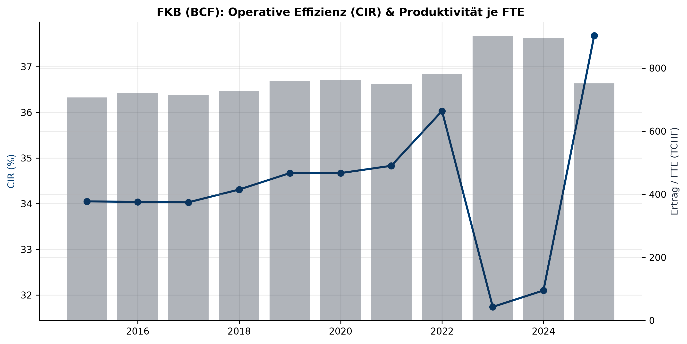

# 04 · Operative Effizienz & Transformation (2015–2025): Freiburger Kantonalbank

## 1. Management Summary
- Die Cost-Income-Ratio (CIR) liegt im Jahr 2025 bei **37,68 %** (vs. 34,05 % im Jahr 2015), die Eigenkapitalrendite (ROE) bei **5,49 %**.
- Der Personalbestand umfasst 2025 **495,0 FTE** bei einem Ertrag pro Vollzeitstelle von **751,7 TCHF** und einem **Lohnkosten-/Produktivitätsverhältnis von 23,2 %** (bzw. **4,31×** Ertrag je CHF Personalaufwand).

## 2. Quantitative Entwicklung
| Jahr | CIR % | ROE % | FTE | Ertrag/FTE (TCHF) | Lohn/FTE (TCHF) | Lohn/Ertrag % | Ertrag/Lohn | Bilanz/FTE (Mio.) |
| --- | --- | --- | --- | --- | --- | --- | --- | --- |
| 2015 | 34,05 % | 7,11 % | 380,0 | 707,0 | 145,0 | 20,5 % | 4,88× | 54,27 |
| 2016 | 34,04 % | 6,79 % | 372,0 | 720,5 | 148,7 | 20,6 % | 4,84× | 57,96 |
| 2017 | 34,03 % | 6,57 % | 383,0 | 715,2 | 148,5 | 20,8 % | 4,82× | 57,43 |
| 2018 | 34,31 % | 6,40 % | 382,0 | 728,0 | 151,5 | 20,8 % | 4,81× | 60,02 |
| 2019 | 34,67 % | 6,25 % | 381,0 | 759,9 | 157,5 | 20,7 % | 4,83× | 64,67 |
| 2020 | 34,67 % | 6,03 % | 385,0 | 761,6 | 158,7 | 20,8 % | 4,80× | 69,39 |
| 2021 | 34,83 % | 5,86 % | 388,0 | 749,6 | 160,9 | 21,5 % | 4,66× | 72,25 |
| 2022 | 36,03 % | 5,84 % | 403,0 | 781,6 | 175,0 | 22,4 % | 4,47× | 67,80 |
| 2023 | 31,74 % | 6,27 % | 443,0 | 900,9 | 183,7 | 20,4 % | 4,90× | 63,12 |
| 2024 | 32,10 % | 6,00 % | 458,0 | 895,1 | 180,9 | 20,2 % | 4,95× | 62,66 |
| 2025 | 37,68 % | 5,49 % | 495,0 | 751,7 | 174,3 | 23,2 % | 4,31× | 59,56 |

## 3. Treiberanalyse & Wendepunkte
- **2015:** Umstellung auf FINMA-RVB
- **2025:** Inkrafttreten Basel III final per 01.01.2025

## 4. Fazit & Ausblick
- Digitalisierung und Skalierung steigern Bilanzsumme und Geschäftsvolumen pro Vollzeitstelle langfristig.
