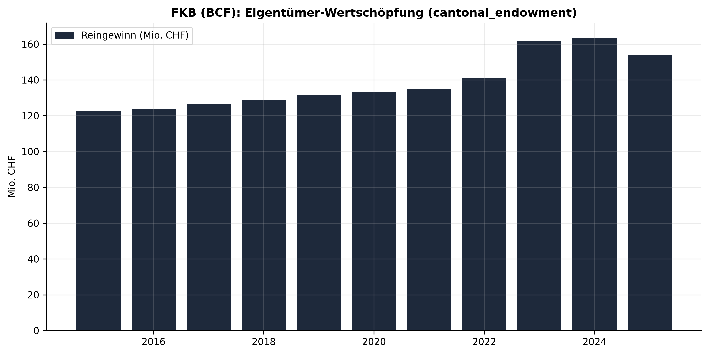

# 05 · Dotationskapital, Ausschüttung & Kanton (2015–2025): Freiburger Kantonalbank

> **Eigentümer-Modus:** `cantonal_endowment` | **Staatsgarantie:** Ja | **Ticker:** `nicht kotiert`

## 1. Management Summary
- Im Geschäftsjahr 2025 erwirtschaftete FKB (BCF) einen Gewinn von **154,0 Mio. CHF** bei einem Eigenkapital von **2'806,8 Mio. CHF**.
- **Eigenkapitalrendite (2025):** ROE **5,49 %** bei einem Eigenkapital von **2'806,8 Mio. CHF**.

## 2. Quantitative Entwicklung
| Jahr | Reingewinn (Mio.) | Eigenkapital (Mio.) | Aktienkurs (split-ber.) | Dividende/Aktie | Div.-Rendite | Öff. Ablieferung (Mio.) |
| --- | --- | --- | --- | --- | --- | --- |
| 2015 | 122,7 | 1'725,4 | – | – | – % | 64,0 |
| 2016 | 123,7 | 1'822,1 | – | – | – % | 65,0 |
| 2017 | 126,4 | 1'922,9 | – | – | – % | 66,8 |
| 2018 | 128,8 | 2'010,5 | – | – | – % | 69,0 |
| 2019 | 131,6 | 2'107,1 | – | – | – % | 70,1 |
| 2020 | 133,3 | 2'212,4 | – | – | – % | 69,9 |
| 2021 | 135,1 | 2'306,5 | – | – | – % | 62,3 |
| 2022 | 141,1 | 2'417,7 | – | – | – % | 64,6 |
| 2023 | 161,5 | 2'574,1 | – | – | – % | 85,8 |
| 2024 | 163,7 | 2'725,8 | – | – | – % | 107,9 |
| 2025 | 154,0 | 2'806,8 | – | – | – % | 84,2 |

## 3. Treiberanalyse & Wendepunkte (Investoren-Perspektive)
- Bei kotierten Instituten mit Aktiensplits (z. B. BCV 1:10 im Jahr 2020) sind sämtliche historischen Kurs- und Dividendenreihen deterministisch split-bereinigt.
- Im Branchenvergleich (siehe `comparison/reports/06_investoren_branchenvergleich.md`) werden P/B, P/E, Dividendenrendite und Eigentümer-Ablieferungen über alle 19 Institute eingeordnet.

## 4. Fazit, Führungsleistung & Ausblick
- Stabile Ertragskraft sichert langfristig Dividendenkontinuität bzw. verlässliche Ablieferungen an Kanton, Post oder Genossenschafter.
- Die detaillierte Leistungsbilanz von CEO und Verwaltungsratspräsidium aus Investoren- und Eigentümersicht findet sich im [CEO & Chairman of the Board Achievement Report](./08_ceo_und_vrp_leistungsbericht.md).
